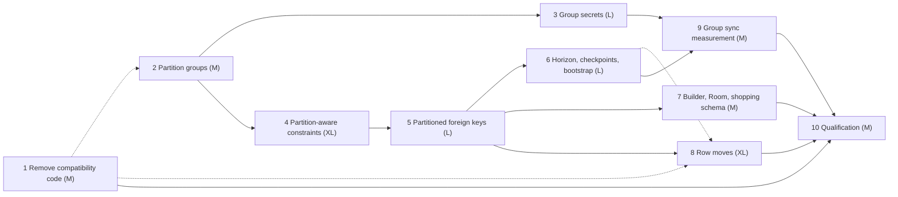

# features_06: constraints, groups and moves on partitioned tables

Status: sequenced on 2026-10-08. No phase has started; each brief records its
own status. This is the next-work authority. It completes the shopping
qualification, whose evidence is in [the audit](../runtime/shopping-qualification.md).

Read the two scopes first; every brief links their sections instead of
repeating them:

- [Constraints on partitioned tables](scope-partitioned-constraints.md):
  partition groups, the group secret, unique indexes and foreign keys.
- [Moving rows between partitions](scope-moving-rows.md).

Deferred: [partitioned existence logs](../ideas/partitioned_existence_logs.md)
and [partitioned command tables](../ideas/partitioned_command_tables.md).

## Destination

The shopping schema of the scope installs natively and from Room. A list, its
items and categories form one group: one envelope shares a list, one rotation
revokes it, and constraints converge per list after offline merges. A row
moves between lists without losing a concurrent edit. The same foundations
carry an ERP with several tables below each customer.

## No backward compatibility

Decided 2026-10-08. Rocky keeps one current version of every persisted and
wire format. A change replaces the format; nothing migrates, and no reader for
an earlier version stays. Any other version is refused, never interpreted.
Existing installations reinstall. [Phase 1](01-remove-compatibility-code.md)
removes what earlier phases added for compatibility. Decision records in this
roadmap therefore state the format and its refusal of other versions, not an
upgrade path.

Application schema generations are a product feature and stay.

## Phases

Each wave runs in parallel; a phase starts when every phase it depends on has
passed its completion gate. Size is a relative budget, not a schedule.

| Phase | Agent brief | Depends on | Size | Required result |
| --- | --- | --- | --- | --- |
| 1 | [Remove compatibility code](01-remove-compatibility-code.md) | none | M | One current version per format; no migrations, legacy readers or legacy tests |
| 2 | [Partition groups in the schema](02-partition-groups.md) | none; lands after 1 on the descriptor | M | Decision 0037; explicit groups in the descriptor, the Kotlin builder and the Room overlay |
| 3 | [Group secrets](03-group-secrets.md) | 2 | L | One secret and one envelope per group partition; derived table keys; group share, revoke, subscribe and evict |
| 4 | [Partition-aware constraint identities](04-partition-aware-constraints.md) | 2 | XL | Resolution keyed by partition; unique indexes with a policy on partitioned tables |
| 5 | [Foreign keys on partitioned tables](05-partitioned-foreign-keys.md) | 4 | L | In-group references and references to an unpartitioned logged parent, with `CASCADE` and `SET NULL` per partition |
| 6 | [Horizon, checkpoints and bootstrap](06-horizon-checkpoints-bootstrap.md) | 4, 5 | L | Hidden rows and orphans finalized, checkpointed and rebuilt per partition |
| 7 | [Builder, Room import and the shopping schema](07-builder-room-and-shopping-schema.md) | 4, 5 | M | The scope's schema, with categories, installs by hand and from Room |
| 8 | [Row moves](08-row-moves.md) | 4, 5; lands after 1 on the frame and after 6 on the checkpoint | XL | Decision 0038; an atomic move whose late updates follow the row |
| 9 | [Group sync measurement](09-group-sync-measurement.md) | 3, 5, 6 | M | ERP fixture with a four-table group over 200 partitions; a budget, and batching if it is exceeded |
| 10 | [Qualification](10-qualification.md) | all | M | Phase 16's scenarios and the move scenarios, on devices, with evidence |

## Dependency graph

Solid arrows are prerequisites. Dashed arrows fix a landing order on a shared
format. Sizes weigh S=1, M=2, L=3, XL=5.

### Critical path

2 → 4 → 5 → 8 → 10 and 2 → 4 → 5 → 6 → 9 → 10 both weigh 17 of 29. Phase 4
is on both and is the largest single risk. Decision 0038 for moves may be
drafted while phases 4 and 5 implement; its code waits for their gates.

### Waves

| Wave | Phases that can run in parallel |
| --- | --- |
| 0 | 1, 2 (2 lands after 1) |
| 1 | 3, 4 |
| 2 | 5 |
| 3 | 6, 7, 8 (8 lands after 6) |
| 4 | 9 |
| 5 | 10 |

## Shared-format hazards

| Format | Phases | Order |
| --- | --- | --- |
| Schema descriptor and definition | 1 (single format), 2 (groups), 7 (lifted refusals) | 1, then 2, then 7 |
| Key envelope and SDK key store | 1, 3 | 1, then 3 |
| Frame envelope | 1 (single row format), 8 (move) | 1, then 8 |
| Checkpoint | 1, 6 (per-partition state), 8 (unfinalized move links) | 1, then 6, then 8 |

Each format change needs a [decision record](../decisions/README.md).

## Agent execution contract

Give an agent this README, both scopes and one phase brief. Read root
`AGENTS.md`, [development](../development.md), the [module map](../modules.md)
and the brief's source and guide inputs. Verify prerequisites against code and
evidence before editing. If a prerequisite fails, repair it within scope or
report the exact blocking contract; never invent successful behavior or
silently weaken admission, durability or atomicity.

The product choices in the scopes are settled; do not reopen them. Internal
mechanisms are the agent's call inside the accepted boundary. Update owning
guides, the brief's status line and measured evidence with each completed
slice. Use `jj`, run `./scripts/check` before finishing, prefer deterministic
fault injection and report what passed and what was not verified.

## Release gate

Phase 10 shows the shopping application with no Rust source: two phones
sharing one list through a group secret with an always-on custody peer, a
duplicate title converging by policy, a deleted list cascading to its items, a
deleted category nulling its items' reference, a moved item keeping an offline
tick, and a horizon that finalizes all of it on every device.
