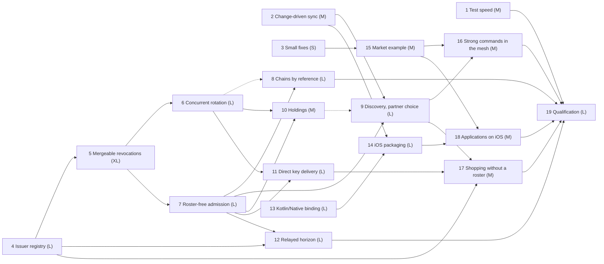

# features_07: an equal-issuer, roster-free mesh and iOS

Status: sequenced on 2026-10-09; not started. This is the next-work authority.
The [proposed defaults](scope-mesh.md#proposed-defaults) of the mesh scope
still await confirmation, each before the phase it names starts. Each brief
records its own status.

Read the two scopes first; every brief links their sections instead of
repeating them:

- [An equal-issuer, roster-free mesh](scope-mesh.md): the issuer registry,
  mergeable revocations, concurrent rotation, admission, discovery, holdings,
  key delivery, the horizon and strong commands.
- [iOS on Kotlin Multiplatform](scope-ios.md): the Kotlin/Native binding,
  packaging, the Keychain and lifecycle.

Defects outside these phases are in [fix later](../fix_later/README.md).

Deferred: a Swift surface, [rotating pseudonyms](../ideas/pseudonym_rotation.md)
(the registry format allows for it), the 4,096-command market soak on devices
and a live public coordination service.

## Destination

Any trusted node enrolls, renews, revokes and rotates for any device, and two
of them doing so at once converge. A member syncs with whichever admitted
device is nearest and holds what it needs; it knows no household roster, and
no replicated table says who holds which list. A strong command reaches its
executor from a device that never met it. The shopping and market applications
run on an iPhone from the same Kotlin sources as on Android and the desktop.

## Standing rules

- One current version per persisted and wire format
  ([decision 0039](../decisions/0039-single-current-formats.md)). A change
  replaces the format; nothing migrates and existing installations reinstall.
- Each format change takes its [reserved decision record](#reserved-decision-records).
- The product choices in the scopes are settled once confirmed; internal
  mechanisms are the agent's call inside them.

## Phases

Each wave runs in parallel; a phase starts when every phase it depends on has
passed its completion gate. Size is a relative budget, not a schedule.

| Phase | Agent brief | Depends on | Size | Required result |
| --- | --- | --- | --- | --- |
| 1 | [Test speed](01-test-speed.md) | none | M | A measured baseline, a budget for the development loop and the changes that meet it |
| 2 | [Change-driven sync and bounded apply](02-change-driven-sync.md) | none | M | Kotlin automatic sync on the native worker; a pause that cancels; incoming pages that yield to a writer |
| 3 | [Small fixes](03-small-fixes.md) | none | S | The coordinator and strong-command defects the market application meets |
| 4 | [Replicated issuer registry](04-issuer-registry.md) | none | L | Every issuer reads every device's record; renewal at any issuer; no last issuer |
| 5 | [Mergeable revocations](05-mergeable-revocations.md) | 4 | XL | A grow-only signed revocation set; concurrent revocations merge; any issuer revokes any device precisely |
| 6 | [Concurrent rotation](06-concurrent-rotation.md) | 5 | L | Two rotations of one scope both readable; writers converge on one |
| 7 | [Roster-free admission](07-roster-free-admission.md) | 5 | L | A peer is admitted by its chain and the revocation set, which travels with the handshake |
| 8 | [Chains by reference and sync budgets](08-chains-by-reference.md) | 7; lands after 6 on the frame | L | A chain crosses a session and is stored once; the four-table budgets met or their cause recorded |
| 9 | [Discovery and partner choice](09-discovery-and-partner-choice.md) | 2, 7; lands after 10 on the session | L | Peers found locally and through a member-only topic; partners ranked; an unreachable peer costs no round |
| 10 | [Holdings after authentication](10-holdings-after-authentication.md) | 6, 7 | M | A peer learns of a partition only by proving it holds that partition |
| 11 | [Direct key delivery](11-direct-key-delivery.md) | 6, 7 | L | Envelopes reach their recipient through the session or a mailbox, never a replicated table |
| 12 | [Relayed horizon](12-relayed-horizon.md) | 4, 7 | L | A horizon finalizes with participants that met only a custody peer |
| 13 | [Kotlin/Native binding](13-kotlin-native-binding.md) | none | L | `rocky-core`, `rocky-sqlite` and `rocky-room` compile and pass their checks on iOS targets |
| 14 | [iOS packaging, Keychain and lifecycle](14-ios-packaging-keychain-lifecycle.md) | 2, 13 | L | A packaged artifact an iOS consumer uses without Rust; Keychain secrets; resume from durable state |
| 15 | [Market example](15-market-example.md) | 3 | M | A packaged Kotlin market application and its harness against three voters |
| 16 | [Strong commands in the mesh](16-strong-commands-in-the-mesh.md) | 9, 15 | M | A command reaches an executor the caller never met; takeover under two issuers |
| 17 | [Shopping without a roster](17-shopping-without-a-roster.md) | 4, 9, 11 | M | Members hold no roster or key table; device management on trusted nodes |
| 18 | [Shopping and market on iOS](18-shopping-and-market-on-ios.md) | 14, 15 | M | Both applications on a simulator and an iPhone from the shared sources |
| 19 | [Qualification](19-qualification.md) | all | L | The release gate on an iPhone and an Android phone, across networks, with evidence |

## Dependency graph

Solid arrows are prerequisites. Dashed arrows fix a landing order on a shared
format. Sizes weigh S=1, M=2, L=3, XL=5.

### Critical path

4 → 5 → 7 → 9 → 16 → 19, 4 → 5 → 7 → 9 → 17 → 19 and
4 → 5 → 6 → 11 → 17 → 19 each weigh 19 of 50. Phase 5 is on all three and is
the largest single risk: it replaces the policy every other mesh phase
verifies against. Its decision record may be drafted while phase 4
implements. The iOS track (13 → 14 → 18 → 19, weight 11) shares no format
with the mesh and never waits for it.

The roadmap weighs 50 against 32 for the previous one. Phases 8, 12 and 16 are
the candidates to move out if it must shrink; the mesh goal survives without
them, with the limits each brief names.

### Waves

| Wave | Phases that can run in parallel |
| --- | --- |
| 0 | 1, 2, 3, 4, 13 |
| 1 | 5, 14, 15 |
| 2 | 6, 7, 18 |
| 3 | 8, 10, 11, 12, then 9 (lands after 10) |
| 4 | 16, 17 |
| 5 | 19 |

## Shared-format hazards

| Format | Phases | Order |
| --- | --- | --- |
| `identity.json` | 4 (registry moves out), 5 (revocation intents), 6 (epoch identities), 11 (pending envelopes) | 4, 5, 6, 11 |
| Signed policy, renewal answer | 5 | 5 alone |
| Key epochs, group secret envelope | 6, 11 (delivery binding) | 6, then 11 |
| Native session | 7 (admission, policy exchange), 8 (chain table), 10 (holding proofs), 11 (envelope delivery), 12 (horizon relay), 9 (contact exchange) | 7, 8, 10, 11, 12, 9 |
| Frame envelope, stored operations | 6 (epoch identity), 8 (chain reference) | 6, then 8 |
| Checkpoint page | 8 | 8 alone |
| Contact and invitation URIs | 4 (issuer flag), 9 (learned contacts) | 4, then 9 |
| Shopping `shared` module | 17 (roster removed), 18 (iOS target) | Either; the second reruns the first's checks |

Each session change replaces `rocky/native-session` with the next name; a
phase that lands later in the order rebases onto the current one.

## Reserved decision records

| Record | Phase | Topic |
| --- | --- | --- |
| 0048 | 4 | Replicated issuer registry |
| 0049 | 5 | Mergeable revocation set |
| 0050 | 6 | Key epoch identities and sibling epochs |
| 0051 | 7 | Roster-free admission and policy exchange in the native session |
| 0052 | 8 | Credential chains by reference |
| 0053 | 10 | Holding proofs |
| 0054 | 11 | Envelope delivery and mailboxes |
| 0055 | 12 | Relayed horizon statements and acknowledgments |
| 0056 | 9 | Discovery capability, discovery secret and topic |
| 0057 | 13 | Kotlin/Native binding |

A phase that needs a further record takes the next unreserved one.

## Agent execution contract

Give an agent this README, the scope its phase belongs to and one phase brief.
Read root `AGENTS.md`, [development](../development.md), the
[module map](../modules.md) and the brief's source and guide inputs. Verify
prerequisites against code and evidence before editing. If a prerequisite
fails, repair it within scope or report the exact blocking contract; never
invent successful behavior or silently weaken admission, durability or
atomicity.

Update owning guides, the brief's status line and measured evidence with each
completed slice. Use `jj`, run `./scripts/check` before finishing, prefer
deterministic fault injection and report what passed and what was not
verified.

Device work uses the `agent-device` CLI for the simulators, the emulators, the
attached iPhone and the attached Android phone. Both phones are in personal
use: install and remove only the example applications, and leave every other
application and setting alone.

## Release gate

Phase 19 shows, with no Rust source in either application:

- an iPhone and an Android phone sharing one list through a custody peer,
  each enrolled by a different trusted node, over iroh relays between two
  networks;
- the two trusted nodes revoking two devices at once while partitioned from
  each other, and every remaining device converging on both revocations and
  on one key epoch per list;
- a member that learned of a revocation only from a peer it had never met;
- a member whose replica holds no table naming another device, and a relay
  observer's transcript showing no partition a peer did not prove;
- a horizon finalizing on a phone that met only the custody peer;
- the two phones competing for the last item in the market application, one
  accepted and one rejected, the caller never having met the executor.
