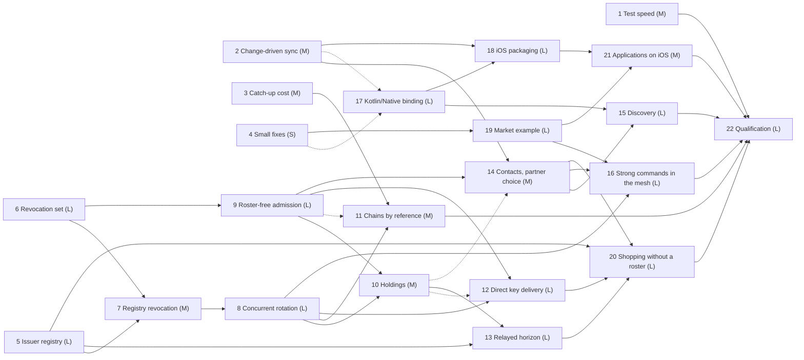

# features_07: an equal-issuer, roster-free mesh and iOS

Status: sequenced and reviewed against the code on 2026-10-09; not started.
This is the next-work authority. The questions the scopes left open are
[decided](scope-mesh.md#decided-2026-10-09); each brief states the ones it
owns under "Settled" and records its own status.

Read the two scopes first; every brief links their sections instead of
repeating them:

- [An equal-issuer, roster-free mesh](scope-mesh.md): the issuer registry,
  mergeable revocations, concurrent rotation, admission, discovery, holdings,
  key delivery, the horizon and strong commands.
- [iOS on Kotlin Multiplatform](scope-ios.md): the Kotlin/Native binding,
  packaging, the Keychain and lifecycle.

Defects outside these phases are in [fix later](../fix_later/README.md).

Deferred: a Swift surface, [rotating pseudonyms](../ideas/pseudonym_rotation.md)
(the registry format allows for it), local-network discovery on a physical iOS
device ([an idea](../ideas/ios_bonjour_discovery.md) covers a system-API
path), the 4,096-command market soak on devices and a live public
coordination service.

## Destination

Any trusted node enrolls, renews, revokes and rotates for any device, and two
of them doing so at once converge. A member syncs with whichever admitted
device is nearest and holds what it needs; it knows no household roster, and
no replicated table says who holds which list. A strong command reaches its
executor from a device that never met it. The shopping and market applications
run on an iPhone from the same Kotlin sources as on Android and the desktop.

## Standing rules

- One current version per persisted and wire format
  ([decision 0039](../decisions/0039-single-current-formats.md)). A change
  replaces the format; nothing migrates and existing installations reinstall.
- Each format change takes its [reserved decision record](#reserved-decision-records).
- The product choices in the scopes and the "Settled" answers in the briefs
  are fixed; internal mechanisms are the agent's call inside them. An agent
  that finds a settled answer unworkable reports it instead of replacing it.
- A phase owns the CI run of every acceptance item its gate names;
  [qualification](22-qualification.md) collects them and implements nothing.

## Phases

Each wave runs in parallel; a phase starts when every phase it depends on has
passed its completion gate. "Lands after" fixes only the order in which two
phases merge a shared format; the later one rebases. Size is a relative
budget, not a schedule.

| Phase | Agent brief | Depends on | Lands after | Size | Required result |
| --- | --- | --- | --- | --- | --- |
| 1 | [Test speed](01-test-speed.md) | none | | M | A measured baseline, budgets for the development loop and the changes that meet them |
| 2 | [Change-driven sync](02-change-driven-sync.md) | none | | M | Kotlin automatic sync on the native worker; a pause that cancels within 1 s; per-peer back-off |
| 3 | [Catch-up cost](03-catch-up-cost.md) | none | | M | Incoming pages that yield to a writer; the four-table budget misses attributed by a profile |
| 4 | [Small fixes](04-small-fixes.md) | none | | S | The coordinator and strong-command defects the market application meets |
| 5 | [Replicated issuer registry](05-issuer-registry.md) | none | | L | Every issuer reads every device's record; renewal at any issuer; no last issuer |
| 6 | [Revocation set](06-revocation-set.md) | none | | L | A grow-only signed revocation set replaces the policy epoch; concurrent revocations merge |
| 7 | [Revocation from the registry](07-registry-revocation.md) | 5, 6 | | M | Any issuer revokes any device, rotating only what its record could read |
| 8 | [Concurrent rotation](08-concurrent-rotation.md) | 7 | | L | Two rotations of one scope both readable; writers converge on one |
| 9 | [Roster-free admission](09-roster-free-admission.md) | 6 | | L | A peer is admitted by its chain and the revocation set, which travels with the handshake |
| 10 | [Holdings after authentication](10-holdings-after-authentication.md) | 8, 9 | | M | A peer learns of a partition only by proving it holds that partition |
| 11 | [Chains by reference](11-chains-by-reference.md) | 3, 8 | 9 | M | A chain crosses a session and is stored once; the checkpoint page fits a 20-grant command |
| 12 | [Direct key delivery](12-direct-key-delivery.md) | 8, 9 | 10 | L | Envelopes reach their recipient through the session or a mailbox, never a replicated table |
| 13 | [Relayed horizon](13-relayed-horizon.md) | 5, 10 | | L | A horizon finalizes with participants that met only a custody peer |
| 14 | [Contacts and partner choice](14-contacts-and-partner-choice.md) | 2, 9 | 10 | M | Peers hand over contacts; partners ranked; an unreachable peer costs no round |
| 15 | [Discovery](15-discovery.md) | 14, 17 | | L | Peers found on the local network and through a topic only members derive |
| 16 | [Strong commands in the mesh](16-strong-commands-in-the-mesh.md) | 8, 14, 19 | | L | A command reaches an executor the caller never met, forwarded where no route exists; takeover under two issuers |
| 17 | [Kotlin/Native binding](17-kotlin-native-binding.md) | none | 2, 4 | L | `rocky-core`, `rocky-sqlite` and `rocky-room` compile and pass their checks on iOS targets |
| 18 | [iOS packaging, Keychain and lifecycle](18-ios-packaging-keychain-lifecycle.md) | 2, 17 | | L | A packaged artifact an iOS consumer uses without Rust; Keychain secrets; resume from durable state |
| 19 | [Market example](19-market-example.md) | 4 | | L | A packaged Kotlin market application and its harness against three voters |
| 20 | [Shopping without a roster](20-shopping-without-a-roster.md) | 5, 12, 13, 14 | | L | Members hold no roster or key table; device management on trusted nodes |
| 21 | [Shopping and market on iOS](21-shopping-and-market-on-ios.md) | 18, 19 | | M | Both applications on a simulator and an iPhone from the shared sources |
| 22 | [Qualification](22-qualification.md) | all | | L | The release gate on an iPhone and an Android phone, across networks, with evidence |

## Dependency graph

Solid arrows are prerequisites. Dashed arrows fix a landing order on a shared
format. Sizes weigh S=1, M=2, L=3.

### Critical path

5 → 7 → 8 → 10 → 13 → 20 → 22 and 6 → 7 → 8 → 10 → 13 → 20 → 22 each weigh
19 of 56. Phases 5 and 6 share no code path but both rewrite `identity.json`;
they are the two wave 0 phases the rest of the mesh waits for. Phase 8 is the
largest single risk: every later mesh phase names its epoch identity. Its
decision record may be drafted while phase 7 implements. The iOS track
(17 → 18 → 21 → 22, weight 11) shares no format with the mesh and never waits
for it; phase 17 grows to XL if its preferred binding mechanism fails.

The roadmap weighs 56 against 32 for the previous one. Phases 11, 15 and 16
are the candidates to move out if it must shrink; the mesh goal survives
without them, with the limits each brief names.

### Waves

| Wave | Phases that can run in parallel | Weight |
| --- | --- | --- |
| 0 | 1, 2, 3, 4, 5, 6, 17 | 16 |
| 1 | 7, 9, 18, 19 | 11 |
| 2 | 8, 21 | 5 |
| 3 | 10, 11, 12 | 7 |
| 4 | 13, 14 | 5 |
| 5 | 15, 16, 20 | 9 |
| 6 | 22 | 3 |

Phase 12 starts in wave 3 beside phase 10 and merges after it.

## Shared-format hazards

| Format or source | Phases | Order |
| --- | --- | --- |
| `identity.json` | 5 (registry and author assignments move out), 6 (revocation intents), 7, 8 (epoch identities), 9 (contacts split from dialed peers), 12 (pending envelopes) | 5 and 6 in either order, the second rebases; then 7, 8, 9, 12 |
| Signed policy, capability and pseudonym credentials, `revoked.json` | 6 | 6 alone |
| Renewal answer and key lists | 5 (registry key), 6 (the set), 8 (epoch identity) | 5 and 6 in either order; then 8 |
| Key epochs, group secret envelope | 8, 12 (outer sealing) | 8, then 12 |
| Native session | 9 (version constant, admission, revocation exchange), 10 (holding proofs), 11 (chain table), 12 (envelope delivery), 13 (horizon relay), 14 (contacts, discovery value) | 9, 10, then 11, 12 and 13 in any order, then 14 |
| Frame envelope, stored operations | 8 (epoch identity), 11 (chain digest) | 8, then 11 |
| Checkpoint page and statement | 6 (policy reference), 8 (epoch identity), 11 (chains beside the page) | 6, 8, 11 |
| Horizon statement | 6 (policy reference), 13 (relay, participants) | 6, then 13 |
| Issuer registry record | 5 | 5 alone; later phases read fields it already holds |
| `admitted()` in enrollment | 5, 9 | 5, then 9 |
| Kotlin `rocky-core` native sources | 2, 4 (small edits), 17 (moved behind the platform boundary) | 2 and 4, then 17 |
| Exported `sdks/native` surface | 5, 6, 7, 9, 12, 14, 15, 18 | Once 17 has landed, each regenerates both bindings and runs the iOS simulator check |
| CI workflows, `scripts/check` | 1 (restructuring), 17, 18, 19, 21 (new jobs) | 1, then the others |
| Command protocol | 16 (forwarding) | 16 alone |
| Shopping `shared` module | 12 (stops using `keys` rows), 20 (roster removed), 21 (iOS target) | 12 before 20; 21 at any point, the later of two rerunning the earlier one's checks |

The session has one version constant from phase 9 on, behind both the
transport name and the signing label. A phase that adds messages bumps it
when it lands; nothing is negotiated and any other version is refused.
The command protocol takes its next name in phase 16; the coordinator
protocol does not change in this roadmap.

## Reserved decision records

| Record | Phase | Topic |
| --- | --- | --- |
| 0048 | 5 | Replicated issuer registry |
| 0049 | 6 | Mergeable revocation set |
| 0050 | 8 | Key epoch identities and sibling epochs |
| 0051 | 9 | Roster-free admission and the revocation exchange in the native session |
| 0052 | 10 | Holding proofs |
| 0053 | 11 | Credential chains by reference |
| 0054 | 12 | Envelope delivery and mailboxes |
| 0055 | 13 | Relayed horizon statements and acknowledgments |
| 0056 | 14 | Contact handover, contact requests and the discovery value |
| 0057 | 15 | Discovery capability and topic |
| 0058 | 17 | Kotlin/Native binding |
| 0059 | 16 | Command forwarding |

Phase 7 changes no format and takes no record. A phase that needs a
further record takes the next unreserved one.

## Agent execution contract

Give an agent this README, the scope its phase belongs to and one phase brief.
Read root `AGENTS.md`, [development](../development.md), the
[module map](../modules.md) and the brief's source and guide inputs. Verify
prerequisites against code and evidence before editing. If a prerequisite
fails, repair it within scope or report the exact blocking contract; never
invent successful behavior or silently weaken admission, durability or
atomicity.

Update owning guides, the brief's status line and measured evidence with each
completed slice. Use `jj`, run `./scripts/check` before finishing, prefer
deterministic fault injection and report what passed and what was not
verified.

Device work uses the `agent-device` CLI for the simulators, the emulators, the
attached iPhone and the attached Android phone. Both phones are in personal
use: install and remove only the example applications, and leave every other
application and setting alone.

## Release gate

Phase 22 shows, with no Rust source in either application:

- an iPhone and an Android phone sharing one list through a custody peer,
  each enrolled by a different trusted node, over iroh relays between two
  networks;
- the two trusted nodes revoking two devices at once while partitioned from
  each other, and every remaining device converging on both revocations and
  on one key epoch per list;
- a member that learned of a revocation only from a peer it had never met;
- a member whose replica holds no node key, name or kind of another device
  and no envelope for one, and a relay observer's transcript showing no
  partition a peer did not prove;
- a horizon finalizing on a phone that met only the custody peer;
- the two phones competing for the last item in the market application, one
  accepted and one rejected, the caller never having met the executor.
