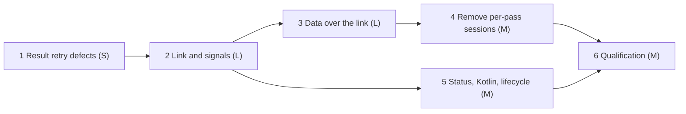

# features_08: live links

Status: accepted execution roadmap (2026-10-12). Phases 1–4 are implemented and
verified; see their briefs for evidence. Phase 5 is implemented with final
verification in progress; phase 6 has not started.
This is the current next-work authority. Each brief states the questions
it owns under "Settled" and records its own status.

## Destination

Two devices that have synced keep one authenticated **live link** open while
both are online. Either side sends its committed changes over that link as
they happen; a keepalive shows at once when the other side is gone. No
device polls, and a device that cannot be dialed, such as a phone on a
cellular network, still receives changes over the link it opened itself.

When the roadmap ends, the link is the only way two databases sync. The
per-pass `Sync` sessions, which dial, authenticate, exchange and close for
every pass, are removed together with their protocol name and the code that
serves them.

## What "the old sessions are gone" means

The per-pass sync sessions can be removed completely; nothing in the mesh
needs them once the link carries every message a session carries today. Four
things remain and are not the old path:

- **Dialing.** A link still starts with a dial and a handshake, and a lost
  link is dialed again with the per-peer back-off of
  [change-driven sync](../runtime/always-on-peer.md#change-driven-sync).
- **Short links.** Explicit `sync`, the always-on peer's first contact, the
  qualification harness and bootstrap of a new device open a link, reconcile
  and may close it again. This is the same protocol and code, not a second path.
- **Re-authentication.** A link ends whenever the replica's authority changes,
  as every [session](../runtime/secure-sessions.md#sessions) does today
  (renewal, learned revocations, key installs), and is dialed again.
- **Other protocols.** `Pair`, `Renew`, `Command` and `Coordinate` are not
  sync and keep their own one-shot streams. Moving `Renew` and `Command` onto
  the link is possible later and is not part of this roadmap.

## Settled

- **Every peer.** A device keeps a link to every peer it syncs with today:
  configured, contacted and inbound peers. Choosing a useful subset in a larger
  mesh is an [idea](../ideas/useful_peer_links.md), not part of this roadmap.
- **One link per pair.** When both sides dial at once, the link the lower
  node key dialed survives and the other closes without error.
- **Symmetric.** Both ends of a link may start a request; neither is the
  server. The side that dialed is irrelevant once the handshake completes.
- **Signals first, then data.** Phase 2 links carry only signals and liveness,
  and a signal starts an ordinary pass. Phase 3 moves the data onto the link,
  and phase 4 deletes the old sessions. Each phase leaves a working mesh.
- **No background links on Android.** `enterBackground` closes every link
  with the worker; `enterForeground` opens them. iOS follows its own
  [lifecycle](../old/features_07/scope-ios.md) and is not changed here.
- **Notification after commit.** A link sends a change only after the local
  commit; nothing is sent from inside a database transaction.
- **Transport-neutral.** Liveness is an application ping on the link, so the
  in-memory, TCP and foreign Kotlin transports behave like iroh. iroh may add
  QUIC keepalive below it, but correctness does not depend on that.
- One current version per format
  ([decision 0039](../decisions/0039-single-current-formats.md)). The link
  replaces the session format; nothing is negotiated or migrated.

## Phases

| Phase | Brief | Depends on | Size | Required result |
| --- | --- | --- | --- | --- |
| 1 | [Result retry defects](01-result-retry-defects.md) | none | S | No checkpoint re-import storm when the coordinator head is unknown |
| 2 | [Link session and signals](02-link-session-and-signals.md) | 1 | L | One symmetric, kept-alive link per peer; a commit reaches the peer as a signal without a dial |
| 3 | [Data over the link](03-data-over-the-link.md) | 2 | L | Rows, existence, horizons, results, envelopes and bootstrap move over the open link |
| 4 | [Remove per-pass sessions](04-remove-per-pass-sessions.md) | 3 | M | The `Sync` protocol, its server and its dialer are deleted |
| 5 | [Status, Kotlin and lifecycle](05-status-kotlin-lifecycle.md) | 2 | M | Per-peer link state in readiness and Kotlin; Android closes links in the background; the shopping app shows them |
| 6 | [Qualification](06-qualification.md) | 4, 5 | M | A desktop and a phone on cellular exchange edits live, with measured latency and idle cost |

Phase 5 may start after phase 2 and run beside phases 3 and 4; it lands
after phase 4 if both change the status shape.

## Reserved decision records

| Record | Phase | Topic |
| --- | --- | --- |
| 0063 | 2 | Live link session: handshake, multiplexing, liveness and signals |
| 0064 | 3 | Sync messages on the link and the end of per-pass sessions |

## Agent execution contract

Give an agent this README and one phase brief. Read root `AGENTS.md`,
[development](../development.md), the [module map](../modules.md) and the
brief's inputs. Verify prerequisites against code before editing; if one
fails, repair it within scope or report the exact blocking contract. Never
report success for missing behavior or weaken admission, durability or
atomicity.

Update the owning guides, the brief's status line and measured evidence with
each completed slice. Use `jj`, run `./scripts/lint` and `./scripts/check`
before finishing, prefer deterministic fault injection on
`rocky_sdk::transport::memory::Hub` under Tokio's paused clock, and report
what passed and what was not verified.
