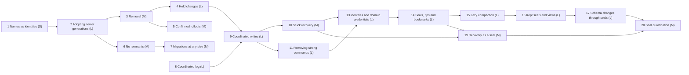

# features_09: evolving schemas without limits

Status: accepted roadmap (2026-10-14). Phases 1–9, 11 and 13 are
implemented, with [accepted limitations](#accepted-limitations) and
[phase 13's own](13-identities-and-domain-credentials.md); each phase's
evidence records its verification. Phase 10 is partial: collection and owner-signed
cuts work in `rocky-coordinator` and `rocky-secure`, without the SDK, Kotlin
API or guides ([evidence](10-stuck-recovery-evidence.md));
[phase 19](19-recovery-as-a-bookmark-move.md) replaces its cuts. Phases 12
and 18 are skipped. Phase 14 is in progress: all slices are implemented, and
[two gate gaps remain](14-seals-and-bookmarks-evidence.md#what-remains-before-phase-14-is-implemented).
Phase 15 is implemented ([evidence](15-lazy-compaction-evidence.md)).
Phases 14–17, 19 and 20 replace
generations' transitions, the mergeable horizon and recovery cuts with
[sealed forks](#generations-as-sealed-forks).
[features_08](../features_08/README.md) is history, not a competing next-work
authority.

## Destination

A Rocky schema evolves over decades. A new app version may add or remove
tables and fields, and Rocky never limits how old an app version may be and
still sync:

- **A database is exactly one schema version.** When a device learns of a
  newer schema, it migrates its whole database to it, whatever its app
  version expects. There is no in-between state: the database is v6 or v7.
- **Old apps keep working on what is unchanged.** An app older than its
  database keeps reading and writing every table and field the new schema
  kept. Its code that touches removed items fails with ordinary SQL errors;
  the application tells the user to update. Across a migrating change, which
  closes its tip, an offline device's writes return as held changes; the
  developer keeps the app forward compatible, re-authors them on a trusted
  node, holds them until the app updates or forces the update first.
- **Nothing incompatible is sent silently.** Local changes made before the
  migration that touch removed items are held, not sent. A newer app version
  re-authors them as new writes, or drops them.
- **Removal is a deliberate, confirmed step.** The device that first opens a
  version removing something gets an impact report, and the application asks
  the user before Rocky signs it.
- **Migrations have no size limit.** They run in one local transaction on
  an issuer that can read and write every partition of the tables involved,
  and leave as many bundles as they need. They need no coordinator: issuers
  that migrate concurrently converge, apart from rows both insert into a
  table keyed by `id`.
- **No remnants.** Manifests are fetched when a frame needs one and dropped
  when no retained frame does. Transitions no longer carry an admission
  horizon, and the cut mechanism of
  [decision 0066](../decisions/0066-breaking-generations.md) is removed.
- **Coordinated writes on ordinary rows.** Writes that must not race, such
  as sequential invoice numbers, are bundles that every connected trusted
  node stores before they become true; the coordinator orders them and
  decides which history is canonical, without holding data. Strong commands
  and command-controlled tables are removed.

Rocky guarantees that every database eventually converges. It does not
guarantee that no data is lost, nor that an app always runs on the complete
schema it declares: an app may be older or newer than its database, and its
queries on what differs fail. An app that must not break forces an update or
handles those failures. Deprecation, update prompts and how long old app
versions are tolerated belong to the application, not to Rocky.

## Settled

- **Names are identities.** A table or field's name is its identity
  forever; there is no separate identity and no translation layer. A name
  removed and added again means the same thing with the same type, which is
  the developer's responsibility. A field whose meaning or type changes takes
  a new name, such as `category2`; renaming is a removal and an addition. An
  app that must keep old versions from misreading a name enforces a minimum
  app version itself.
- **Adopt on discovery.** A device that meets a newer generation fetches its
  schema and publisher-signed manifest, verifies them and migrates its
  database to it with the existing backfill and switch, before it applies
  that generation's frames. No chain of transitions is needed.
- **The same schema everywhere.** Removed tables and fields are dropped on
  every device that runs the new generation, with their constraints; nothing
  is frozen, emptied in place or filled with synthetic values.
- **Re-adding converges.** A generation that re-adds a removed name
  records its signing time as a baseline, the earliest if several issuers
  signed it. Every device ignores writes to the
  field stamped before it, and a device adopting the generation pulls again
  the frames of that field's tables stamped after it. The
  [lazy compaction](../runtime/lazy-compaction.md) finalizes sealed history:
  each copy uses the seal's frontier or imports its checkpoint. Nothing
  requires a participant declaration before compaction.
- **No device inventory.** Rocky never needs to know how many devices exist
  or whether two of them share a key. Every rule here is applied by each
  copy on its own state; seals carry no device inventory.
- **Receivers check field by field.** A frame from a device that has not
  migrated yet applies its kept fields and ignores removed ones, the same way
  on every device.
- **Held changes are voided, not split.** A held bundle never offered to a
  peer is cancelled with a signed void record, so its author logs continue.
  A bundle that was offered, even by a push that failed midway, counts as
  sent; receivers apply its kept fields. Re-authoring is an ordinary new
  write with a new timestamp; the application can show what it would
  overwrite first.
- **No split brain.** A coordinated write is committed once every trusted
  node in the coordinator's in-sync set stored it, and the set has at least
  the domain's minimum size. A domain whose whole set is permanently cut off
  is stuck until the domain owner signs a recovery cut; Rocky accepts this.
- **The coordinator holds no data.** Per domain it keeps the in-sync set, the
  log head and commit index with a bounded hash window: a few KiB, constant
  over time, with lazy membership and no heartbeats.
- **Old apps may join** a newer household when the protocol is compatible;
  their database starts at the household's generation.
- One current version per format
  ([decision 0039](../decisions/0039-single-current-formats.md)).

## Accepted limitations

- **A split schema is undefined.** Issuers that sign different schemas on
  the same generation fork the lineage: each device adopts the branch it
  meets first and refuses the other, and nothing joins the branches again.
  What a device applies of the other branch's writes is not specified.
  Issuers running one application release sign one generation, so a split
  needs a bug, two releases rolled out at once or a malicious issuer.
  [Phase 17](17-schema-changes-through-seals.md) removes this limitation.
- **Two migration runs may duplicate rows.** Issuers that migrate apart each
  run the migrations. Updates meet by latest wins and rows keyed by name
  merge, but an `insert` step into a table keyed by `id` adds each row once
  per run. Rocky neither detects nor removes the duplicates: the application
  must prevent them, for example by using the
  [coordinator](../runtime/coordinated-log.md)
  ([decision 0071](../decisions/0071-staged-migration-publication.md)).
  [Phase 17](17-schema-changes-through-seals.md) removes this limitation.

From [phase 14](14-seals-and-bookmarks.md) on, sealed forks accept these:

- **A frontier may never fill.** A seal names a frontier its sealer need not
  hold. If every holder of frames through it quits, no device builds,
  keeps or compacts that seal's state; the owner's
  [recovery](19-recovery-as-a-bookmark-move.md) is the way out. Rocky
  requires no full node.
- **A malicious issuer can win races.** It can vary a statement until its
  digest is lower and so beat honest issuers' concurrent seals and moves,
  though never a trusted identity's or the owner's. Revoking it removes its
  statements; the owner then recovers one branch.
- **A branch works when its trusted nodes are online.** Peers sync a tip
  only with peers following it, and its coordinated log is run by its own
  trusted nodes.
- **A device may rebootstrap.** Uncoordinated seals can lose late; a device
  that compacted at a losing seal rebuilds at the winner. Its own writes
  follow the usual late-frame and held-change rules; Rocky never re-authors
  them.

## Phases

| Phase | Brief | Depends on | Size | Required result |
| --- | --- | --- | --- | --- |
| 1 | [Names as identities](01-stable-identities.md) | none | S | A name is its table or field's identity forever; no separate identity |
| 2 | [Adopting newer generations](02-adopting-newer-generations.md) | 1 | L | A device migrates its database to any newer generation it meets, whatever its app version |
| 3 | [Removal](03-removal.md) | 2 | M | A generation drops tables and fields on every device that adopts it |
| 4 | [Held changes](04-held-changes.md) | 3 | L | Incompatible local changes are held, voided and re-authored or dropped by the app |
| 5 | [Confirmed rollouts](05-confirmed-rollouts.md) | 3 | M | Removals are signed only after the app confirms an impact report |
| 6 | [No remnants](06-no-remnants.md) | 2 | M | Cuts are removed; unused manifests are dropped |
| 7 | [Migrations at any size](07-migrations-at-any-size.md) | 6 | M | A migration of 100,000 rows runs once and leaves as many bundles |
| 8 | [Coordinated log](08-coordinated-log.md) | none | L | The coordinator orders one log per domain and commits entries the in-sync set stored |
| 9 | [Coordinated writes](09-coordinated-writes.md) | 4, 8 | L | Trusted nodes make race-free writes as ordinary bundles, without split brain |
| 10 | [Stuck recovery](10-stuck-recovery.md) | 9 | M | A stuck domain recovers what any device holds; the owner signs the rest away |
| 11 | [Removing strong commands](11-removing-strong-commands.md) | 9 | L | Commands and command-controlled tables are gone; the examples use coordinated writes |
| 12 | ~~[Qualification](12-qualification.md)~~ | — | — | Skipped: not needed; phase 20 qualifies the shopping app on seals |
| 13 | [Identities and domain credentials](13-identities-and-domain-credentials.md) | 10, 11 | L | Grants name identities; nodes sign under certificates; pseudonyms are gone; the publisher key stays with the owner; adopting a generation needs no issuer |
| 14 | [Seals, tips and bookmarks](14-seals-and-bookmarks.md) | 13 | L | Issuers seal tips; trusted identities open branches; devices follow and sync only their bookmark's tip; late frames walk `continue` seals; one coordinated log per tip; races resolve by authority, then digest |
| 15 | [Lazy compaction](15-lazy-compaction.md) | 14 | L | Devices compact final seals on their own schedule; checkpoints sit at seals in the graph; the horizon is gone |
| 16 | [Kept seals and views](16-kept-seals-and-views.md) | 15 | L | Nodes keep configured seals; branches open on held seals; any connection reads a seal or bookmark through read-only views |
| 17 | [Schema changes through seals](17-schema-changes-through-seals.md) | 16 | L | A schema change is a seal; a migration closes its tip; transitions, baselines and both accepted limitations are gone |
| 18 | ~~[Drafts and sandboxes](18-drafts-and-sandboxes.md)~~ | — | — | Skipped: a branch tries, a seal of `main` publishes |
| 19 | [Recovery as a seal](19-recovery-as-a-bookmark-move.md) | 10, 14 | M | A stuck tip recovers with one owner `continue` seal that excludes abandoned entries; cuts are gone |
| 20 | [Seal qualification](20-seal-qualification.md) | 17, 19 | M | The shopping app compacts, keeps seals, branches, migrates offline and rolls back on real devices |

## Generations as sealed forks

Phases 13–17, 19 and 20 reduce schema changes, compaction, branches and
recovery to one operation. Their briefs hold the details.

- **A domain** is the owner identity's key and the application. It owns
  members, credentials, grants by table and field name, reader key epochs
  and the coordinator, and never forks. A separate test cluster is a
  separate domain.
- **Identities** hold permissions; an `IdentityProvider` supplies them, a
  passkey module later. Each node signs under its own key, certified by its
  identity, with an author number from the identity's range. Revoking an
  identity stops all its nodes. Pseudonyms are removed.
- **A tip** is an open generation: one schema and the frames written to
  it. **A seal** ends a tip once, at a per-author frontier, and either
  `continue`s into one successor tip or `close`s it. Trusted identities open
  further tips on any seal, for branches and drafts. A seal changes no row;
  devices compact sealed tips whenever they choose. Applications call
  `seal()`; Rocky runs no timer. Every device holds the complete graph of
  seals, tips and bookmarks.
- **Bookmarks** are named, signed pointers to tips; Rocky defines none, and
  an application follows the one it names, by convention `main`. Issuers
  move bookmarks forward; trusted identities and the owner also create,
  delete and move them backwards or sideways.
- **Races resolve by authority.** Concurrent seals of a tip, or moves of a
  bookmark from one tip, resolve to the owner's, then a trusted identity's,
  then an issuer's, and among equals to the lower digest. Revoking an
  identity removes its statements and resolves again. Inspection lists the
  losers as `main/1`, `main/2`, in the manner of jj; they stay branches.
- **Peers on a branch.** A device writes only its followed bookmark's tip
  and syncs that tip's frames only with peers following it, so a branch
  costs the rest of the domain nothing. Each tip has its own coordinated
  log, run by the trusted nodes that follow it.
- **Late frames** beyond a frontier walk the `continue` seals to the open
  tip and apply there field by field. A `close` stops them: they return as
  held changes for the application to re-author.
- **One live workspace** per domain holds the followed tip's tables under
  their plain names. The code keeps workspaces behind a boundary so that
  [more](../ideas/additional_live_workspaces.md) can be added later.
- **Compaction is final only at a final seal.** A seal committed in its
  tip's coordinated log cannot lose and may be compacted at once. Elsewhere
  each `compact` call names how many latest seals it leaves uncompacted; a
  device that compacted at a seal that later loses rebootstraps.
- **Checkpoints sit at seals.** A checkpoint is a seal's state, signed by an
  issuer; its record (seal, signer, digest, size) is part of the graph and
  its body moves on request. A rebootstrapping device imports one, else
  replays frames, else waits for the owner's recovery.
- **Kept seals** are configured per node and stored as history tables.
  Unlimited read-only views show any kept seal or bookmark with the live
  tables' names, for migrations, audits and debugging. A seal not kept is
  shallow: in the graph, without state.
- **Branches open on held seals,** whose state the node holds: a kept seal,
  a checkpoint it pulled, or a seal it makes now from its live state.
  Keeping the latest seal is the developer's choice.
- **Trying and publishing.** There are no drafts: every tip is synced to
  its followers, and a tip without a bookmark is simply not followed. A
  developer tries a change on a dev branch. To publish, an issuer seals
  `main` forward and runs the migration on that fresh parent, offline if it
  should be ready when the seal becomes public; nothing of the branch is
  reused. Merging branches and rebasing are out of scope.
- **Recovery is a seal.** The owner recovers a stuck tip with one
  `continue` seal that excludes the abandoned coordinated entries.
- An inspection API shows developers the graph, bookmarks, kept seals and
  checkpoints.

This supersedes, once the phases land, the settled items above on adopting
on discovery, transitions, re-add baselines, the horizon's guarantees and
the coordinator's single log per domain, the first two accepted limitations
and [phase 10](10-stuck-recovery.md)'s cuts. Existence logs
stay and are compacted at seals.

## Reserved decision records

| Record | Phase | Topic |
| --- | --- | --- |
| 0067 | 1 | [Names are table and field identities](../decisions/0067-names-are-identities.md) |
| 0068 | 2, 3 | Adopting newer generations and removal |
| 0069 | 4 | [Held changes, void records and re-authoring](../decisions/0069-held-changes-and-void-records.md) |
| 0070 | 5, 6 | [Confirmed rollouts and the end of cuts](../decisions/0070-confirmed-rollouts-and-the-end-of-cuts.md) |
| 0071 | 7 | [Staged migration publication](../decisions/0071-staged-migration-publication.md) |
| 0072 | 8, 9 | The coordinated log and coordinated writes |
| 0073 | 10, 11 | [Stuck recovery and the end of strong commands](../decisions/0073-stuck-recovery-and-strong-commands.md) |
| 0074 | 10 | [Owner-signed recovery cuts](../decisions/0074-owner-signed-recovery-cuts.md) |
| 0075 | 13–17, 19 | [Generations as sealed forks](../decisions/0075-generations-as-sealed-forks.md) |

## Open questions

None. How members see a final seal was settled for phase 15: trusted
nodes acknowledge the committed terminal and a graph record carrying enough
acknowledgments makes a seal final ([final seals](../runtime/seal-finality.md)).

## Agent execution contract

Give an agent this README and one phase brief. Read root `AGENTS.md`,
[development](../development.md), the [module map](../modules.md),
[generations](../runtime/generations.md) and
[decision 0066](../decisions/0066-breaking-generations.md). Verify the brief's
prerequisites against code before editing; if one fails, repair it within
scope or report the exact blocking contract. Never weaken admission,
durability or atomicity, and never report success for missing behavior.

Update the owning guides, the brief's status line and its evidence with each
completed slice. Use `jj`, run `./scripts/lint` and `./scripts/check`, and for
Kotlin changes `sdks/kotlin/gradlew -p sdks/kotlin check` and
`./examples/shoppinglist-app/check`. Report what passed and what was not
verified.
