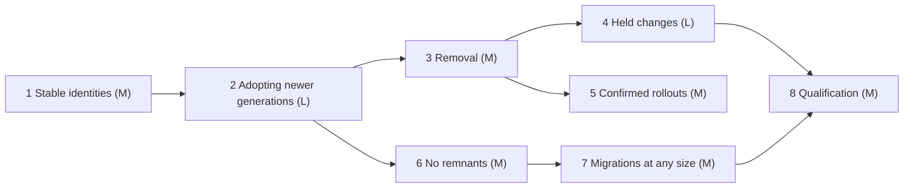

# features_09: evolving schemas without limits

Status: proposed roadmap (2026-10-14), not yet accepted. It does not replace
[features_08](../features_08/README.md) as the next-work authority until that
roadmap finishes or this one is accepted. No phase has started.

## Destination

A Rocky schema evolves over decades. A new app version may add or remove
tables and fields, and Rocky never limits how old an app version may be and
still sync:

- **A database is exactly one schema version.** When a device learns of a
  newer schema, it migrates its whole database to it, whatever its app
  version expects. There is no in-between state: the database is v6 or v7.
- **Old apps keep working on what is unchanged.** An app older than its
  database keeps reading and writing every table and field the new schema
  kept. Its code that touches removed items fails with ordinary SQL errors;
  the application tells the user to update.
- **Nothing incompatible is sent silently.** Local changes made before the
  migration that touch removed items are held, not sent. A newer app version
  re-authors them as new writes, or drops them.
- **Removal is a deliberate, confirmed step.** The device that first opens a
  version removing something gets an impact report, and the application asks
  the user before Rocky signs it.
- **Migrations have no size limit.** They run in one local transaction on
  an issuer that can read and write every partition of the tables involved,
  and leave as many bundles as they need.
- **No remnants.** Manifests are fetched when a frame needs one and dropped
  when no retained frame does. Transitions no longer carry an admission
  horizon, and the cut mechanism of
  [decision 0066](../decisions/0066-breaking-generations.md) is removed.

Rocky guarantees that every database eventually converges. It does not
guarantee that no data is lost, nor that an app always runs on the complete
schema it declares: an app may be older or newer than its database, and its
queries on what differs fail. An app that must not break forces an update or
handles those failures. Deprecation, update prompts and how long old app
versions are tolerated belong to the application, not to Rocky.

## Settled

- **Identities, not names.** A table or field's identity is a plain string
  in the schema, its name by default. Renaming keeps the old string as its
  identity. A new field takes a new one, such as `category2`; re-adding a
  removed identity is allowed, and keeping its meaning and type is the
  developer's responsibility. No language-specific tooling is involved. The same identity keeps one type; a
  new type is a new field.
- **Adopt on discovery.** A device that meets a newer generation fetches its
  schema and publisher-signed manifest, verifies them and migrates its
  database to it with the existing backfill and switch, before it applies
  that generation's frames. No chain of transitions is needed.
- **The same schema everywhere.** Removed tables and fields are dropped on
  every device that runs the new generation, with their constraints; nothing
  is frozen, emptied in place or filled with synthetic values.
- **Re-adding converges.** A generation that re-adds a removed identity
  records its signing time as a baseline. Every device ignores writes to the
  field stamped before it, and a device adopting the generation pulls again
  the frames of that field's tables stamped after it. The
  [mergeable horizon](../runtime/mergeable-horizon.md) guarantees the rest:
  every copy that meets a finalized cut either reproduces its state digest
  or imports the finalized checkpoint. Nothing holds back pruning.
- **No device inventory.** Rocky never needs to know how many devices exist
  or whether two of them share a key. Every rule here is applied by each
  copy on its own state; the horizon's participant list only bounds how long
  finalization waits.
- **Receivers check field by field.** A frame from a device that has not
  migrated yet applies its kept fields and ignores removed ones, the same way
  on every device.
- **Held changes are voided, not split.** A held bundle never offered to a
  peer is cancelled with a signed void record, so its author logs continue.
  A bundle that was offered, even by a push that failed midway, counts as
  sent; receivers apply its kept fields. Re-authoring is an ordinary new
  write with a new timestamp; the application can show what it would
  overwrite first.
- **Commands follow the same rule.** An invocation of a removed command
  version is held and reported, like a row change.
- **Old apps may join** a newer household when the protocol is compatible;
  their database starts at the household's generation.
- One current version per format
  ([decision 0039](../decisions/0039-single-current-formats.md)).

## Phases

| Phase | Brief | Depends on | Size | Required result |
| --- | --- | --- | --- | --- |
| 1 | [Stable identities](01-stable-identities.md) | none | S | Identities are strings in the schema; names change without a transition |
| 2 | [Adopting newer generations](02-adopting-newer-generations.md) | 1 | L | A device migrates its database to any newer generation it meets, whatever its app version |
| 3 | [Removal](03-removal.md) | 2 | M | A generation drops tables and fields on every device that adopts it |
| 4 | [Held changes](04-held-changes.md) | 3 | L | Incompatible local changes are held, voided and re-authored or dropped by the app |
| 5 | [Confirmed rollouts](05-confirmed-rollouts.md) | 3 | M | Removals are signed only after the app confirms an impact report |
| 6 | [No remnants](06-no-remnants.md) | 2 | M | Cuts are removed; unused manifests are dropped |
| 7 | [Migrations at any size](07-migrations-at-any-size.md) | 6 | M | A migration of 100,000 rows runs once and leaves as many bundles |
| 8 | [Qualification](08-qualification.md) | 4, 7 | M | The shopping app removes `items.category` while an older desktop keeps syncing |

## Reserved decision records

| Record | Phase | Topic |
| --- | --- | --- |
| 0067 | 1 | Table and field identities and their reuse |
| 0068 | 2, 3 | Adopting newer generations and removal |
| 0069 | 4 | Held changes, void records and re-authoring |
| 0070 | 5, 6 | Confirmed rollouts and the end of cuts |
| 0071 | 7 | Staged migration publication |

## Open questions

None at the moment; each brief settles its own details.

## Agent execution contract

Give an agent this README and one phase brief. Read root `AGENTS.md`,
[development](../development.md), the [module map](../modules.md),
[generations](../runtime/generations.md) and
[decision 0066](../decisions/0066-breaking-generations.md). Verify the brief's
prerequisites against code before editing; if one fails, repair it within
scope or report the exact blocking contract. Never weaken admission,
durability or atomicity, and never report success for missing behavior.

Update the owning guides, the brief's status line and its evidence with each
completed slice. Use `jj`, run `./scripts/lint` and `./scripts/check`, and for
Kotlin changes `sdks/kotlin/gradlew -p sdks/kotlin check` and
`./examples/shoppinglist-app/check`. Report what passed and what was not
verified.
