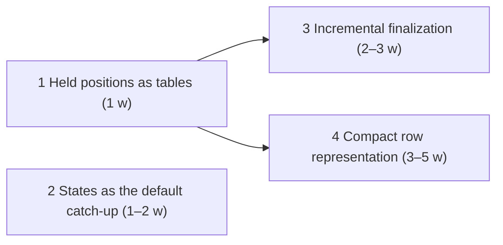

# features_10: sync at the speed of state

Status: specified for implementation (2026-10-22). Every design question
the [review](00-sync-performance-review.md) raised is settled below; the
phase briefs are written to be handed to an agent as they stand. This
roadmap is not yet the accepted one: `AGENTS.md` and the root README still
name [features_09](../features_09/README.md), whose phase 20 is in
progress. Phases here build on features_09's sealed forks and change none
of their security contracts.

## Destination

A device that is far behind receives a state, not a history. A device that
is close behind receives frames whose bytes are the data, not identifiers
around the data. Nothing a device does per received page costs more than
that page. Concretely, on the reference machine and the existing 100,000-row
migration fixture (`rocky-sdk::migrations`):

| Measure | Today | After phase 2 | After phase 4 |
| --- | --- | --- | --- |
| Member stage, 100,000 rows | 233 s | ≤ 120 s | ≤ 60 s |
| Bytes moved for 5 MB of rows | 570 MB | 570 MB as frames, ~135 MB as a state | ≤ 50 MB |
| Member file after sync | 1.0 GB | 1.0 GB | ≤ 200 MB |
| Cost of a maintenance step while a seal waits | every retained header | every retained header | a few rows (phase 1) |
| Finalizing a seal on a 100,000-row scope | two full rebuilds | unchanged | ≤ 1 s (phase 3) |

Phases 1 and 3 remove quadratic and linear-per-seal terms that only show
at scale; their gates are absolute times on fixtures, not fractions of the
member stage.

## Measured baseline

From the member replica of the 100k run on 2026-10-19
([review](00-sync-performance-review.md#measurements)): 5,761 frames with an
average body of 99 KB, 557 MB of frames and 196 MB of stored row records
for 5 MB of application rows. One row costs 3.1 KB on the wire and 1.35 KB
at rest; a stored record is seven 32-byte field commitments, seven stamps
each carrying a 32-byte node key, and a 230-byte signed creation proof.

## Settled

- **States are the default for far-behind peers.** A sender tells a
  requester when its base at a seal is cheaper than the frames it lacks;
  the requester imports it through the existing checkpoint import and
  pulls the tail. The mandatory `behind` signal is unchanged.
- **A migration ends with a seal and a checkpoint.** The issuer that
  finished publishing a migration seals the successor tip, compacts and
  lists the checkpoint. Bundles stay the source of truth for devices that
  hold concurrent writes; the checkpoint is what joiners and far-behind
  members take.
- **Rocky compacts at final seals on its own.** A final seal cannot lose,
  so compacting there is a reaction to finality, not a timer. `compact(keep)`
  stays for seals that are not final. This revises features_09's "called by
  the developer" for compaction only; sealing stays an application call,
  except the migration's closing seal.
- **Readiness and frontiers are maintained, never scanned.** Every write
  that stores, settles, voids, places or releases a position updates
  range tables; seal readiness and tip frontiers read those. The header
  scan survives only in the audit, as the oracle.
- **Finalizing a seal costs the operations it excludes.** Rows a seal
  excludes nothing of are its state already; drops come from indexes;
  only rows the excluded operations touched are rebuilt.
- **Frames carry data, not identifiers.** Fields are named by their
  ordinal in the source tip's schema, stamps carry the author number the
  header already proves, and an ordinary birth's creation statement is
  derived from its frame instead of shipped as a second signed proof.
  Carried rows keep the signed proof. Names remain identities
  ([0067](../decisions/0067-names-are-identities.md)).
- **One current version per format.** Each phase that changes a persisted
  or wire shape moves its version; nothing reads an earlier one
  ([0039](../decisions/0039-single-current-formats.md)).

## Phases

| Phase | Brief | Depends on | Effort | Required result |
| --- | --- | --- | --- | --- |
| 1 | [Held positions as tables](01-held-positions-as-tables.md) | none | about a week | Seal readiness and tip frontiers cost rows, not headers; the audit proves them equal to the scan |
| 2 | [States as the default catch-up](02-states-as-default-catch-up.md) | none | one to two weeks | A member joins a 100,000-row migration by importing the closing seal's checkpoint in ≤ 120 s |
| 3 | [Incremental finalization](03-incremental-finalization.md) | 1 | two to three weeks | Finalizing a seal on a 100,000-row scope with ten excluded operations takes ≤ 1 s and equals the full rebuild |
| 4 | [Compact row representation](04-compact-row-representation.md) | 1 | three to five weeks | A seven-field row costs ≤ 500 B on the wire and ≤ 300 B at rest; the member file of the 100k fixture is ≤ 200 MB |

Order: 1, then 2, then 4, then 3. Phase 2 lands the largest gain with
mostly existing machinery; phase 4 is the largest change and runs as its
own numbered phase with evidence; phase 3 matters once seals are frequent,
which phase 2 makes them. Phases 1 and 2 are independent and may run in
parallel lanes. Effort assumes one lane per phase with the full check suite
as the gate; the two 100k end-to-end runs cost about fifteen minutes per
iteration.

## Decision records

| Record | Phase | Topic |
| --- | --- | --- |
| 0076 | 2 | [States as the default catch-up and automatic compaction at final seals](../decisions/0076-states-as-default-catch-up.md) |
| 0077 | 4 | [Compact row representation](../decisions/0077-compact-row-representation.md) |

Phases 1 and 3 change storage internals under unchanged contracts and need
no record; the lazy compaction guide gains their rationale.

## Open questions

None. The review's questions are answered in the briefs: how a sender
decides a state is cheaper (phase 2, a covered frontier and at least 64
lacking frames), who seals after a migration (the publishing issuer, with
`continue` and the same schema), whether compaction may run without an
application call (yes, at final seals only), how fields are named without
32-byte commitments (source-schema ordinals on the wire, interned ids at
rest), and how a birth proves its origin without a per-row signature (the
frame signature, with the derived statement hashed exactly as the signed
one was).

## Agent execution contract

Give an agent this README and one phase brief. Read root `AGENTS.md`,
[development](../development.md), the [module map](../modules.md),
[lazy compaction](../runtime/lazy-compaction.md),
[encrypted checkpoints](../runtime/encrypted-checkpoints.md) and
[admission evidence](../runtime/admission-evidence.md). Verify the brief's
prerequisites against code before editing; if one fails, repair it within
scope or report the exact blocking contract. Never weaken admission,
durability or atomicity, and never report success for missing behavior.

Each phase keeps the 100k fixture's measurements in its evidence file with
the stage times and the member file's `dbstat` table sizes, so the
destination table above can be checked. Update the owning guides, the
brief's status line and its evidence with each completed slice. Use `jj`,
run `./scripts/lint` and `./scripts/check`, and for Kotlin changes
`sdks/kotlin/gradlew -p sdks/kotlin check` and
`./examples/shoppinglist-app/check`. Report what passed and what was not
verified.
