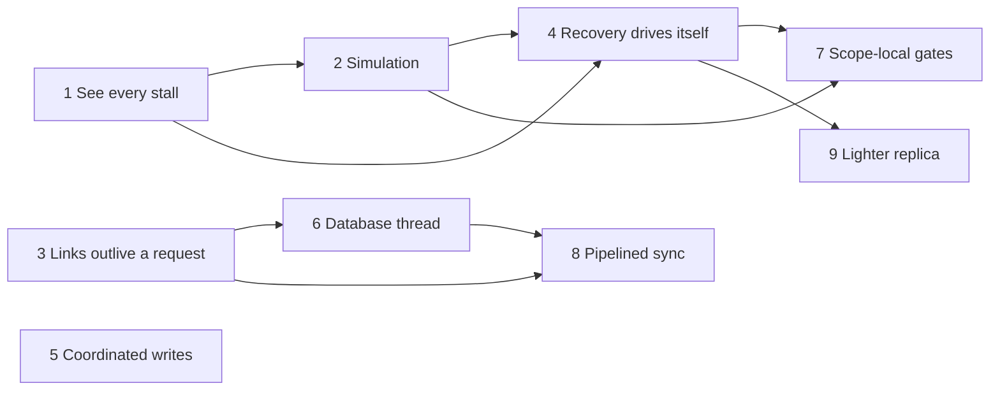

# features_11: sync that keeps going

Status: in progress (2026-10-25). Phase briefs and evidence record implementation
and outstanding qualification gates.
The [review](00-reliability-review.md) records what was read and measured;
the phase briefs below are its response. Sealed-fork security, admission
and atomicity contracts remain unchanged. Source code and tests define
current behavior.

## Destination

A node that can reach a peer able to serve it becomes writable and
converges without a restart, a user action or an unrelated event. When it
cannot, it says why, scope by scope. One request that fails costs that
request, never the link or the other scopes. The database thread never
stops the link from breathing. Then the costs that the device runs exposed
come down.

| Measure | Baseline (2026-10-24) | Target |
| --- | --- | --- |
| Stall without a named blocker | common; diagnosed with probe builds | none (phase 1) |
| Link closed by a late reply or a refused request | repeated on devices | never (phase 3) |
| Simulated seeds that converge after healing | not tested | all, blockers strictly decreasing (phases 2, 4) |
| Full phone writable after joining a sealed household | > 8 h, 11 builds | ≤ 2 min foreground with one reachable trusted peer (phase 4) |
| Coordinated write after a coordinator timeout | aborted, log blocked to deadline | committed on retry, same identity (phase 5) |
| AEAD opens / chain verifications per applied frame | 4–5 / 2+ | 1 / ≤ 1, cached (phase 6) |
| Link heartbeat while the replica finalizes a 100k seal | starved | ≤ 500 ms (phase 6) |
| Writes in a scope while another scope rebootstraps | refused domain-wide | allowed (phase 7) |
| Phone 100k bootstrap | 215.3 s | ≤ 60 s (phases 6, 8) |
| One-row sync, phone ↔ desktop, LAN, p95 | 0.8–9.1 s | ≤ 1 s (phase 8) |
| Empty reconciliation over relay | 10.43 s | ≤ 2 s (phase 8) |
| Member file after a 100k sync | 161.7 MB | ≤ 80 MB (phase 9) |
| Issuer author and publish, 100k rows | 96.7 s, 412.7 MB file | ≤ 70 s, ≤ 300 MB (phase 9) |

Device rows are the isolated three-node load and household runs of
2026-10-24 (two JVM desktops, one Pixel phone). Fixture rows use the 100k
migration fixture in `rocky-sdk::migrations`. A performance phase starts
with a sampled profile recorded in its evidence; a gate the profile shows
is unreachable within the phase's scope is reported with that profile and
never silently relaxed.

## Settled

- **Blockers are data.** Every gate that refuses a read, a write or an
  import derives its answer from one per-scope `Blocker` list, and the
  diagnostic reads the same list, so they cannot drift. Each blocker names
  its scope by short hash, its kind, what will clear it (any permitted
  peer, a specific peer, local work, the application) and since when. A
  refusal carries the whole list. Payloads, keys and credentials never
  appear.
- **Progress is owed while a blocker exists.** A sync that leaves a
  peer-cleared blocker for a scope that peer may serve reports a retry.
  Local recovery runs at open, after tip changes, after a commit that
  touches a blocked scope and on a timer while local work remains, never
  only inside a peer session.
- **Failures are per scope and per request.** The link gains a refusal
  reply. A refused or failed request ends that request; only framing
  violations, quota violations by a live receiver, expired credentials and
  transport loss end a link. The client records a failing scope and
  continues with the rest. A frame that fails for a reason that is not a
  semantic refusal is quarantined with its reason and retried on change;
  it never stops other logs.
- **A timed-out request is retired, not abandoned.** Late data for a
  retired channel generation is discarded and counted.
- **Every response is budgeted in bytes.** Each message family is cut by
  encoded size against `MAX_SECURE_FRAME` with a framing reserve, and an
  item that can never fit is refused when it is authored.
- **The database thread owns storage, not the link.** Link readers and
  writers and channel plumbing run on the transport runtime. Blocking
  fsyncs leave the replica lock and the database thread; replies still
  follow the flush that makes them durable. The single writer and its
  commit order are unchanged.
- **A frame is opened once and its chain verified once.** Decoded payloads
  move through apply; verified chains are cached under their digest and
  the revocation set's digest, so a revocation invalidates them. Current
  grants and time windows are still checked at apply.
- **Gates are scope-local by default.** A gate stays domain-wide only
  where an inventory, written before the change, shows that authoring in
  one scope depends on another scope's verified state.
- **Simulation is a test tier.** A seeded, paused-clock, in-process
  multi-node simulation runs a fixed seed set in the integration tier and
  a wide sweep in e2e. A failing seed prints and reproduces exactly.
- **Rocky emits structured events.** Spans and events use the `tracing`
  crate with fixed fields only. The library installs no subscriber; the
  SDK and native binding offer an opt-in sink that applications such as
  the shopping app write to their diagnostics.
- **The coordinator owns coordinated deadlines.** A device sends a
  duration and retries an append with the same sequence when the
  coordinator is unavailable; only a definite refusal aborts.
- **One current version per format.** Each phase that changes a persisted
  or wire shape moves that format by one at landing (today row 12,
  checkpoint 17, replica 37, link 17); nothing reads an earlier one.

## Phases

| Phase | Brief | Depends on | Effort | Required result |
| --- | --- | --- | --- | --- |
| 1 | [See every stall](01-see-every-stall.md) | none | 1–2 w | Blockers, wait reasons and spans; refusals list every blocker |
| 2 | [Deterministic simulation](02-deterministic-simulation.md) | 1 | 1–2 w | Seeded multi-node runs with faults; mutation check finds reverted device fixes |
| 3 | [Links that outlive a request](03-links-that-outlive-a-request.md) | none | 1–2 w | Retired channels, refusal replies, per-scope isolation, byte budgets, jittered backoff |
| 4 | [Recovery that drives itself](04-recovery-that-drives-itself.md) | 1, 2 | 2–3 w | Retry while blocked, local drivers, quarantine; every seed converges |
| 5 | [Coordinated writes through outages](05-coordinated-writes-through-outages.md) | none | 1 w | Retry on unavailability, coordinator deadlines, lighter polling |
| 6 | [A database thread that never blocks the link](06-database-thread.md) | 3 | 2–3 w | Link off the database thread, fsync off the lock, open and verify once |
| 7 | [Scope-local gates](07-scope-local-gates.md) | 1, 2, 4 | 2 w | Gate inventory; unaffected scopes read and write; checks per domain, cached |
| 8 | [Pipelined sync](08-pipelined-sync.md) | 3, 6 | 2–3 w | Windowed pages, parallel scopes, tip-graph differences, stream per channel |
| 9 | [A lighter replica](09-lighter-replica.md) | 4 | 2–3 w | Base-and-overlay rows, compact keys, fewer statements per row, tuned SQLite |

Order: 1 and 3 first in parallel lanes, with 5 beside them; then 2, then
4. Reliability lands before speed: 6 follows 3, then 7, 8 and 9. Phases 8
and 9 touch different crates and may run in parallel. Phase 7 carries the
most risk and does not start until the simulation from phase 2 passes with
phase 4.

## Open questions

None for the briefs as written. Phases 4 and 7 each begin with an
inventory slice whose output is reviewed before code changes: which
peer-dependent guards need that specific peer (phase 4), and which gates
must stay domain-wide (phase 7).

## Agent execution contract

Give an agent this README, the review and one phase brief. Infer
architecture and ownership from source code, Cargo manifests, module
declarations and tests. Keep modules focused and names clear. Verify
prerequisites against code before editing; repair failures within scope or
report the exact blocking contract. Never weaken admission, durability or
atomicity, and never report success for missing behavior. Do not recreate
removed documentation; keep phase status and evidence in this directory as
`NN-<name>-evidence.md`.

Use `jj`, run `./scripts/lint` and `./scripts/check`, and for Kotlin changes
`sdks/kotlin/gradlew -p sdks/kotlin check` and
`./examples/shoppinglist-app/check`. Phases 3, 4, 6 and 8 also finish with
the three-device check (two desktops and the phone, shopping app and the
isolated 100k load), recorded in evidence with build names and identities;
without devices, report that check as not verified. Report what passed and
what was not verified.
