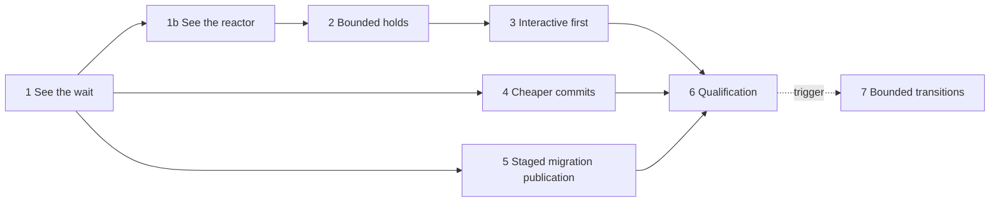

# features_12: writes that never wait

Status: phase 1 complete (2026-10-27); [evidence and qualification limits](01-see-the-wait-evidence.md).
Replanned 2026-10-27 after the [phase 2 inventory](02-bounded-holds-evidence.md#replanning-2026-10-27):
phase 1b added, phase 2 narrowed to steady state, transitions deferred to phase 7.
L1 uses an already writable member, as approved by the owner. Phase briefs record
their own status; evidence goes beside each brief as
`NN-<name>-evidence.md`. Source code and tests define current behavior.

## Destination

A local write commits and becomes visible to observers within one display
frame, whatever steady-state work the replica is doing in the background.
That includes receiving frames and checkpoint pages, settling,
maintenance, pruning and checkpointing the WAL. Transitions that replace
a scope's state wholesale (checkpoint installation, rebootstrap, live
schema switch, compaction and finalization rewrites) don't start while
a write waits. Making them bounded is a [later decision](07-transitions.md). Nothing that features_11 gained for sync gets slower to buy it.
Opening after a 100k-row schema migration stops being dominated by SQLite
spilling one giant transaction.

## Why this shape

features_11 made sync fast and reliable. It didn't measure local writes.
Reading the write path shows where the latency comes from:

- **One lock serializes everything.** A secure SQL transaction takes the
  replica's `Inner` mutex at `BEGIN` and holds it until `COMMIT`
  (`SecureSql::begin`). Receive groups, settle passes, maintenance, WAL
  checkpoints, compaction, finalization and checkpoint transfer take the
  same FIFO mutex. A tap waits behind whatever is queued ahead of it, and
  some background holders are unbounded.
- **One thread serves everything.** `Database` runs every connection,
  link, receive and maintenance task with `spawn_local` on one `LocalSet`
  thread. Holders run synchronous SQLite inline on it. A write that isn't
  polled can't even start waiting for the lock. Phase 1's lock wait
  explains little of a write's latency: Pixel L0 Buffered write p95 is
  359.850 ms, with lock wait 0.009 ms and hold 25.841 ms. Phase 1b
  measures this directly.
- **The write itself is cheap.** Ed25519 and AEAD cost tens of
  microseconds per frame. The archived engine comparison measured about
  4 ms per serial crypto commit at FULL fsync on an M5, and most of that
  was the fsync. The ~83-statement count from phase 9 is for *receiving* a
  frame; authoring has never been counted.
- **Local commit and publication are already separate.**
  `CommitClass::Buffered` commits without a device flush. Observers fire
  after `COMMIT`, before the flush, and nothing leaves the device above
  the durable watermark. The Kotlin binding already connects with
  `Buffered`. The Rust SDK's `Database::transaction` still hard-codes
  `Flushed`.

So the fix is to bound and prioritize the shared critical section and the
reactor thread it runs on, not to add a new local state.

## Goals

| Measure | Baseline | Target | Phase |
| --- | --- | --- | --- |
| Interactive write, idle (p95) | measured in phase 1 | desktop ≤ 3 ms, phone ≤ 10 ms | 1b, 4 |
| Interactive write under background load L1–L4, outside transitions (p95 / p99 / max) | measured in phase 1 | desktop ≤ 16 / 50 / 100 ms; phone ≤ 33 / 100 / 250 ms | 1b, 2, 3 |
| Write time not attributed to a named site (p95) | not measured (phase 1 lock wait misses reactor stalls) | ≤ 1 ms | 1b |
| Observer notification after `commit()` returns (p95) | measured in phase 1 | ≤ 5 ms | 1, 4 |
| Background lock hold and reactor poll, steady state (p99 / max) | unbounded for some holders | desktop ≤ 10 / 50 ms; phone ≤ 25 / 100 ms | 2 |
| Background holders an interactive request waits behind | FIFO, unbounded | at most one bounded step or running transition | 3 |
| Single-row receive, SQL statements | 83 | ≤ 45 | 4 |
| Single-row local author, SQL statements | 87 (phase 1) | ≤ half of the phase 1 count | 4 |
| Issuer 100k migration fill (open running the migration) | 239.6 s (paired, loaded host) | ≤ 70 s; publication to a peer ≤ 110% of paired baseline | 5 |
| Issuer WAL during the 100k migration | grows with the transaction | never above 64 MiB | 5 |

Load scenarios L0–L4, the write probe and the device classes are defined
in [phase 1](01-see-the-wait.md). "Phone" means the physical iPhone 15 and
the Pixel used in features_11. "Desktop" means the release build on the
reference Apple Silicon host.

### Sync must not regress

These hold at the end of every phase that touches the replica. Each is a
paired comparison against the features_12 start commit, on the same host
under the same load. Physical-device rows are checked in phase 6.

| Measure | features_11 result | Allowed after features_12 |
| --- | --- | --- |
| 32-row receive, statements per row | 6.40625 | ≤ 6.5 |
| Desktop receive throughput, 100k fixture member pull | 15.2 s (paired) | ≤ 110% of paired baseline |
| Phone 100k bootstrap, LAN | 16.6 s | ≤ 18.3 s |
| One-row sync phone ↔ desktop, LAN, p95 | 128.6 ms | ≤ 150 ms |
| Empty phone sync | 0.83–1.05 s | ≤ 1.15 s |
| Member file after 100k sync | 65.1 MB (phone) | ≤ 80 MB |
| Issuer file after 100k migration | 125.3 MB | ≤ 300 MB |

## Non-goals

- **Deferred authoring for interactive writes.** No pending overlay, no
  provisional stamps, no "committed but not yet authored" state for
  application transactions. An overlay that SQL can read must be written
  through the same single SQLite writer, so it would remove only
  milliseconds of authoring CPU and none of the lock wait. Its real risks
  are conflicts surfacing after the UI showed a write, and authority
  changing before signing. Those change what a successful write means.
  See "Revisit deferred authoring" below.
- **Optimistic UI inside the SDK.** In-memory state that SQL can't see is
  an application concern.
- **A new storage engine, MVCC or several writer connections.** The engine
  comparison found no advantage for one serial writer per file.
- **Shorter application transactions.** An interactive transaction still
  holds the replica from `BEGIN` to `COMMIT`. `transaction_timeout`
  (default 5 s) remains its only bound.
- **Changes to conflict, merge or admission semantics.** `before` is still
  checked at commit, and the hybrid clock is still decided at authoring.
- **Link or wire changes.** The link format stays at 18. Row and
  checkpoint formats stay unchanged.
- **Chunking arbitrary migration SQL.** A program's statements keep
  running in one SQLite transaction. Only the authoring that follows is
  bounded.
- **Lower-latency publication.** Buffered commits are still sent only
  after the background flush.

## Settled

These resolve the questions raised while planning. Phases don't reopen
them. A phase that finds one unworkable stops and reports the evidence
instead of choosing differently.

- **Interactive writes commit buffered.** `Database::transaction` in the
  Rust SDK uses `Durability::Buffered`, matching the Kotlin binding. A
  caller that needs a flushed commit opens a connection with
  `Durability::Flushed`. A buffered commit survives an application crash
  (WAL at `synchronous=NORMAL`), not power loss. Nothing outside the
  device has seen it until the background flush (`settle_commits`)
  advances the durable watermark. No new SDK API is added.
- **Work bounds, not wall-clock bounds.** Every background critical
  section is bounded by work counts: frames, rows, pages and bytes. Never
  by `Instant` deadlines, so seeded simulation stays deterministic. Phase
  2 measures each separated step's cost per unit on the slowest supported
  phone, and picks each bound so that the phone hold target fits with a
  factor of two of headroom. Bounds are named constants next to the code they bound.
- **Steady state versus transitions.** Steady-state work (receiving,
  settling, maintenance, pruning, WAL checkpoints, checkpoint page
  storage, metadata scans) is bounded in phase 2 without a format change.
  A transition replaces a scope's state wholesale and must look atomic:
  checkpoint installation, rebootstrap replay, live schema switch,
  projection rebuild, compaction and finalization rewrites, and tip
  workspace rebuilding. It keeps its single transaction until
  [phase 7](07-transitions.md), and phase 3 delays its start while
  interactive work waits.
- **One reactor thread stays.** The `LocalSet` reactor is kept.
  CPU-bound work that touches no SQLite connection moves to the existing
  blocking pool where phase 1b measures it above 1 ms. Bounded SQLite
  steps keep the thread responsive.
- **Bounded holds keep one flush.** A receive group that exceeds its bound
  commits as several SQLite transactions and releases the replica between
  them. Its exposed replies still wait for one shared flush that covers
  all of them. Holds get shorter; device flushes don't multiply.
  Atomicity stays per request, as each request's savepoint already gives.
- **Passive checkpoints leave the replica lock.** A passive WAL checkpoint
  runs on a dedicated connection on the blocking pool, without the
  replica or the reactor thread. A truncating checkpoint still needs the writer. It stays under
  the replica lock and keeps its existing 50 ms reader wait.
- **Interactive work goes first.** The replica lock becomes a two-class
  gate. An interactive acquisition (SQL session `BEGIN`, a writing
  autocommit, `author_bundle`, `author_transaction`) registers while it
  waits. A background holder that reaches a step boundary while an
  interactive waiter is registered releases the lock and re-queues behind
  it. To prevent starvation, after 8 consecutive yields a background step
  runs once before the next yield. Interactive acquisitions among
  themselves stay FIFO. A transition starts only when no interactive
  waiter is registered.
- **One acquisition point.** Every replica lock acquisition goes through
  one wrapper that records the call site, the class, wait time and hold
  time. Existing spans and the opt-in tracing sink carry these; no new
  metrics dependency is added.
- **Staged migration publication.** A schema migration runs its program
  inside a savepoint, captures the resulting row writes, rolls the
  savepoint back, and stores the captured writes durably as a staged
  publication input, all in one transaction. Bounded transactions then
  author the staged writes through the ordinary bundle path. Each one
  atomically commits its operations, rows, projection, outbox entries and
  cursor. Frames stay unsent, and the publication is recorded and
  released, only when the last chunk commits. Open doesn't return until
  the publication completes, which is today's behavior. A crash resumes
  from the cursor at the next open. This is commit/authoring separation
  where it is safe: a single issuer, an unreleased tip, no concurrent
  authors and nothing yet visible to the application.
- **Format.** Only phase 5 changes a persisted format: the replica moves
  from 39 to 40 for the staging input. Phase 4 may add an index or a
  cache only if it fits within that same single bump; otherwise phase 4
  changes no persisted shape. Phase 7, if triggered, may change the
  replica format for transitions: within phase 5's bump if they overlap,
  otherwise as one new version. Each format keeps one current version and
  nothing reads an earlier one.

## Revisit deferred authoring

Interactive deferred authoring becomes a candidate brief only if one of
these holds after phase 6:

- The phone L1–L4 p95 gate still misses, and the phase 1b breakdown shows
  the authoring step (not lock wait, reactor delay or flush) as the
  largest share.
- The product decides that writes in a blocked scope (rebootstrap, missing
  key, unwritable tip) must be accepted and published later instead of
  refused.

If it is revisited, build it on the existing held-change and re-authoring
path (`commit_reauthoring`, `held.rs`) as durable local intents, not as
provisional stamps.

## Phases

| Phase | Brief | Depends on | Effort | Required result |
| --- | --- | --- | --- | --- |
| 1 (complete) | [See the wait](01-see-the-wait.md) | none | 1 w | Lock wrapper, write probe, load scenarios, baseline evidence |
| 1b | [See the reactor](01b-see-the-reactor.md) | 1 | 3–5 d | Reactor stalls attributed; interactive path free of background detours |
| 2 (replanned, inventory done) | [Bounded holds](02-bounded-holds.md) | 1b | 2 w | Every steady-state holder bounded; passive checkpoint off the lock and reactor |
| 3 | [Interactive first](03-interactive-first.md) | 2 | 1 w | Two-class gate; interactive writes wait for at most one step; transitions start only when quiet |
| 4 | [Cheaper commits](04-cheaper-commits.md) | 1 | 1–2 w | Buffered Rust default; author and single-row receive statements cut |
| 5 | [Staged migration publication](05-staged-migration-publication.md) | 1 | 2 w | Bounded migration authoring; issuer 100k ≤ 70 s |
| 6 | [Qualification](06-qualification.md) | 1b, 2, 3, 4, 5 | 3–5 d | Device gates, sync non-regression, final evidence, phase 7 trigger evaluated |
| 7 (deferred) | [Bounded transitions](07-transitions.md) | 6 and its trigger | design first | Transitions published in bounded steps; may change the replica format |

Order: phase 1 first and alone, because every bound and target depends
on its numbers. Then three lanes run in parallel:

- phase 1b, then 2, then 3, in the reactor, the replica's locking, group
  and maintenance code
- phase 4, in authoring, receive and the SDK default; its buffered-default
  slice lands first
- phase 5, in SQL publication and SDK schema publication

When two lanes touch the same file, the later one rebases; neither
reverts the other. Phase 6 runs after the lanes. Phase 7 runs only if
phase 6 or a product decision triggers it.

## Agent execution contract

Give an agent this README and one phase brief. Read the
[AGENTS instructions](../../AGENTS.md) first. Infer architecture and
ownership from source code, Cargo manifests, module declarations and
tests. Verify every prerequisite the brief names against code before
editing. If something this README calls settled doesn't match the code,
stop and report the mismatch rather than redesigning.

- Work through the brief's ordered slices. Record each slice's result in
  the phase's evidence file as you go, not at the end.
- Never weaken admission, durability, atomicity or the "publish only
  after the local commit and flush" rule. Never report success for
  missing behavior.
- Assert deterministic properties (work bounds, step counts, statement
  counts, yield behavior, crash resumption) in tests within their tier
  budgets. Timing targets are measurements recorded in evidence, not
  assertions in tiered tests. Measurement tests are `#[ignore]`d and run
  explicitly in release mode, like the 100k migration test.
- Record each measurement with: commit or change id, host, load, build
  profile, command, sample count and p50/p95/p99/max. Pair performance
  claims with the phase-start commit on the same host. If a target is
  shown unreachable within scope, report it with its profile; never
  quietly relax it.
- Use `jj`. Before finishing, run `./scripts/lint` and `./scripts/check`.
  For SDK or binding changes, also run
  `sdks/kotlin/gradlew -p sdks/kotlin check` and
  `./examples/shoppinglist-app/check`. Report what passed and what was
  not verified. Without devices, report device checks as not verified.
- Update the phase brief's status line and this README's phase table
  status when the phase lands.
