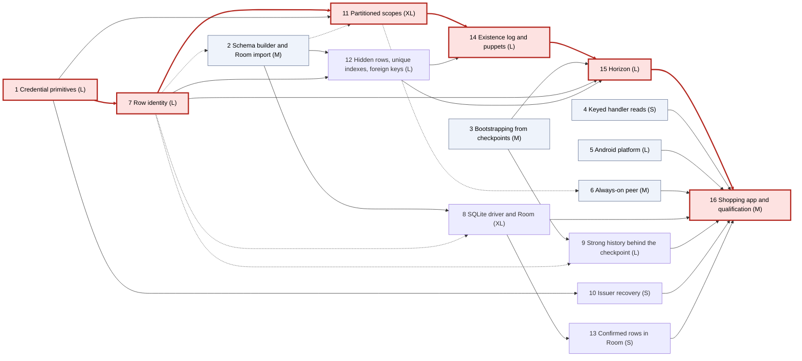

# features_05: a first real application

Status: sequenced on 2026-10-07 from the [agreed scope](agreed-scope.md).
Phase 1's credential primitives are implemented; its final qualification is
recorded in [the brief](01-credential-primitives.md). Phase 2's builder/import
slices are implemented; its implicit columns are qualified under phase 7. Phase 3 is
implemented and verified. Phase 4 is implemented and qualified. Phase 5 is
implemented and qualified on one emulator. Phase 7 is complete: legacy
refusal, all identity bullets and the unfiltered shared gate pass after correcting
driver latency on the P08/P10 rebase. Evidence is linked in [the brief](07-row-identity.md).
Phase 8 is complete, including slice 6's entity rules. Phase 9 is complete:
encrypted strong history is pruned from authenticated bases, with recovery,
bootstrap and bounded reopen qualified in [its brief](09-strong-history-behind-the-checkpoint.md).
Phase 13 is complete: confirmed rows read through Room, including the market
example's stock DAO after its format-2 migration. Phase 14 is complete: foreign keys
cross reader scopes through signed existence logs, with local puppets and
virtual rows ([its brief](14-existence-log-and-puppets.md)). Other phases retain their brief
statuses. Each brief records its own measured status;
implementation status lives in each brief. This is the next-work authority; features_04's
outstanding real-network evidence stays its own item and is not a
prerequisite here. Read the scope first; every brief links its sections instead
of repeating them.

## Destination

Rocky is sufficient for a shopping-list application on Android with per-list
sharing, Room DAOs on Rocky's own file and an always-on peer, and the
foundations carry to an ERP: row identity that survives key reuse, partitioned
read scopes, unique indexes and foreign keys that converge after offline
merges, bounded history and credential primitives an application composes
its own permission model from.

## Phases

Phases are numbered by the earliest wave they can start in. Each wave runs in
parallel; a phase starts when every phase it depends on has passed its
completion gate. Size is a relative budget, not a schedule.

| Phase | Agent brief | Depends on | Size | Required result |
| --- | --- | --- | --- | --- |
| 1 | [Credential primitives](01-credential-primitives.md) | none | L | Raw grants, delegation, executor registration and author pseudonyms through the native ABI and Kotlin |
| 2 | [Schema builder and Room import](02-schema-builder-and-room-import.md) | none; 7 for the implicit columns | M | One Kotlin builder for definition data, filled by hand or from Room's export |
| 3 | [Bootstrapping from checkpoints](03-bootstrapping-from-checkpoints.md) | none | M | Join and catch-up through existing checkpoints; retention policies in the SDK |
| 4 | [Keyed handler reads](04-keyed-handler-reads.md) | none | S | Handlers read by key and bounded scan instead of whole tables |
| 5 | [Android platform](05-android-platform.md) | none | L | Native packaging, lifecycle handling and a Keystore secret store |
| 6 | [Always-on peer](06-always-on-peer.md) | none; 11 for partition grants | M | Packaged custody-only replica and change-driven sync |
| 7 | [Row identity](07-row-identity.md) | 1 | L | `id` and `row_kind` on every table; the `id` as incarnation in frames and checkpoints |
| 8 | [SQLite driver and Room](08-sqlite-driver-and-room.md) | 2; 7 for the entity rules | XL | Room DAOs read and write Rocky's file; one Room transaction is one bundle |
| 9 | [Strong history behind the checkpoint](09-strong-history-behind-the-checkpoint.md) | 3; lands after 7 | L | Results and preparations pruned behind a strong base; bounded reopen audit |
| 10 | [Issuer recovery](10-issuer-recovery.md) | 1 | S | A second issuing device by default in the starter layer |
| 11 | [Partitioned scopes](11-partitioned-scopes.md) | 1, 7; 2 for the builder | XL | Row-level read scopes by partition columns, selectors, key envelopes and checked partial reads |
| 12 | [Hidden rows, unique indexes and foreign keys](12-hidden-rows-unique-indexes-and-foreign-keys.md) | 2, 7 | L | Real constraints in mergeable tables within one scope, converging through hidden rows |
| 13 | [Confirmed rows in Room](13-confirmed-rows-in-room.md) | 8 | S | Command-controlled tables readable through DAOs, refused for writes |
| 14 | [Existence log and puppets](14-existence-log-and-puppets.md) | 11, 12 | L | Foreign keys across scopes on devices that hold the child only |
| 15 | [Horizon](15-horizon.md) | 3, 7, 12, 14 | L | Signed horizon statement; tombstones, hidden rows and orphans finalized at one cut |
| 16 | [Shopping application and qualification](16-shopping-application-and-qualification.md) | all | M | The shopping app on Room DAOs, per-list sharing, Android and an always-on peer, with evidence |

## Dependency graph

Arrows point from a prerequisite to the phase that needs it. The thick red
chain is the critical path: the longest sequence of dependent sizes
(S=1, M=2, L=3, XL=5). Dashed arrows are soft dependencies: the phase can start
without them and takes their result as a late slice.

### Critical path

1 → 7 → 11 → 14 → 15 → 16, weight 19 of 46 total. Every other chain is at
most 10 (2 → 8 → 13 → 16). The critical path is the chain of persisted and
wire formats: pseudonyms in credentials, the `id` in frames and checkpoints,
partition tuples in scopes, the existence log, then the horizon that
finalizes what the others produce. Shortening it means starting the next
format decision record while the previous phase implements, not adding
agents to one phase.

Two overlaps are allowed to pull the critical path in:

- Phase 11's credential slice (partition selectors and key envelopes) only
  needs phase 1. It may start in wave 1 beside phase 7, as long as the frame
  format slice waits for phase 7's gate.
- Phase 14's existence log format may be drafted as a decision record while
  phase 11 implements; its code waits for 11 and 12.

### Waves

| Wave | Phases that can run in parallel |
| --- | --- |
| 0 | 1, 2, 3, 4, 5, 6 |
| 1 | 7, 8, 9, 10 |
| 2 | 11, 12, 13 |
| 3 | 14 |
| 4 | 15 |
| 5 | 16 |

Six agents are useful in wave 0, four in wave 1, three in wave 2. From wave 3
the work is sequential. Phases 4, 5, 6, 8, 9, 10 and 13 have slack; an agent
on them may also prepare the shopping example's DAOs and Android packaging
for phase 16.

## Shared-format hazards

Independent phases that edit the same persisted format must land in a fixed
order, or the second rebases on the first:

| Format | Phases | Order |
| --- | --- | --- |
| Checkpoint statement | 7 (row incarnation), 9 (strong base), 15 (horizon cut) | 7, then 9, then 15 |
| Frame envelope | 7 (`id`), 11 (partition tuple) | 7, then 11 |
| Credential chain | 1 (pseudonyms, raw grants), 11 (selectors, envelopes) | 1, then 11 |
| Schema descriptor | 2 (keys, indexes), 7 (implicit columns), 11 (partitions), 12 (policies, delete actions) | 2, then 7, then 11 and 12 |
| `sdks/native` ABI | 1, 4, 8 | any; small additive surfaces |

Each format change needs a [decision record](../decisions/README.md) with
versioning and an upgrade or refusal path, as the scope's
[list of new formats](agreed-scope.md#new-formats-that-need-decision-records)
records.

## Agent execution contract

Give an agent this README, the [agreed scope](agreed-scope.md) and one linked
phase brief. Read root `AGENTS.md`, [development](../development.md), the
[module map](../modules.md) and the brief's current source and guide inputs.
Verify prerequisites against code and evidence before editing. If a
prerequisite fails, repair it within scope or report the exact blocking
contract; never invent successful behavior or silently weaken admission,
durability or atomicity.

Every product choice is settled in the scope's
[decisions](agreed-scope.md#decisions-of-2026-10-07); do not reopen them.
Internal mechanisms are the agent's call inside the accepted boundary.
Illustrative API shapes in the scope are not implemented APIs. Update owning
guides, the brief's status line and measured evidence with each completed
slice. The [features_04 contract](../features_04/README.md#agent-execution-contract)
on `jj`, checks, deterministic faults and reporting applies unchanged.

## Release gate

Phase 16 must show the shopping application with no Rust source: Room DAOs on
Rocky's file, two phones sharing one list through partition scopes with an
always-on custody peer, a device joining from a checkpoint, a list unlinked
and relinked, and a horizon that drops tombstones on every device. The market
application keeps exercising strong commands with pruned history. Items in
[not in scope](agreed-scope.md#10-not-in-scope) stay out.
