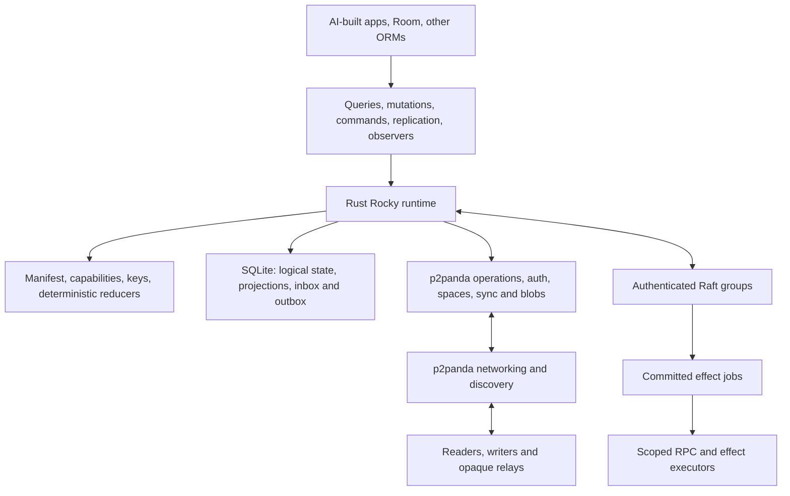

# Rocky DB: revised P2P framework proposal

> Historical proposal. [V4](architecture-proposal-v4.md) supersedes this document
> for future architecture and implementation order. Existing evidence and
> implemented contracts are described in runtime guides and decision records.

Status: architecture and proof-of-concept plan, not an implemented framework or a performance guarantee. Research and small engine checks performed on 2026-10-03. This document is independent of, and leaves unchanged, [the original proposal](architecture-proposal.md).

## 1. Decisions and recommendation

**Use bundled upstream SQLite with WAL for the proof of concept. Build the framework as a Rust runtime around it, using the p2panda stack for P2P operations, transport, synchronization, authorization and encryption. Use Raft for authoritative transactions.**

The recommendation changes the original storage choice, but does not change the central protocol: replicate authenticated, encrypted logical operations and authoritative committed results, then materialize the authorized subset into local SQL tables. Do not replicate database pages, WAL records or arbitrary SQL statements between independent writers.

Raft is now a chosen crash-fault-tolerant trust model. Authority compromise is an incident outside its consensus safety guarantee; accepting that tradeoff avoids adding BFT overhead. Security audits are outside the PoC scope and are not an implementation gate here. The PoC should still demonstrate payload encryption, signature verification, rejection of unauthorized mutations and key rotation because those are requested features.

The main decisions are:

| Area | Revised choice | Consequence |
| --- | --- | --- |
| Local engine | Bundled SQLite, WAL, one managed writer per database file | Simple transactional integration and a clear concurrency limit |
| Canonical data | Versioned logical operations, CRDT metadata and committed authority results | SQL tables are projections; changing engines does not change the wire protocol |
| Mergeable writes | Declared field and aggregate semantics | Offline editing works for qualified operations |
| Non-I-confluent operations | Independent Raft groups per invariant domain | Finality requires that domain's online majority |
| Cryptography | Mesh root signing identity, authority credentials, client credentials; separate data keys | The root is not a symmetric secret shared with every peer |
| Partial replication | Encryption/replication scopes first; richer predicates later | Practical opaque forwarding without promising arbitrary encrypted query evaluation |
| SDK | Rust core, explicit mutation API, SQL reads and observable queries | Room and other ORMs are adapters, not protocol authorities |
| PoC target | Native peers, one ERP example, three authorities, an opaque relay | Demonstrate the difficult semantics before promising every platform and radio |

Turso remains a credible later backend. SQLite is the recommended first implementation because it reduces integration uncertainty, **not because current Turso cannot combine CDC and MVCC**. The check below disproves that blanket claim for the tested release.

## 2. SQLite versus Turso: the actual tradeoff

Here “Turso” means the Rust database engine at [tursodatabase/turso](https://github.com/tursodatabase/turso), not libSQL or a hosted Turso service. “SQLite” means the upstream embedded engine, bundled consistently by the framework.

### CDC and MVCC are compatible in the tested Turso release

In Turso **v0.8.1**, enabling MVCC first and then enabling CDC works. Upstream includes a test named `test_mvcc_mode_supports_cdc_for_client_push` that captures insert, update and delete operations in MVCC mode. [Pinned upstream test](https://github.com/tursodatabase/turso/blob/v0.8.1/core/mvcc/database/tests.rs#L17078-L17125)

This small check was also executed against the v0.8.1 macOS ARM64 CLI:

```sql
PRAGMA journal_mode='mvcc';
PRAGMA capture_data_changes_conn('full,turso_cdc');
CREATE TABLE items(id INTEGER PRIMARY KEY, payload TEXT);
INSERT INTO items VALUES (1, 'alpha');
UPDATE items SET payload='beta' WHERE id=1;
SELECT change_id, change_type, table_name
FROM turso_cdc ORDER BY change_id;
```

It exited successfully and produced captured schema, insert, update and transaction records. Reversing the first two statements failed with:

```text
cannot change journal_mode (from wal to mvcc) while CDC capture is active:
capture would silently stop; disable capture first with
PRAGMA capture_data_changes_conn('off')
```

The current restriction is **changing journal mode while capture is active**, rather than using CDC within an already initialized MVCC database. The pinned implementation makes that distinction explicit. [Journal-mode guard](https://github.com/tursodatabase/turso/blob/v0.8.1/core/vdbe/execute.rs#L19025-L19040)

There is nevertheless a concurrency question worth measuring. Turso's MVCC CDC emitter uses an implicit AUTOINCREMENT sequence, and its sequence implementation documents serialization of inserts sharing a sequence row. That suggests a potential capture bottleneck under concurrent writers; it is a source-based inference, not a measured throughput result. Its emitter also handles change IDs whose allocation order differs from transaction commit order. A consumer must not treat a larger change ID as proof that every earlier transaction has committed. [CDC emitter](https://github.com/tursodatabase/turso/blob/v0.8.1/core/translate/emitter/mod.rs#L1332-L1378), [Sequence implementation](https://github.com/tursodatabase/turso/blob/v0.8.1/core/translate/sequence.rs#L349-L355)

### Comparison for this framework

| Concern | Upstream SQLite | Rust Turso Database |
| --- | --- | --- |
| Reader/writer concurrency | WAL readers retain snapshots while a writer commits; one writer per file | MVCC offers concurrent-writer transactions, subject to conflicts and shared hot spots |
| Capture | Framework-owned outbox; generated triggers or optional hook/session integrations | Framework-owned outbox or engine CDC; current MVCC/CDC initialization order matters |
| p2panda integration | Existing SQLite store implementations are a useful starting point | A separate storage adapter is required |
| Room integration | Uses the actual SQLite engine and familiar SQL behavior | SQLite compatibility still needs qualification for the exact APIs/SQL used |
| Runtime ownership | Stable C interface, with a Rust wrapper | Rust implementation and embedded interfaces fit a Rust core |
| Local write scalability | Partition across files; keep transactions short | Potentially better independent concurrent writes within one file |
| Implementation uncertainty | Mostly in the new framework and adapter transaction boundaries | Also includes the selected pre-1.0 engine's behavior and integration surface |
| Language neutrality | Exposed through Rocky APIs, not direct C handles | Exposed through the same Rocky APIs |

SQLite WAL already provides versioned reader snapshots. Calling it “no MVCC” would obscure the relevant distinction: SQLite permits one writer per database file, whereas Turso's MVCC work targets concurrent writers. [SQLite isolation](https://www.sqlite.org/isolation.html), [SQLite WAL](https://www.sqlite.org/wal.html)

The [p2panda store API](https://docs.rs/p2panda-store/latest/p2panda_store/) provides SQLite implementations and a transaction provider. Reusing it is an advantage, but it does not automatically put application projections, encryption state, operation storage and Rocky's outbox in one transaction. Verify that integration first; extend the store or implement the required traits over a framework-owned connection if necessary.

A Raft state machine applies ordered commands serially within its group anyway. Multi-writer storage does not make those invariant checks parallel. SQLite's limit is therefore reasonable for the first authority implementation. Independent groups can later have independent database files and leaders.

Turso becomes attractive if measurements show a local database writer is the bottleneck and the workload contains independent writes that can actually benefit from MVCC. Compare both engines with the same operation store, indexes, capture strategy, durability, cryptography and observer load. A plain insert benchmark would miss most framework costs. Do not claim either engine is faster before this comparison.

Start with a narrow storage module, not two full backends. Keep canonical serialization and reducers independent of engine-specific SQL. A later engine change should replay operations or import a verified logical snapshot into a new database; it should not mix SQLite and Turso processes against one live file.

## 3. What to borrow from Ditto, and where to improve

Ditto is useful evidence that a polished local-first P2P developer experience is possible. The following comparison uses public documentation; it does not infer the internals of its closed-source implementation. Proposed improvements are Rocky design goals, not claims of an existing faster or more capable product.

| Documented Ditto pattern | Rocky direction | Tradeoff |
| --- | --- | --- |
| Remote subscription queries select what syncs. [Subscriptions](https://docs.ditto.live/sdk/latest/sync/syncing-data) | Separate `replicate()` from local SQL querying | More explicit API, fewer accidental network requests |
| Local query observers react to changes. [Observers](https://docs.ditto.live/sdk/latest/crud/observing-data-changes) | Snapshot plus revisioned local change stream; Kotlin `Flow` adapter | Start with invalidation/requery; incremental result diffs can follow |
| Field deltas and version-vector comparison reduce transfer. [Sync model](https://docs.ditto.live/key-concepts/syncing-data) | Compact signed field operations, frontier comparison, later checkpoints | Signature/history overhead must be controlled; no per-peer permanent copy of every operation |
| Local commit progress can be tracked against peers. [Commit tracking](https://docs.ditto.live/sdk/latest/sync/tracking-local-commits) | Distinguish durable locally, received, applied, authority committed and effect executed | More states, but “synced” does not conceal missing finality |
| Stable subscriptions avoid repeated synchronization work. [Sync handling](https://docs.ditto.live/best-practices/sync-handling) | Persistent named subscriptions and structured temporary handles, with diagnostics | Subscription lifecycle becomes part of SDK design |
| Bounded document aggregates help atomic synchronization. [Data modeling](https://docs.ditto.live/best-practices/data-modeling) | Bounded logical aggregates materialized across SQL tables | Relational joins stay local; distributed atomicity has explicit boundaries |
| Schema-version coexistence supports rolling upgrades. [Schema versioning](https://docs.ditto.live/best-practices/schema-versioning) | Stable entity IDs, versioned operations, deterministic upcasters and a support horizon | Requires a migration protocol rather than only local DDL |
| Local eviction is distinct from shared deletion. [Storage management](https://docs.ditto.live/sdk/latest/sync/device-storage-management) | Separate eviction, tombstones, history compaction and key retirement | Storage reclamation needs custody and catch-up rules |
| Preview raw streams serve transient data. [Data streams](https://docs.ditto.live/sdk/latest/sync/data-streams) | Separate durable data, online control/RPC and ephemeral streams | Presence does not inflate the durable ERP operation history |

One particularly relevant opportunity concerns authenticated forwarding. Ditto's authorization guide documents a read-only forwarding limitation: an intermediary without write permission cannot forward another author's document in the example, and application payload signing is suggested for integrity-sensitive cases. That is a documented scenario, not a claim about every Ditto version or configuration. [Ditto authorization guide](https://docs.ditto.live/sdk/latest/auth-and-authorization/data-authorization)

Rocky should preserve the original author's signature through every hop:

```text
A: authorized writer -> B: opaque relay -> C: authorized reader
     signed encrypted operation unchanged across both transfers
```

C authenticates A's operation and capability chain independently of B. B needs permission to store/forward the scope, not permission to write it or decrypt it. Forwarding must not re-author the operation. This uses p2panda's signed-operation model as a fundamental framework property, rather than an optional application convention.

Ditto documents TLS-based peer channel protection. Channel encryption alone does not establish payload secrecy from a peer that stores or forwards the application data. Rocky's stated requirement is stronger: payload ciphertext remains opaque at unauthorized forwarding peers. This observation is about the required Rocky contract, not a blanket assertion that Ditto offers no other encryption mode. [Ditto certificate security](https://docs.ditto.live/sdk/latest/auth-and-authorization/certificate-based-security)

Avoid copying a proprietary query language. SQLite provides familiar local SQL; the framework manifest supplies sync, policy and merge semantics. Also avoid generic last-writer-wins for every ERP field. Preserve conflicting business edits where resolution matters, and use authority commands where deterministic merging cannot preserve invariants. Ditto's documented conflict patterns are useful design examples, but convergence alone cannot prevent overselling or assign unique invoice numbers. [Conflict patterns](https://docs.ditto.live/best-practices/conflict-resolution-patterns)

## 4. A Rust runtime, not a database extension

The core must own transactions, operation encoding, identity, keys, permissions, reducers, network lifecycle, consensus routing and query observation. A SQLite or Turso extension can expose helper functions or virtual tables later; it cannot supply the whole framework contract.



Use the complete relevant p2panda stack, with clear responsibilities:

| Building block | Responsibility in Rocky |
| --- | --- |
| `p2panda-core` | Signed envelopes, author logs, hashes and causal references |
| `p2panda-net`, discovery | Connections, discovery and topic routing |
| `p2panda-sync`, store | Anti-entropy, durable operation storage and cursors |
| Processing/orderer APIs | Dependency scheduling and replay |
| `p2panda-auth` | Membership and coarse permissions, combined with application conditions |
| `p2panda-spaces`, encryption | Encrypted scope membership and key evolution |
| `p2panda-blobs` | Transfer of encrypted attachments and snapshots |

The [library catalog](https://p2panda.org/#libraries) and [API documentation](https://docs.rs/p2panda/0.7.1/p2panda/) describe these building blocks. Integrated high-level behavior and individual module availability are different: pin compatible versions and explicitly wire policy/encryption into the operation processing path where the high-level API does not yet do so.

Use three traffic planes over the available networking substrate:

1. **Durable data:** signed operations, committed results, encrypted attachments, catch-up and checkpoints.
2. **Online control:** Raft messages, current-policy queries, subscription negotiation and authenticated command/RPC requests.
3. **Ephemeral data:** presence, cursors, telemetry and transient streams. It may be dropped and does not imply a durable business event.

Raft uses an authenticated request/response adapter over the networking substrate. Its uncommitted log entries are not ordinary gossip operations. Gossip distributes committed authority results and, where useful, durable client proposals.

## 5. SQLite ownership, transactions and change capture

### Own the write boundary

One Rust runtime owns each local database lifecycle. Begin with one file per runtime to make the atomicity boundary simple. Use one writer actor, a bounded write queue and separate WAL readers. Do not hold a write transaction while waiting for the network, a remote signer or an external service.

For a local mergeable mutation, one transaction should atomically:

1. Validate the capability and requested fields under the known policy epoch.
2. Assign logical IDs and causal dependencies; allocate the appropriate author-log position.
3. Produce and sign the canonical operation and encrypted payload using the correct key state.
4. Store the operation, CRDT metadata, projection change, updated cryptographic state and durable outbox entry.
5. Advance the local revision and commit.

Publish only after commit. A crash after commit leaves a replayable outbox item; a rollback leaves no visible operation. Never reuse persisted cryptographic counters or message state after a restart. Prefer unique operation hashes/IDs over a universal AUTOINCREMENT counter; still serialize updates to each author's own log cursor.

If the existing p2panda store cannot share this transaction, that is a concrete adapter gap to resolve. Two independently committed SQLite connections are not an atomic transaction simply because both point at the same file.

Incoming operations follow a durable pipeline: receive and deduplicate, verify envelope, resolve required dependencies, decrypt if authorized, validate policy and schema, reduce state, then advance the processing cursor and revision atomically with materialization. Receiving ciphertext is a separate status from successfully applying plaintext.

### CDC is an adapter, not the canonical sync model

The primary API should express operations such as `set_field`, `add_tag` or `post_invoice`. A row changing from 10 to 9 cannot tell a capture engine whether the user meant “assign 9,” “decrement” or “reserve stock.” SQL capture cannot invent those semantics.

For a later managed SQL write bridge, use generated triggers to record supported old/new field changes in a **transactional staging table**. The framework wraps autocommit statements in an explicit transaction and intercepts transaction completion. Before COMMIT, it converts staging records to declared logical operations, validates them and writes the signed outbox in the same transaction. Rollbacks and savepoints must roll back staging as well. A transaction-scoped origin context distinguishes local writes from remote projection application, avoiding capture loops.

SQLite update/commit hooks alone are not durable CDC. Update hooks have documented coverage limits, and a commit-hook callback cannot modify or query the invoking connection as if it were an ordinary transaction callback. Do not publish from a hook or attempt to insert an outbox record after the source transaction has already committed. [Update hook](https://www.sqlite.org/c3ref/update_hook.html), [Commit hook](https://www.sqlite.org/c3ref/commit_hook.html)

Preupdate hooks and the session extension are possible later capture helpers, with build and table restrictions. Session changesets describe relational changes, not authorization or distributed merge intent. Neither is necessary for the first explicit mutation API. [Preupdate hook](https://www.sqlite.org/c3ref/preupdate_blobwrite.html), [Session extension](https://www.sqlite.org/sessionintro.html)

SQLite's authorizer can reject forbidden SQL actions and access to private tables, but is not row-level security. Use it as part of a brokered API alongside restricted schemas and scoped views. Reject direct edits of protocol metadata, arbitrary DDL, ATTACH and configuration-changing pragmas through the app-facing SQL interface. Native code with unrestricted access to the database file and process keys is not isolated by a SQL authorizer. [Authorizer API](https://www.sqlite.org/c3ref/set_authorizer.html)

### Local operating rules

Use short `BEGIN IMMEDIATE` write transactions, prepared statements, indexed scope/entity lookups and bounded batching. Do not enable shared-cache/read-uncommitted behavior. Configure a bounded busy strategy and backpressure rather than endless retries.

Authority durable logs and accepted state require an explicit crash-durability policy, initially SQLite WAL with `synchronous=FULL` for the PoC authority store. Rebuildable caches may later choose a different policy. Returning a successful authority commit before required stable storage is complete would undermine Raft's assumptions.

Long-lived SQL readers can prevent WAL checkpoint progress. Observers should close each result snapshot and requery on a newer revision, rather than keep a read transaction open for the lifetime of a UI screen. Monitor WAL size and checkpoint pressure.

When scaling across files, a transaction in file A no longer atomically commits file B. Use explicit durable inbox/outbox boundaries; do not assume cross-shard atomicity from the original single-file design.

## 6. Logical schemas, SQL and AI-built apps

A language-independent manifest defines stable entity and field IDs, SQL projection names/types, replication scope, encryption scope, permitted mutations, merge types, command schemas, invariants and migration compatibility. AI generates this manifest, queries and UI code; the runtime enforces the declared contract.

| Example data | Contract |
| --- | --- |
| Invoice draft title | Conflict-preserving register or a deliberately selected register policy |
| Draft tags | Observed-remove set |
| Invoice lines | Stable line IDs and explicit add/change/remove operations |
| Posted invoice | Immutable authority result sealing exact accepted content |
| Stock reservation | Raft command in the relevant stock domain |
| Payroll fields | Separate encryption scope and narrower capability |
| Audit event | Authenticated immutable fact; not an excuse to accept arbitrary client claims |

A bounded aggregate can materialize into multiple relational tables. For example, an invoice draft and its lines can share a logical batch and a replication scope without forcing the framework into a document-only local query model. Do not create giant aggregates containing unrelated security or invariant domains.

I-confluence depends on operations, invariants and merge rules together. Default invariant-affecting writes to authority commands until an operation family has been qualified for coordination avoidance. Neither a CRDT label nor an AI-generated analysis is enough to certify arbitrary business logic. [Coordination-avoidance research](https://www.vldb.org/pvldb/vol8/p185-bailis.pdf)

There is a real ORM hazard: a generated full-row `@Update` may write stale fields that the user did not edit. Comparing the submitted row to the latest local row can mistake stale values for intentional changes. Support precise patches, an original field baseline or an explicit revision precondition; do not promise transparent safe replication of every ORM statement. The PoC should use Room for reads and the framework mutation API for writes. Add a constrained write bridge once these semantics are demonstrated.

Arbitrary AI SQL is therefore a local query capability, not an unrestricted replicated write protocol. Commands such as `post_invoice` and `reserve_stock` remain named, validated operations. SQL constraints may validate a projection, but they cannot silently settle a distributed uniqueness conflict by letting each peer keep a different winner.

App-specific reducers and command handlers must be deterministic and versioned. Time, randomness and external observations are explicit recorded inputs. Start with a small trusted Rust handler set; later provide a restricted plugin or WASM execution environment if applications need independently installed logic.

## 7. Raft, authority compromise and horizontal scaling

**Raft is settled for this proposal.** Three voting authorities tolerate one unavailable voter; five tolerate two. A majority must communicate to commit. Use an established Rust implementation such as OpenRaft and implement its authenticated transport, durable storage and snapshot interfaces. This is less implementation risk than inventing a consensus algorithm. [Raft paper](https://raft.github.io/raft.pdf), [OpenRaft docs](https://docs.rs/openraft/latest/openraft/docs/)

The chosen contract assumes authorities execute the protocol correctly. Compromised authority software or credentials can fabricate results, leak authorized plaintext or violate that assumption. Rotation limits subsequent use once learned; it does not undo disclosure or committed damage. This is an accepted limitation, not an unresolved request to choose BFT.

A trusted leader-signed committed receipt is sufficient for the initial client contract under that assumption. Bind it to mesh ID, invariant domain, request ID, result hash, authority configuration epoch and Raft log position. A client cannot independently prove a live majority's internal commit merely from one leader signature. Additional quorum attestations could later strengthen receipts, but are not a mandatory second consensus protocol in this PoC.

The command lifecycle is:

1. Client durably records a signed request with stable request ID, parameters, exact input hashes/revisions and authorization references. Its UI shows pending.
2. The owning group orders the request in its Raft log. Admission checks are provisional.
3. The deterministic state machine evaluates authorization, preconditions and invariants at that committed position. Policy changes and schema activation in that domain share the ordering.
4. Apply or reject deterministically. Store deduplication/result state, changes and any effect job; publish only committed results.
5. Client materializes the result and reports committed or rejected. Repeated submission returns the same result rather than reposting the invoice.

Posting a draft must seal exact accepted content. If a referenced draft operation has not reached the authority, fetch/validate the dependency or reject as not ready. Do not read whichever draft version happens to be present and silently post different content. Later mergeable edits cannot change an already posted invoice.

Adding voters to one group improves availability tolerance, not write throughput. Scale horizontally with **many independent groups and leaders**, for example stock domains or business units whose invariants do not cross boundaries. Eventually give hot groups separate SQLite files and distribute them across machines. Each normal voter holds the complete invariant-relevant state of the group it validates; it may still hold only a small fraction of the overall mesh.

Cross-domain transfers use a declared protocol: initially pending workflows and sagas with explicit outcomes. Arbitrary serializable cross-shard transactions and generalized two-phase commit are outside the first implementation. Partitioning a global invariant without changing its semantics would only conceal the coordination requirement.

Root-certified membership does not replace Raft membership changes. Normal changes use the consensus library's membership protocol. Exceptional recovery after permanent quorum loss requires an explicit root-authorized epoch transition and fencing; clients must reject the old configuration once they learn the new one. An isolated stale peer cannot know instantly that a new epoch exists, so freshness-sensitive operations require contact with current authorities.

## 8. Keys, fine permissions and E2EE

Preserve the three requested authority levels while separating signing keys from encryption keys:

| Key/credential | Function | Compromise or loss |
| --- | --- | --- |
| Mesh root signing key | Sign genesis, authority delegations and exceptional recovery epochs | Loss of every usable copy removes ultimate recovery authority; compromise permits root-level impersonation |
| Authority node signing key | Scoped authority identity, authenticated consensus and results | Rotate/revoke through the root-authorized configuration; misuse is outside CFT safety |
| Client/device signing key | Identify signed requests and limited writes | Revoke its permissions; do not trust its timestamps or claimed business facts |
| Scope encryption state/keys | Encrypt application payloads and attachments for authorized endpoints | Rekey for future secrecy; already learned plaintext cannot be clawed back |

The root private key is kept off ordinary peers; its public identity anchors the mesh. Backups or a future recovery scheme can still represent one logical mesh-root identity. Losing one physical copy is not automatically fatal if another authorized copy exists. Conversely, possessing the root does not reconstruct lost application ciphertext or forgotten data keys. Administrative recovery and data recovery are different properties.

Use p2panda authorization and encrypted spaces for coarse group/scope rights, then application conditions for entity, field, method and transition restrictions. Its coarse permissions are not an arbitrary SQL row-policy engine. Model relay/pull, plaintext read, write and policy management separately at the framework boundary, within the supported p2panda permission hierarchy. A forwarding peer may retain ciphertext without belonging to the decryption group.

Every receiving endpoint checks the original author, delegated scope, policy reference, permitted fields, operation shape, schema generation and causal dependencies before materializing it. Relay authentication is not a substitute for author verification. Limit resource consumption and dependency fanout to keep malformed clients from exhausting a peer.

Read permissions require encryption boundaries. An employee who can decrypt a whole payroll document can inspect all of it regardless of a UI filter. Split confidential fields into separate encrypted subentities/scopes. This creates extra keys, joins and membership work; arbitrary per-row and per-field cryptographic ACLs can be expensive, so group common access patterns where possible.

Authority validators may decrypt the subset needed for their invariants. They are authorized endpoints for that data, even if the same physical machine is an opaque relay for other scopes. An authority that is forbidden to decrypt an invoice cannot validate arbitrary invoice totals using ordinary Raft alone. Payload secrecy from unauthorized intermediaries is compatible with authorized validators; secrecy from all validators would require a materially different design.

Revocation has two explicit contracts:

- **Strong commands and strict writes:** current authoritative policy is checked in the ordered state-machine transition. An offline request remains pending and may be rejected after revocation.
- **Offline mergeable edits:** local acceptance under a cached capability is provisional where policy might have changed. Define a deterministic authorization cut/epoch rule and re-evaluate accepted projections on policy updates. Do not describe cached access as immediate global revocation.

For the PoC, privileged policy changes are authority-ordered. High-sensitivity writes use the strong path. Historical offline edits need a documented acceptance window or an epoch-based reject rule; author-supplied wall-clock timestamps cannot prove they preceded revocation. Rekeying protects future messages once membership changes propagate, not already decrypted history or every isolated stale writer immediately.

Application payloads and attachments are encrypted before relay storage. Routing topics, sizes, timing and some authentication metadata can remain observable. The PoC's local authorized SQLite projection may be plaintext on developer devices; upstream SQLite does not supply built-in database encryption. Optional encrypted local storage is a separate later integration, not a condition for demonstrating E2EE between endpoints.

## 9. Shards, subscriptions and encrypted routing

Define four different units instead of calling every boundary a shard:

- **Replication scope:** which authenticated operations are transferred together.
- **Encryption scope:** who can decrypt a set of payloads.
- **Invariant domain:** which state must be evaluated by one authoritative group.
- **Storage partition:** which local database file or blob store holds the data.

Align them where convenient, but do not require every ACL update to move an authority group or every storage split to change entity identity. Use scope-specific author logs and dependency references so subscribing to one scope does not require downloading an author's unrelated private history.

Begin with explicit scopes such as `tenant/site/invoice-drafts` and an entity-ID selection within authorized scopes. Local SQL can express richer filters over the cached subset. A query observer only sees what is present locally; it does not discover all matching rows somewhere in the mesh.

An opaque relay cannot evaluate `WHERE total > 1000` over encrypted totals. Practical options are coarse opaque topics followed by local filtering, authorized peers performing selective queries, or deliberately exposed routing metadata. The first is the PoC default. The second needs source-completeness/freshness semantics. The third trades metadata privacy for selectivity. Do not promise arbitrary confidential SQL predicate routing without additional machinery.

Dynamic subscriptions need entering/leaving-set handling, deletion notifications and dependency closure. Unsubscribing or a record leaving a filter is not a business deletion. After receiving a scope frontier, fetch the necessary visible dependencies before publishing causally dependent state. Cross-scope dependencies must not force disclosure of data the subscriber cannot read; use suitable references, authorized summaries or redesigned aggregates.

For encrypted blobs, authorize decryption separately from transfer, encrypt before content-addressing the transferred object, and verify hashes/manifests. Fetch attachments on demand. Sharing a key lets a peer read any ciphertext available under it, even when a query subscription did not request that ciphertext.

Expose completeness honestly: “applied through frontier F from these sources” or “authority snapshot at index I,” rather than “all mesh data synchronized.” An unknown offline peer might have unpublished edits. A future strong read uses the relevant authority's read-index/current-state mechanism; a follower's local SQL read is otherwise a potentially stale snapshot.

Raft replication covers consensus voters, while p2panda replication serves clients, relays and non-voting copies. These are different placement and acknowledgment contracts. A storage-only peer does not acquire authority simply by holding a full encrypted copy.

## 10. Migration generations and old offline peers

Do not use a single generation number for every kind of change. Track at least protocol version, logical operation schema, local projection schema, policy epoch, encryption epoch and authority configuration. They evolve for different reasons.

Stable business identity should survive a schema change. For example, invoice `I-42` remains the same entity when a field is split; source operation generation tells the reducer how to interpret the old representation. SQL column names are projection details.

Use this migration sequence:

1. Publish a signed manifest containing stable IDs, supported operation versions, deterministic transforms and handler hashes. Authorities approve the relevant domain generation.
2. Ship readers/reducers that understand the new form before enabling new writers. Additive fields can default; nontrivial transformations need explicit rules.
3. Rebuild or migrate the local projection in a shadow schema, validate it against canonical state, then atomically switch. A large background rebuild should use a checkpoint plus catch-up, not hold one enormous transaction.
4. Activate new strong-command schemas at an authority-ordered cut. Commands after the cut are evaluated under the new handler generation.
5. Upcast supported old operations deterministically. Preserve their signatures over the original bytes; derived normalized representations do not pretend to be newly signed by the original author.
6. Establish a support horizon. Devices beyond it bootstrap from an authorized checkpoint and reconcile pending edits explicitly. Do not wait forever for every offline or abandoned device.

Not every migration admits a lossless upcast. Splitting one free-text address into structured fields can require user input; changing an accounting invariant can invalidate a pending command. Keep the old pending input and report migration-required/rejected status. Do not silently discard it or reinterpret it into a materially different business action.

Snapshots need scope, schema version, reducer version, key epoch, included operation frontier and authority checkpoint bindings. Validate or trust their signer under an explicit credential. Preserve enough authorization/dependency evidence to verify subsequent operations. Compaction cannot leave a new device unable to authenticate history.

Ditto's documented versioned-document coexistence is a useful rolling-upgrade pattern, but attaching schema version to every business ID can complicate joins and reconciliation. Rocky should retain stable logical identity and put versioning in envelopes and projections. This is a framework design choice; it requires more reducer discipline than merely creating a new collection.

## 11. Practical SDKs, realtime updates and Room

Expose a small language-neutral runtime contract rather than a Rust connection object:

```text
open(manifest, identity, storage_config)
replicate(scope_selector, lifecycle) -> subscription_handle
query(sql, bindings, read_options) -> rows + local_revision
observe(sql, bindings) -> snapshots/changes + local_revision
mutate(entity_id, field_patch, baseline) -> operation_id + local_commit_id
command(domain, method, args, request_id) -> request_handle
track(handle, desired_status) -> progress stream
evict(scope_selector, custody_options) -> result
close()
```

Names are illustrative. A replication subscription controls remote data acquisition; `observe()` controls local UI updates. Persistent subscriptions survive UI screens, while temporary subscriptions use explicit structured lifetimes. Persistent handles should not accidentally disappear because a screen is destroyed.

The first observer implementation invalidates relevant tables/scopes after committed revisions and reruns indexed queries. Coalesce bursts and send bounded snapshots or diffs. Later add finer incremental query evaluation if profiling justifies it. Subscribe-and-snapshot must avoid the gap between registering interest and reading the initial state: capture a revision, register against it, and replay/coalesce later invalidations. Slow consumers may receive a reset-to-latest snapshot rather than an unbounded event queue.

Local commit IDs are UI/bookkeeping values, not globally ordered mesh IDs. A progress API should identify both target and evidence:

| State | Meaning |
| --- | --- |
| Local durable | Stored under the configured local crash-durability policy |
| Peer received | A named peer persisted the encrypted operation |
| Peer applied | An authorized peer validated and materialized it |
| Authority committed | The relevant group finalized a command result |
| Effect completed | A named executor reports the job's external outcome |

A per-scope author frontier or explicit operation acknowledgment is needed for transfer progress. One maximum local commit number is not proof that a peer received all commits when it subscribes to only some scopes. Ciphertext custody can be useful without decryption/application.

Use UniFFI for supported foreign interfaces, a C-compatible ABI where needed, and an official Kotlin SDK that wraps handles into suspend functions and `Flow`. Standard UniFFI Kotlin generation and Kotlin/Native coverage are different integration tasks; Gobley is a candidate for Native binding generation. Web/WASM needs its own storage, transport and binding qualification. Do not equate “Rust compiles” with all KMP targets being supported. [UniFFI bindings](https://github.com/mozilla/uniffi-rs#third-party-foreign-language-bindings), [Gobley](https://github.com/gobley/gobley)

Room should be an optional adapter over managed SQLite reads. A custom SQLite driver/connection wrapper must coordinate with the Rust runtime and use a consistent bundled engine; do not pass SQLite handles between unrelated native SQLite library copies. A second independent Room writer bypassing the mutation boundary would break capture and permissions. Build a read-first Room adapter, then a carefully restricted write bridge. Room migrations must not independently own the framework schema. [Room KMP guidance](https://developer.android.com/kotlin/multiplatform/room)

Room's invalidation machinery does not automatically provide the required contract for every externally applied Rust write. Wire committed table changes into the selected driver's invalidation path or use the official SDK's observable queries and map them to Kotlin models. Prove this on actual target platforms. [Room InvalidationTracker](https://developer.android.com/reference/androidx/room/InvalidationTracker)

Generated Room DAOs require build-time knowledge of schemas. Runtime AI-created tables and queries need a dynamic query API or generated models compiled with the app; they cannot instantly become compiled DAOs. Other ORMs and languages consume the same protocol-neutral SDK contract, with their own convenient model adapters.

## 12. Authenticated RPC and external effects

Separate a remote read/service call from a durable business effect.

An ordinary authenticated RPC binds mesh ID, target service/method, arguments, request ID, caller identity, policy epoch and replay protection. The server checks method-level capabilities independently of transport identity. Responses are authenticated and correlated. Sensitive arguments use endpoint encryption where relay secrecy is required. Online calls have timeout/cancellation semantics and are not promised to work offline.

For “send this invoice by email,” the authority first commits a job referencing the sealed invoice, recipient and stable idempotency key. A capable worker receives only the data and credentials it needs. The worker records attempts and outcome; another worker may retry after failure using the same job identity.

Use provider idempotency when supported. Ordinary SMTP cannot guarantee exactly one externally delivered email across a crash after sending but before recording success. State the delivery contract, usually retryable at-least-once with deduplication where possible. Consensus can serialize job creation; it cannot make an arbitrary external service transactional.

Do not hold a Raft transition or SQLite write lock while sending mail. Treat worker results as authenticated observations submitted back into the appropriate state machine. Presence and transient raw streams use the ephemeral plane; they do not require appending every packet to an immutable business log.

## 13. Deletion, eviction, compaction and recovery

Four operations have distinct meanings:

- **Business deletion:** a permitted logical tombstone or command outcome propagated to replicas.
- **Local eviction:** remove cached projections/blobs while preserving required processing and pending-write state.
- **History compaction:** replace old replay material with a verified checkpoint and sufficient frontier/dependency evidence.
- **Key retirement:** stop distributing old secrets; it does not erase secrets already copied elsewhere.

Pin unsent operations, pending commands, outbox items and required authorization/dependency evidence. Before deleting the sole durable copy, obtain custody acknowledgments from the configured number of storage peers or authorities. A successfully applied local projection is not a backup.

An old replica must not resurrect a deleted entity simply because a tombstone was removed locally. Retain suitable version/tombstone summaries, or require peers older than the compaction horizon to rebootstrap. Efficient selective catch-up after eviction is a goal to verify, not an automatic consequence of append-only logs.

Raft snapshots recover authoritative state. Encrypted data checkpoints recover scoped application state. Key backups and the mesh root recover different kinds of access/control. If every copy of a needed ciphertext or decryption secret is lost, the root signing key cannot regenerate the application data.

No-cloud is feasible with user-controlled authorities, replicas and optional relay/rendezvous nodes. Internet P2P connectivity may still require reachable discovery or relay infrastructure; it can be self-hosted. A LAN deployment can work without a cloud service. Mobile background suspension, NAT and browser transport limits remain real availability constraints.

Ditto documents native transport options beyond ordinary Internet connections, while its browser SDK has a more limited connectivity path. That is inspiration for transport work, not evidence that p2panda currently provides the same BLE/AWDL capabilities. Start with the available native network/LAN path; BLE and comparable radios are separate adapters and milestones. [Ditto mesh networking](https://docs.ditto.live/key-concepts/mesh-networking)

## 14. Contradictions and accepted limits

| Demand combination | Resolution in this proposal |
| --- | --- |
| Fully P2P plus privileged authorities | Peer-operated transport/storage with explicitly delegated decision authority; peers do not all have equal rights |
| Offline-first plus invariant-safe transactions | Offline drafts and queued proposals; final non-I-confluent decisions require a majority |
| Immediate revocation plus indefinitely offline access | Strong operations check current policy; cached reads and provisional offline edits have limited freshness guarantees |
| Opaque intermediaries plus validation | Relays remain opaque; authorized validators see the data necessary for their domain |
| Every authority is a partial replica | Partial across the mesh; complete invariant-relevant state within each group it votes in |
| Arbitrary SQL/ORM writes plus safe merge semantics | Managed write subset and explicit commands/patches; arbitrary local reads remain possible |
| Fine-grained confidential permissions plus encrypted predicate routing | Encryption scopes and coarse routing first; richer selectivity has privacy/completeness costs |
| Raft plus safety after malicious authority compromise | Compromise is outside the chosen CFT guarantee; rotation and incident recovery remain supported |
| One mesh key plus recovery from losing every root copy | Impossible without another recovery authority/backup; accept permanent administrative loss or add a declared recovery scheme |
| High performance plus unlimited history, tiny devices and frequent subscription churn | Bounded subscriptions, checkpoints, retention policy, custody and measured resource budgets |
| All Kotlin/KMP platforms plus one automatic UniFFI path | Multiple binding/driver/transport integrations under one official SDK contract |

These limits should be part of app-visible behavior, especially pending command status, stale snapshots, conflict handling and rejected offline edits. They do not prevent a useful PoC or an eventual scalable framework, but they prevent misleading guarantees.

## 15. PoC sequence and evidence

Build a narrow but complete vertical slice before generalizing every interface.

1. **Transactional runtime:** bundled SQLite, manifest, explicit mutations, operation store, durable outbox and revisioned local observers. Confirm the p2panda-store transaction boundary. Add a minimal schema generation and reducer replay path.
2. **Signed encrypted mesh:** two clients plus a store-and-forward peer with no plaintext keys. Use p2panda operations, sync, authorization, spaces/encryption and encrypted blobs. Demonstrate A -> relay -> B with relay unable to decrypt or forge A's data.
3. **ERP consistency:** three Raft authorities, invoice drafts, immutable posting, stock reservation and request deduplication. Authorities can each host only assigned domains. Lose a leader, restart it and reconcile offline proposals.
4. **Partial replication and policy:** separate invoice/payroll scopes, named subscriptions, ciphertext versus applied acknowledgments, authority-ordered revocation and future-key rotation. Show the exact offline rejection rule rather than claim instant revocation.
5. **Rolling schema upgrade:** change a draft field across two operation versions, migrate a projection, reconnect an old client and preserve or reject its pending input explicitly. Exercise a supported checkpoint/bootstrap path.
6. **Official consumption:** Kotlin observable queries first, then a Room read adapter on Android and one Native target. Implement one authenticated service and one durable mock-email job with retry/deduplication behavior.
7. **Measure and decide:** assess representative throughput, p95 latency, bytes per operation, catch-up time, WAL/checkpoint growth and memory. Consider Turso only if a measured storage bottleneck warrants another backend.

Success scenarios should include reordered and duplicated deliveries, rollback, restart between commit and publication, stale entity updates, denied fields, offline command submission, authority majority loss, a mutable subscription record leaving its scope, and a reader reconnecting after checkpoint compaction. These are behavior checks of the framework's hard requirements, not a security-audit workstream.

The following limited engine checks have already been performed for this revision:

| Check | Result | What it does not establish |
| --- | --- | --- |
| Turso v0.8.1: enable MVCC, then CDC; insert and update | Captured changes and transaction records successfully | Throughput, multiwriter fairness, rollback/crash correctness or the complete Rocky integration |
| Turso v0.8.1: enable CDC, then switch WAL to MVCC | Rejected with the active-capture journal-mode error | Blanket CDC/MVCC incompatibility |
| SQLite 3.53.4: rollback an insert with a capture trigger | Both application row and trigger capture disappeared | Complete managed SQL bridge coverage |
| SQLite WAL: reader open while a writer commits | Reader kept its previous snapshot; a new read saw the committed row/capture | Distributed snapshot consistency |
| SQLite: two competing `BEGIN IMMEDIATE` writers | Second writer received the expected lock failure | An application throughput benchmark |

The SQLite checks used temporary databases and multiple connections. They were removed afterward. The Turso checks used the release CLI. No comparative throughput benchmark or implemented Rocky prototype is claimed by this document.

The remaining near-term design choices are the exact manifest/operation format, the initial encryption-scope layout, the p2panda/SQLite shared transaction adapter, the provisional offline authorization rule, and the first Room/Native target pair. Raft selection and deferring security audits are already settled for this PoC.
