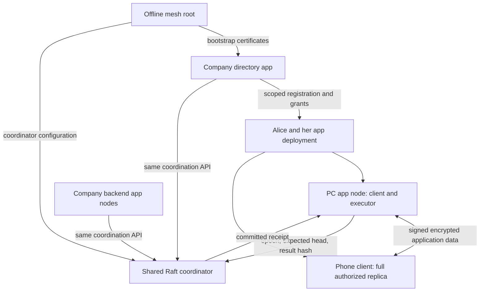

# Rocky DB: application-owned schemas and shared commit coordination

> Historical proposal. [V4](architecture-proposal-v4.md) supersedes this document
> for future architecture and implementation order. Existing evidence and
> implemented contracts are described in runtime guides and decision records.

Status: architecture and proof-of-concept proposal, not an implemented framework or a performance guarantee. Written on 2026-10-03. This revision incorporates the application/authority discussion and the [engine decision](../../benchmarks/engine-comparison/DECISION.md). It leaves [v2](architecture-proposal-v2.md) and the [original proposal](architecture-proposal.md) unchanged.

Note 2026-10-04: the Turso MVCC engine choice below is superseded by [design rationale](../runtime/write-concurrency.md#engine): the runtime uses SQLite in WAL mode with one writer per file and cross-domain group commit.

## 1. Decisions

**Build a Rust runtime around Turso MVCC for concurrent independent local mutations, using an explicit logical-operation/outbox path. Give each app one versioned schema namespace. Run application logic on app nodes, and let a shared Raft-backed coordinator confirm leadership and strong commit metadata without running those applications.**

Most qualified operations remain local-first and mergeable. For non-I-confluent operations, the application provides the business decision or resolution; the framework provides an exclusive execution role and an ordered commit confirmation. A company can provide that coordination to Alice without receiving her executable, handlers or business payloads.

| Area | V3 decision | Consequence |
| --- | --- | --- |
| App model | One app = one executable/application definition and one logical schema namespace | A schema can contain many tables, versions and data domains |
| Deployment | An app node is a running copy with its own credentials and assigned domains | Laptop, work PC, mobile service and Kubernetes pod use the same model |
| Schema management | Scoped schema publishers issue signed manifests | Publishers may go offline after publication; no central schema registry is required for validation |
| Permissions | Users and app deployments are principals with bounded, signed delegation | Registration does not grant access to another app's data |
| Read/write granularity | Whole-row read permissions (RLS); row-plus-field write permissions (RLS + CLS) | Columns with different readers belong in separate encrypted 1:1 tables |
| Mergeable changes | Application-declared operations and merge rules qualified against their invariants | No coordinator round trip on the ordinary local mutation path |
| Strong changes | One authorized app executor per domain; coordinator confirms each strong commit | Alice needs only one running application node, not three application voters |
| Coordinator | Shared Raft service storing leadership, versions, hashes and bounded deduplication metadata | It orders decisions but does not check application business correctness or back up payloads |
| Recovery | Full client replicas can supply state to a replacement app node | A full subscription is not proof that the newest commit reached that replica |
| Engine | Turso MVCC plus explicit operations for concurrent one-file work | SQLite WAL remains appropriate for serial or partitioned writers; full MVCC CDC is not the default |
| Trust | Crash-fault-tolerant coordination; authorized app executors are trusted within their scope | No BFT guarantee and no automatic correctness proof for unaudited app code |

Turso here means the Rust database engine tested in the repository, not libSQL or a hosted database service. Its selection does not introduce a cloud dependency.

## 2. The basic moving parts

There are four everyday concepts. Other distinctions below describe implementation boundaries, not additional deployment products.

| Concept | What it is | Example |
| --- | --- | --- |
| Principal | A signing identity to which permissions can be delegated | Alice, an organization, Alice's webhook deployment, one PC node |
| App | An executable/application definition with one stable schema namespace, manifest and handlers | Directory, Accounting, Alice's webhook app |
| Domain | A bounded partition of an app's data and invariants | Alice's private webhook data or one accounting business unit |
| Grant | A signed, scoped capability with explicit delegation limits | Read invoice events, update one field, execute commands in domain D |

An **app node** is simply a running copy of the app. It can perform several roles: replicate data, execute commands, serve queries, publish a schema if authorized, or run external effects. “Worker” is a role, not another managed entity.

Different deployments of the same app share its schema namespace but have separate domain IDs, owners and credentials. A deployment ID can label ownership and registration records; it does not require a separate installation service or worker hierarchy. Alice's PC and laptop may be two nodes of the same deployment. A phone client can be a full authorized replica without being an executor.

The minimum deployment consists of:

1. **Rocky runtime in clients and app nodes:** local storage, operations, permissions, encryption, synchronization and observable queries.
2. **Shared coordinator:** generic Raft-backed leadership and strong-commit metadata. A company commonly runs three coordinator voters for availability. Alice does not run three app voters.
3. **Directory app:** consumer-defined user/app registration and administration. Its own executable runs on company-operated app nodes and uses the same coordination contract.

Schema publication is a permission on a principal. It is not a mandatory always-online server. Opaque relays and discovery nodes are optional infrastructure; storing ciphertext does not confer decision authority.



The company may run the directory and coordinator in one operational deployment. Their contracts remain separate: directory handlers implement administrative policy; coordinator handlers only implement fixed framework coordination rules. No Alice-specific code is loaded into either.

## 3. Applications own schemas and business meaning

An app's signed, language-independent manifest defines stable entity/field IDs, local SQL projection names/types, domain rules, replication/encryption scopes, row-level read rules, row/field-level write rules, operation versions, permitted mutation shapes, merge types, command interfaces and migration compatibility. It identifies the handler versions needed for execution and recovery. Consumer-defined policies choose the rules; the read/write granularity below is the framework contract.

“One app = one schema” means one owned logical namespace, not one SQL table, one database file or one global serialization queue. A manifest can contain a webhook-settings table, event history, command results and effect jobs. Many domains instantiate that schema. Local SQL can join permitted cached data from several apps without transferring ownership of their schemas.

Schema publishers have explicit `publish_schema` grants. Initial publication and version updates are signed; peers retain the manifest and delegation evidence. The publisher may then go offline. Existing grants remain valid without contacting their issuer unless an explicit expiry or learned revocation says otherwise. The directory may index registered manifests for discovery, but it neither owns every schema nor decides every schema update.

Use stable publisher-bound app IDs and immutable manifest hashes rather than requiring a globally coordinated human-readable schema name. A manifest describes a contract; receiving it does not automatically install or execute arbitrary publisher code. Clients must support the declared operation/reducer versions or report an unsupported schema. Custom handler code is installed only on the nodes that choose to run that app.

Applications supply business transitions, conflict handling and resolution. Rocky cannot infer “reserve stock” from a row decrement, decide an accounting conflict, or certify an AI-generated operation as I-confluent.

| Application operation | Execution contract |
| --- | --- |
| Qualified independent edits, tags and drafts | Local signed operations with deterministic merge rules |
| Post an invoice, allocate a constrained number, reserve stock | Application command against an exact state/input cut, followed by coordinator confirmation |
| Resolve an ambiguous business conflict | Application-defined command, possibly proposed by a user or AI |
| Send a webhook or email | Durable effect job, executed outside the state transition |

I-confluence is a property of the operation family, merge rules and invariants together. Default invariant-affecting operations to strong commands until qualified. A mergeable write must remain safe when combined with strong transitions; otherwise restrict that field to the strong path or seal an immutable input version. A generic CRDT label is insufficient.

Handlers and reducers are versioned and deterministic. Time, randomness, human choices, AI outputs and external observations become recorded inputs. An app executor may consult an AI before proposing a resolution, but recovery must replay the recorded result rather than ask an AI to independently decide again. Pin the schema and handler generation used by each strong transition.

## 4. Bootstrap and permission distribution

### Root-certified bootstrap

The mesh root is a signing identity, not a symmetric secret copied to peers. Its public identity anchors certificate chains. Genesis binds the mesh ID, initial coordinator membership/configuration, directory schema and bootstrap domain, and delegated administrative credentials.

The root certifies the directory's deployment and initial node identities with bounded powers to register users/apps, administer declared organization scopes and delegate specified rights. A bootstrap directory executor is authorized against the genesis domain head. This avoids requiring an already-running directory to authorize itself.

The directory starts as an ordinary application with those special initial grants. Its handlers define organization policy. The root can remain offline afterward; exceptional recovery and root-level delegation still require a root copy or a declared recovery authority.

### Registration and grants

Each app deployment and each node has a separate identity. Correct credentials make an executable runnable anywhere, but copying one private signing key to every pod or device is not the identity model. Delegate scoped node credentials and distribute data keys separately.

```text
Root
  -> Directory: register/manage declared organization principals and domains
      -> Alice: create and administer her own app deployments
          -> Alice's webhook deployment: control its own data domains
              -> PC node: execute commands and replicate those domains
              -> Phone node: read/replicate those domains

Accounting's authorized grant issuer
  -> Alice's webhook deployment: read selected invoice events,
                                update the permitted checkbox
```

The final grant must come from a principal allowed to delegate Accounting access. App registration supplies an identity and ownership record, not permission to every other app. Alice can only delegate Accounting rights to her nodes if that grant permits further delegation.

A grant binds issuer, subject, mesh/app/domain/table scope, authorized rows or row selector, actions, permitted write fields/methods where applicable, delegation limits, policy reference and optional expiry. Distinguish relay/custody, whole-row plaintext read, insert, field update, delete, invoke command, execute domain, publish schema, issue grants and administer ownership. Table scope alone does not implicitly authorize every row or mutation. Private data is encrypted for authorized readers; a signature alone does not prevent reading.

### Whole-row reads; row-plus-field writes

V3 adopts **RLS for reads and RLS + CLS for writes**. RLS means row-level security. CLS here means the fields/cells a principal may change on an authorized row; it does not introduce per-cell read permissions.

| Access | Authorization unit | Enforcement |
| --- | --- | --- |
| Read | A complete row | Authorize the row and its decryption scope; every column in that row is readable |
| Update | An authorized row and explicitly permitted fields on that row | Check the precise patch and the resulting row before accepting it |
| Insert | Explicit insert permission for the destination row scope and supplied fields | Validate the new row, required/defaulted fields and policy constraints |
| Delete | Explicit delete permission for the target row | Field-update permission does not authorize deletion |

For confidential columns with different readers, create a separate **1:1 companion table** in the same app schema, linked by the same stable entity ID. For example, `employees(id, display_name)` can be readable organization-wide while `employee_private(id, salary, bank_account)` is restricted to authorized payroll readers. Split further if salary and bank-account readers differ. Group fields by common read permissions instead of creating per-cell encryption policies.

The companion table has independent row-read grants and encryption membership. SQL separation alone is insufficient: a peer must not have keys that decrypt rows it is forbidden to read. Group rows with the same authorized readers into encryption scopes where practical; a shared table key cannot enforce different row readers if it exposes all their ciphertext. Read rules therefore govern authorized decryption and materialization, not merely query filtering or subscription interest.

For a direct update, each changed `(row ID, field ID)` must be covered by an applicable write grant. Combining grants must preserve their row/field pairing; permission for one row must not be combined with an unrelated grant's field list to create broader rights. Reject a patch containing any unauthorized field rather than silently applying a subset. Read and write grants are independent; neither implies the other.

Validate the existing target and the resulting row against applicable write rules. Changes to ownership, tenant, ACL or other permission-controlling fields need explicit rights and a strong transition whenever concurrent/offline edits could undermine authorization. Inserts and deletes are separate actions, and generated changes or cascades cannot bypass the affected resources' permissions. A command grant may authorize an owning app's declared transition through its handler; invoking an arbitrary method is not unrestricted row-write permission.

Use precise patches rather than unrestricted full-row replacement. Apply the admission rules at local mutation, incoming replication and managed SQL-write boundaries; command handlers check the original caller and their authorized effects. A coordinator receipt does not waive these checks. The coordinator continues to handle generic metadata only and does not acquire a row-policy engine or application payloads.

The 1:1 split adds joins, separate synchronization/deletion handling and migration work. Hidden, not-yet-replicated or evicted companion rows must not be treated as business deletion. Readers can join only the tables/rows available to them, with completeness reported explicitly. Cross-scope updates are atomic only where a declared logical batch and authorized dependency closure support that guarantee; the 1:1 relationship alone does not provide distributed atomicity. References and existence metadata may still reveal relationships even when values are encrypted.

### Programmable policy, fixed enforcement

The framework is neutral about roles such as CEO, owner or administrator. It is precise about identity, signature verification, bounded delegation and operation admission. Consumers program the directory's and other apps' policy handlers; the framework does not prescribe a universal role hierarchy.

Every receiving endpoint verifies author identity, capability chain, operation shape, schema version, scope and dependencies before materialization. Strong receipts additionally prove coordinator acceptance of a particular result commitment; they do not override grants. An app cannot use its own valid receipt to authorize a write to Accounting.

Arbitrary stateful permission conditions are checked by the app that owns the affected resource, through its strong command handler. The coordinator checks only generic domain-control and confirmation capabilities. It cannot evaluate “this user is currently the customer's account manager” without that application's state and logic. For v3, expose ordinary cross-app writes through explicit bounded grants; use commands at the owning app for dynamic business conditions.

Grants persist while issuers are offline. Revocation becomes effective as relevant policy updates reach peers; cached reads and offline edits cannot promise immediate revocation. Strong handlers can enforce the current policy of their own domain. A condition depending on another app's current state needs an explicit online check or workflow, with a defined freshness/race contract; an old directory snapshot does not automatically provide a current global policy check.

Use an explicit epoch/authorization-cut rule for offline edits when policy changes. Author timestamps do not prove that an operation preceded revocation. Future key rotation restricts future ciphertext access; it cannot retract plaintext or keys already copied.

## 5. Two mutation paths

### Local mergeable mutations

A local transaction validates the known row/action/write-field grants and applicable before/after policy, assigns stable operation IDs and causal references, signs/encrypts the canonical operation, and atomically stores the operation, merge metadata, projection change, cryptographic state and durable outbox. Publish only after commit.

Incoming operations are deduplicated, authenticated, dependency-checked, decrypted where authorized, validated and reduced. Materialization, processing progress and observer revision advance atomically. Relays preserve the original signature; forwarding must not re-author a payload.

This path needs neither an app leader nor a coordinator round trip. Offline acceptance can be provisional under a cached policy, as described above. Subscribers see their authorized local subset, not a magically complete global database.

### Strong commands

A client records a signed request with stable request ID, arguments, exact input hashes/revisions and authorization references. It sends the request to the domain's current app executor. Without an executor or reachable coordinator majority, it remains pending.

The executor evaluates the app's permissions and business rules using the complete state needed for that domain. It prepares a result, stores it durably, then submits its commitment to the coordinator. Only a confirmed result becomes final and may trigger external effects.

The coordinator provides ordering and fencing. Application correctness remains the responsibility of the authorized application code. This is deliberately different from v2's model, where every Raft voter executed application handlers and held invariant-relevant plaintext.

## 6. Borrowing company coordination without uploading code

### Coordinator state and generic rules

For each domain the coordinator retains:

- Owner/control delegation references and the assigned coordinator group.
- Current executor identity and monotonically increasing leadership epoch.
- Active schema/handler generation and policy-control references.
- Confirmed strong sequence and head commitment, plus retained result/request metadata needed for recovery and deduplication.

Conceptually, a confirmation request binds:

```text
mesh_id, app_id, domain_id, coordinator_configuration,
executor_id, leadership_epoch,
request_id, request_hash,
expected_sequence, expected_head,
schema_generation, handler_generation,
new_head, result_commitment
```

The committed coordinator state machine checks the generic capability, assigned executor, current epoch, expected head/version, active generations and duplicate request identity. It atomically accepts exactly one successor or rejects the request. A duplicate matching request returns its established outcome; reusing an ID for different input is rejected.

The commitment references an immutable encrypted result package. That package includes the request, decision, exact input frontier, state delta or checkpoint bindings, dependency references and any effect jobs. Hash canonical immutable bytes. The strong head commits the ordered strong history; it is not a hash of every concurrently changing local projection. The package's input frontier specifies which mergeable inputs were considered.

The coordinator stores commitments and coordination metadata, not business payloads or executable code. Domain IDs, command frequency and generation identifiers remain observable metadata. Storage and requests have quotas; this is a small service, not a cost-free service.

Eligible app nodes are identified by scoped execution/takeover grants. They request leadership; the coordinator orders assignment and takeover using fixed rules, not an application-specific election algorithm. Owner-directed takeover is enough for the first implementation. Automated failover can use heartbeats to suspect failure and choose an eligible candidate, but suspicion never replaces epoch fencing or state recovery. Alice needs no laptop quorum to make her PC eligible.

Retain v2's direction of an established Rust Raft implementation such as OpenRaft for coordinator transport, durable logs, snapshots and membership changes. Root certificates authorize node identities; they do not replace the consensus membership-change protocol. Do not invent a separate majority-election protocol for each app.

### Strong commit lifecycle

1. Discover/acquire the execution role through an authorized coordinator transition. The app-node leader is distinct from the coordinator Raft leader.
2. Fetch and verify the confirmed head and required application dependencies. An executor cannot finalize commands while its state is behind that head.
3. Evaluate the command under the pinned app handler and policy. Seal exact inputs; do not substitute whichever draft version happens to be locally visible.
4. In a short local transaction, durably store the immutable prepared package and pending submission record. Keep prepared changes out of final projections. Do not hold a database transaction while contacting the coordinator.
5. Submit confirmation. The coordinator serializes the metadata update in Raft and returns a committed receipt after its configured durability requirements are met.
6. In another local transaction, persist the receipt, apply the confirmed result and write its publication outbox. Replicate the package plus receipt to authorized clients. Only now report `coordinator_confirmed` and allow its effect jobs to execute.

A crash before confirmation leaves an uncommitted proposal. A crash after confirmation but before local application leaves a recoverable confirmed package, if that package survives. After timeout, query by request ID/head before deciding whether to retry or discard. If an epoch or expected-head check fails, reconcile with current state and re-evaluate; do not publish the prepared result as successful.

The two local transactions and coordinator confirmation are not a distributed atomic transaction. Durable preparation and explicit recovery bridge that gap. Deleting an unresolved package before learning its confirmation outcome is unsafe.

### Fencing and trust

On takeover, the coordinator increments the epoch. Old executors cannot confirm new transitions. Readers accept strong results only with a valid receipt bound to the result commitment; an executor signature or old leadership certificate alone is insufficient. Results genuinely confirmed before takeover remain valid historical commits even if delivered later.

Confirmation per strong commit avoids relying on expiring leadership leases for correctness. The first implementation does not need clock-based leases. A strong read obtains the current coordinator head and then fetches/applies the matching payload; a local SQL read alone may be stale.

Under the chosen CFT contract, coordinator nodes follow the protocol and authorized app executors apply their own rules correctly. A leader-signed coordinator receipt is a trusted attestation, not an independently verifiable quorum proof. Malicious coordinator credentials or malicious authorized app code remain outside those assumptions. Additional attestations or BFT are not part of the PoC.

## 7. Alice's deployment and recovery

Alice configures her client as a full replica of her app's authorized data domains. Her PC can run client and executor in one executable/process arrangement. Her phone can hold the same logical data without running the service handler. She needs one executing app node plus the borrowed coordinator; app data never becomes a mandatory company-wide replica.

| Situation | Behavior |
| --- | --- |
| PC offline; phone has a qualified mergeable edit | Phone commits locally and synchronizes later |
| PC offline; phone requests a strong command | Pending until an authorized executor is running and coordinator majority is reachable |
| PC fails; phone has the complete confirmed state | Install a replacement app node, authorize a new node identity, import state and take over |
| PC fails after confirmation; newest package never reached phone | Coordinator knows a commitment, but cannot reconstruct its missing payload; the old domain is blocked |
| Phone also hosts the executor | It can finalize strong commands while its process is running and connected; background suspension affects availability |

“Full replica” describes coverage, not instantaneous synchronization. It includes recoverable logical operations/checkpoints, dependency and authorization evidence, confirmed results, request deduplication state, pending writes, jobs and necessary data keys. A SQL row export alone is not a full recovery artifact. Coverage extends only to granted data; replicating an entire confidential third-party schema requires permission to it.

The default is asynchronous replication: the PC does not wait for the phone on every strong commit. This accepts that the deployment can become broken after losing the only copy of a confirmed result. It matches Alice's preferred lightweight setup rather than promising zero data loss.

Recovery proceeds as follows:

1. Install a compatible app executable and authorize a fresh node credential through the existing owner/recovery grants. Losing the PC key does not make a new node automatically trusted.
2. Import the phone's canonical state, manifests, receipts, required secrets and pending records. Verify its checkpoint/frontiers and compare its strong head with the coordinator.
3. Fetch missing confirmed packages from any surviving authorized replica or ciphertext custodian. Reconcile coordinator outcomes for prepared/unconfirmed requests and preserve genuinely offline mergeable edits.
4. Fence the old executor by an authorized takeover. Before serving strong commands, recheck and reconcile the confirmed head after takeover; the old executor may have advanced it during import.
5. Resume only when the replacement has all state required by the confirmed head and active handler generation.

If step 3 cannot recover a confirmed package, do not rewind the old head to the phone's earlier version. Alice may explicitly create a replacement domain/deployment from the surviving data, close/fence the old execution role, and preserve the old domain's audit identity. Carry over possible completed effects as uncertain outcomes. This is recovery with acknowledged loss, not transparent failover or retroactive cancellation of previous webhooks.

Applications that require better durability may opt into replication acknowledgments to another device or an encrypted custodian before submitting confirmation. Receipts must cover the recovery package and required dependency closure, and custody must persist through the outcome/retention horizon. This adds a storage dependency, not another application voter. Distinguish such replicated durability from the default coordinator confirmation.

## 8. Horizontal scaling and deployment anywhere

Company backends use the same app-node executable and credential model as Alice. Kubernetes runs many app nodes, each assigned domains and separate identities. One node may lead many domains; others replicate assigned state and can take over after catching up. Kubernetes replicas are not automatically Raft voters or current state replicas.

Scale application work by distributing independent domains and leaders. Commands within one invariant domain remain ordered. Adding nodes does not parallelize a single global invariant without changing the application's semantics. Independent local mutations/domains can use Turso's concurrent writers where the atomic boundaries permit it.

Start with one shared coordinator Raft group serving many domains. It can confirm small metadata updates without holding their data. Quotas, bounded requests, fair scheduling and backpressure limit noisy applications. The coordinator still consumes CPU, network, storage and consensus latency; there is no guarantee of zero impact on company performance.

When measured coordinator load warrants it, assign domains across independent coordinator groups. Ownership/routing must be authoritative; moving a domain needs an explicit fenced transfer of its head and epoch, not two coordinators simultaneously confirming it. Group migration is later work, not a prerequisite for Alice.

An owner-operated single-node coordinator is also possible for a standalone installation. It uses the same confirmation API and sacrifices replicated coordinator availability. A company-backed setup instead depends on the company's online majority. Neither arrangement forces three copies of Alice's application.

Cross-domain or cross-app workflows begin as durable sagas with explicit pending/completed/compensated outcomes. The coordinator's metadata ordering does not provide arbitrary atomic business transactions across apps. Global uniqueness, transfers or permissions spanning domains need a declared application protocol.

## 9. Directory lifecycle and the checkbox/webhook example

The directory is consumer-programmed. Its schema can contain users, app deployments, node registrations, ownership, status and cleanup progress. Its handlers may expose `register_app`, `register_node`, `grant_access`, `disable_user`, `list_apps` and `delete_deployment`. The consumer defines whether CEOs, administrators or users can call them and which rows they may see. Columns requiring different readers belong in independently authorized 1:1 tables, such as ordinary registration details and private administrative records.

Deletion is a durable workflow: disable/revoke relevant identities, fence affected executors, request permitted data cleanup from owned domains, rotate future keys where needed and record acknowledgments. Organization-owned deployments need not disappear when their creator leaves. The directory cannot erase other apps' records without grants, instantly erase offline replicas, or undo already delivered effects. Existing grants need explicit revocation; a directory status flag alone is not universal invalidation.

For Alice's additional checkbox:

1. Accounting issues whole-row read rights for the needed events and, if appropriate, row-plus-field write rights for a declared extension field. Events containing columns Alice must not read are split into separately authorized 1:1 tables. Alice cannot add DDL to Accounting's namespace merely because she owns her own app.
2. Alice's AI-built executable publishes its own schema for checkbox settings, jobs and outcomes. If Accounting offers no extension field, her UI joins a checkbox in her own schema to permitted Accounting entity IDs.
3. Alice authorizes her PC node to execute this domain and her phone to replicate it. The coordinator accepts those bounded domain-control grants.
4. The app subscribes only to the authorized input scopes, records the checkbox operation and creates a stable job identity. Where ordering or exclusive job creation is required, it uses the strong path.
5. Her app node sends the webhook after job confirmation and records its outcome. The company never runs her code or acquires her webhook secret.

Buggy code can corrupt what it may write, disclose what it may read, and produce bad outputs consumed elsewhere. These permissions and dependencies define the impact boundary. Subscription sharding reduces replication load but does not guarantee that an unaudited app harms only Alice. Consumers must choose which outputs to trust.

Run third-party services with scoped credentials and appropriate process/resource isolation on their host. Permission checks do not isolate native code that already has unrestricted access to another app's database files or keys. The framework enforces its protocol boundary; it cannot retract data an authorized process sends to a webhook.

## 10. Engine recommendation and evidence

Use **Turso MVCC with framework-owned explicit operations/outbox** as the primary app-node storage direction when one file contains independent concurrent mutations. Qualify the actual storage adapter and target platforms before claiming production support. The local [decision](../../benchmarks/engine-comparison/DECISION.md) supersedes v2's SQLite-first recommendation for that workload.

| Repository benchmark | SQLite explicit | Turso MVCC explicit | Architectural implication |
| --- | --- | --- | --- |
| Four independent writers, one file, complete JSON bodies | 222 tx/s | 645 tx/s | 2.91x; transaction p99 330 -> 9 ms supports concurrent app-domain work |
| Eight writers, batch four, compact markers | 291 tx/s | 1,215 tx/s | 4.17x; confirm complete-payload sizing before extrapolating |
| Four writers across four files, batch four | 358 tx/s | 329 tx/s | No demonstrated advantage when partitioning removes writer contention |
| Serial common crypto, batch four, complete bodies | 248 tx/s | 223 tx/s | No demonstrated advantage for a serial execution path |

These are median results from repeated local runs on an Apple M5 Pro, macOS/APFS, warm small datasets and FULL/fullfsync durability. They are transactions/s; logical mutations/s also depends on batch size. They are not P2P, Kubernetes, mobile battery or physical-power-loss measurements. Mixed observer p95 regressed from roughly 0.17 ms on SQLite to 8.2 ms on MVCC, and CPU/memory increased. Strict observer/resource budgets can change the choice. See the [assessment](../../benchmarks/engine-comparison/ASSESSMENT.md) and [reproduction instructions](../../benchmarks/engine-comparison/README.md).

Choose SQLite WAL for a deployment that retains one serial writer per file or partitions independent work across files. The coordinator's serial state-machine application does not itself benefit from MVCC concurrency. Keep a narrow storage interface and start app-node integration with Turso; do not make two complete interchangeable backends a PoC prerequisite. A serial coordinator store can use SQLite if that reduces integration work.

Do **not** enable full CDC on every MVCC projection write by default. In complete-operation independent capture runs, SQLite triggers measured about 168 tx/s, Turso WAL CDC 271 tx/s and MVCC CDC 75 tx/s. Full MVCC capture removes the observed concurrent-write advantage. This is combined capture overhead, not a measurement isolating all cost to one sequence row.

Turso WAL CDC remains a useful optional managed SQL bridge. It supplies typed before/after images and transaction grouping and removes 21 generated triggers in the tested schema. All six tested adapters passed the covered rollback, savepoint, committed grouping, restartable-consumption, replay/dedup, remote-origin and acknowledged-write process-crash checks. Those checks do not establish a production Rocky integration. Turso 0.8.1 supports initializing MVCC before CDC; switching journal mode while capture is active is rejected.

CDC cannot derive application intent, grants, signatures or encryption. A delayed-commit test showed that a maximum-change-ID cursor skips committed rows. The benchmark's durable consumed-transaction set avoids that bug but has unbounded retained-history scanning; production cursor/retention design remains work. See the [capture integration assessment](../../benchmarks/engine-comparison/INTEGRATION.md).

## 11. Runtime ownership and transaction boundaries

Rocky owns the database lifecycle and managed write boundary. With Turso MVCC, independent transactions may run concurrently; serialize conflicting entity/domain work, each author log and any shared cryptographic state. Avoid a global hot revision counter or author cursor that makes all otherwise independent writes contend. Scope revisions and author logs appropriately, then expose an observer revision contract over those committed changes.

Projection writes, operation storage, signed/encrypted outbox, policy/key state and processing progress must share the same local transaction where the contract requires atomicity. Implement p2panda store interfaces over the framework-owned transaction. Neither the existing SQLite store nor the engine benchmark proves that integration. Retrying a conflict retries the whole mutation with stable identity and safe cryptographic-state handling; never reuse persisted counters/nonces after restart.

Use short transactions, prepared statements, indexed scope/entity queries, bounded batching and bounded retries/backpressure. External calls, coordinator waits and AI work happen outside database transactions. Confirmed data and coordinator logs need explicit crash-durability settings; projection caches can have a different declared policy. Long-lived snapshots, WAL/log growth and MVCC reclamation need resource budgets.

Canonical data consists of logical operations, causal/merge metadata, confirmed result packages and verified checkpoints. SQL tables are projections. Synchronize authenticated encrypted logical data, not database pages, WAL records or arbitrary SQL.

An optional SQL write bridge must own transaction completion, origin metadata and conversion to supported logical operations. Reject direct protocol-table edits, arbitrary DDL, ATTACH and configuration-changing access through the app API. Remote materialization must not loop back into newly authored operations. Engine hooks or CDC are capture aids, not the permission or distributed semantic authority. Separate files require explicit durable inbox/outbox boundaries; a file-A transaction does not atomically commit file B.

## 12. P2P transport, scopes and encryption

Use the relevant p2panda stack for signed operations, networking/discovery, synchronization, operation storage, dependency processing, membership, encrypted spaces and blobs. Pin compatible versions and wire the policy/encryption path explicitly; module availability does not prove the whole runtime integration. V3 retains v2's opaque forwarding contract: a relay transfers the original author's signed ciphertext without write permission or plaintext keys.

Keep durable application data, online control/RPC/coordinator traffic, and ephemeral presence/streams as separate traffic planes. Raft messages and uncommitted coordinator entries are not ordinary application gossip.

Maintain these implementation boundaries even when defaults align them:

- **Domain:** state needed for one application's invariant/strong ordering boundary.
- **Replication scope:** operations transferred together to interested peers.
- **Encryption scope:** payloads sharing a decryption membership boundary.
- **Storage partition:** a local database file/blob store.

An app is not necessarily one domain, encryption key or file. A full replica of Alice's private domains does not imply a full company replica. App executors must have all invariant-relevant state for their domains; coordinator voters need only coordination metadata. Read access and ciphertext custody are independent permissions.

Begin with explicit scopes and entity-ID selections. Rich SQL runs over the authorized cached subset. Opaque relays cannot evaluate confidential predicates over encrypted values; use coarse routing and local filtering first. Fine-grained read restrictions need encryption boundaries, not merely UI filters. A key holder can decrypt available ciphertext under that key even if its current subscription did not request it.

Enforce whole-row read boundaries consistently across operations, before/after images, command responses, result packages, jobs, blobs and recovery checkpoints. A public row must not leak its private companion through a shared event or snapshot. Results spanning different read scopes use separately encrypted subpackages bound by the result commitment; the coordinator receipt can attest that commitment without disclosing every subpackage to every reader. Only peers with sufficient access can reconstruct a complete execution/recovery state. The 1:1 split does not force private data into a public replica's dependency closure.

Subscriptions need entering/leaving handling, deletion notifications, visible dependency closure and persistent lifecycle management. Leaving a subscription is not business deletion. Cross-scope references must not force unauthorized data disclosure. Report completeness as an applied frontier from identified sources or a confirmed head, rather than “all mesh data is synchronized.”

Encrypt attachments/checkpoints before transfer and content-address the transferred ciphertext. Authorized verification checks the manifest/hash and checkpoint bindings. Routing, timing, sizes and some identity metadata remain observable. Transport E2EE does not imply encrypted local projections; local-at-rest protection is a separate integration.

## 13. SDKs, SQL reads and observation

Keep a language-neutral API over the Rust runtime:

```text
open(app_manifest, node_identity, storage_config)
replicate(scope_selector, lifecycle) -> subscription_handle
query(sql, bindings, read_options) -> rows + local_revision
observe(sql, bindings) -> snapshots/changes + local_revision
mutate(entity_id, precise_patch, baseline) -> operation_handle
command(domain, method, args, request_id) -> request_handle
acquire_execution(domain, coordinator) -> execution_handle
track(handle) -> progress_stream
export_checkpoint(scope, recovery_options) -> checkpoint
import_checkpoint(checkpoint) -> recovery_status
evict(scope_selector, custody_options) -> result
close()
```

These names are illustrative. An app node embeds the API and its handlers; consumer UIs and generated apps use the same protocol contract. Queries do not automatically subscribe to remote data. First observers invalidate relevant committed tables/scopes and requery, with bounded snapshots and coalescing. Register-and-snapshot must not lose intervening revisions. Close read snapshots promptly; slow observers may receive reset-to-latest rather than unbounded event queues.

Expose progress precisely:

| State | Evidence |
| --- | --- |
| Local durable | This node stored the operation/package under its configured durability policy |
| Peer received | A named peer durably holds the encrypted operation/package |
| Peer applied | An authorized peer validated and materialized it through the indicated frontier/head |
| Coordinator confirmed | The coordinator committed the strong result commitment; payload may still exist on only one node |
| Recovery copy acknowledged | A designated custodian holds the agreed recovery package and dependency closure |
| Effect completed | A named executor reported the external outcome |

A local commit ID or one maximum sequence is not proof that a selectively subscribed peer received everything. Strong reads must bind coordinator-head discovery to payload application; local reads otherwise remain potentially stale.

Provide official Kotlin suspend/Flow bindings and qualify other foreign interfaces. Room is an optional read adapter whose driver/engine APIs must be tested against the selected backend; Turso compatibility is not automatically equivalent to upstream SQLite integration. Room must not independently own schema migrations or bypass Rocky writes. Native/KMP and web/WASM storage, binding and transport paths need separate qualification.

Generated full-row ORM updates can overwrite fields the user did not edit. Use precise patches, an original baseline or explicit revision preconditions. Runtime-created schemas need dynamic query APIs or newly compiled generated models; they do not instantly become compiled Room DAOs. Other ORMs consume the same constrained write contract.

## 14. Effects, schema upgrades and retained history

Authenticated RPC binds caller, mesh, target app/method, arguments, request ID, policy reference and replay protection. The target independently checks its permissions. Ordinary online RPC has timeout/cancellation semantics; it is not an offline durable business operation.

Durable effects begin with stable job identities in application data. A strong job is not executable until its result package has a valid coordinator receipt. Sending a webhook happens afterward, outside storage/coordination locks. Record attempts and outcomes as authenticated application observations. Provider idempotency can suppress duplicate delivery; arbitrary SMTP/webhooks cannot guarantee exactly-once external effects across a crash between sending and recording success. A fenced old executor may still complete an already-started external request; coordinator fencing alone does not fence that external service.

Track protocol, logical schema, local projection, handler, policy, encryption and leadership/configuration versions separately. Stable entity identity survives schema changes. Publish signed manifests and compatibility transforms before enabling new writers. Build/rebuild local projections in a shadow schema and atomically switch after catch-up/validation. Active strong-handler generations change through authorized coordinator metadata transitions, so incompatible executors cannot confirm new results.

If an upgrade changes canonical state or invariants, prepare its explicit application migration result and activate the new generation/head together in one coordinator transition. A metadata version bump alone must not reinterpret an existing confirmed state. Projection-only rebuilds do not need to rewrite the strong history.

Upcast supported old operations deterministically while retaining original signatures over original bytes. Lossy transformations require explicit reconciliation; do not silently reinterpret pending business requests. Define a support horizon for old offline devices and bootstrap them from verified checkpoints when needed.

Recovery checkpoints bind app/domain/scope, schema/handler versions, policy/key epochs, operation frontier, confirmed strong head and required dependency/authorization evidence. Keep receipts, deduplication summaries and pending jobs sufficient to prevent replayed commands or effects. Coordinator metadata must also have a bounded retention/checkpoint design; dropping request records blindly would allow duplicate confirmations after restart or failover.

Separate logical tombstones, local eviction, history compaction and key retirement. Pin unsent operations, unresolved prepared packages, pending requests and the sole recovery copies. Require declared custody before deleting the only needed data. Retain anti-resurrection evidence or rebootstrap replicas older than the compaction horizon.

Raft snapshots restore coordination metadata. Application checkpoints restore application state. Root/node key recovery restores credentials. None substitutes for the other. Exceptional coordinator recovery after permanent quorum loss needs a root-authorized fenced configuration change; an isolated stale peer cannot learn it instantly.

## 15. Accepted limits and changes from v2

| Requirement | V3 boundary |
| --- | --- |
| Offline schema authority | Published manifests/grants remain usable; new publication or undelegated permissions wait |
| Company-backed decision-making without app upload | Company confirms leadership and commitments; app node alone evaluates business rules |
| One running Alice app node | Supported; strong availability still requires that executor and the coordinator |
| Phone as full recovery replica | Supported when it has complete confirmed state/keys; async replication can leave the deployment broken |
| No company-wide replication burden | Only subscribed/custody app peers hold payloads; coordinator still stores small metadata and spends resources |
| Arbitrary programmable permissions | Consumer owns policy; dynamic rules run at the resource-owning app, not magically in an opaque coordinator |
| Different readers for columns of one entity | Whole-row reads from separate encrypted 1:1 tables; additional joins, scope/lifecycle handling and possible relationship metadata |
| Fine-grained writes | Row-plus-field grants, explicit insert/delete actions and before/after checks; no arbitrary per-cell read policy |
| Unaudited custom app code | Damage follows permissions and downstream trust; business correctness and host isolation are not automatic |
| Horizontal scaling | Independent app domains and coordinator groups; one invariant domain is still ordered |
| Immediate revocation everywhere | Not available with indefinite offline operation and cached grants |
| Recovery after losing all copies of a confirmed payload | Impossible from a hash or root key; explicit replacement with acknowledged loss is required |
| Cross-app atomic transactions | Explicit workflows first; generic distributed serializability is outside the PoC |
| Zero coordinator cost | Not promised; strong commits add consensus/network/storage work |
| Safety after malicious authority compromise | Outside the accepted CFT/trusted-executor contract |

V3 replaces per-application Raft execution with shared metadata coordination and trusted single execution per domain. Raft remains the coordinator's consensus mechanism. It replaces the mandatory SQLite serial-writer app topology with the benchmark-supported Turso concurrent explicit-operation direction. It introduces first-class app principals and offline schema publishers while retaining v2's logical replication, E2EE, bounded domains, exact input sealing, observer separation and explicit effect semantics.

No-cloud operation remains possible with user-operated coordinator/app nodes and optional relays. Internet reachability, discovery/NAT, mobile suspension and browser transport limitations remain deployment constraints. Start with available native network/LAN paths; BLE and comparable transports are separate milestones. Security audits remain outside the PoC gate, as accepted in v2; signature checks, denied-operation behavior, encryption and recovery correctness still belong in the PoC.

## 16. PoC sequence and checks

1. **App-owned runtime:** Turso MVCC, one signed manifest/schema, precise mergeable mutations, atomic p2panda store/outbox integration, scope-aware revisions and observers. Demonstrate independent concurrent domains without a global cursor bottleneck.
2. **Permissions and opaque sync:** user/app/node principals, bounded delegation, signed schema publication, offline issuer, two clients and an opaque relay. Demonstrate whole-row read restrictions, separately encrypted 1:1 private tables, unauthorized row/field/method rejection and no relay plaintext.
3. **Root bootstrap and directory:** genesis certificates, initial coordinator configuration, consumer-defined registration/ownership policies and user-deletion workflow. Show that registration cannot grant unrelated Accounting access.
4. **Shared coordination:** three generic coordinator voters, one Alice executor, per-domain head/epoch confirmation, receipts and stable request IDs. The coordinator receives neither Alice's code nor payloads. Exercise coordinator leader loss and stale app-executor fencing.
5. **Replica recovery:** PC client/executor plus phone full replica. Kill the PC before confirmation, after confirmation before application, and after publication. Recover a complete head; deliberately withhold the newest package and show blocked old-domain recovery plus explicit replacement rather than rollback.
6. **Application extension:** own-schema checkbox/job table joined to authorized Accounting data, one webhook service, retries/idempotency and visible outcomes. Exercise permission revocation propagation and downstream impact boundaries.
7. **Scaling and upgrades:** two independently led domains, backend app nodes deployed with separate credentials, handler-generation activation and old-client checkpoint/bootstrap. Measure coordinator contention and noisy-client quotas before adding more groups.
8. **SDK/engine qualification:** Kotlin observation and dynamic queries, then a qualified Room read path and one Native target. Check actual Turso SQL/migrations/platform APIs and observer/resource budgets; qualify optional WAL CDC separately.

Required behavior checks include duplicate/reordered deliveries, rollback/savepoints, MVCC conflict retries, crashes at every strong-commit boundary, request-ID misuse, import during executor activity, missing encrypted dependencies, lost data keys, old schema/policy generations, unauthorized cross-app results, external-effect uncertainty and coordinator quorum loss. Permission checks must cover unreadable rows/companion tables, mixed allowed/forbidden patches, incorrect row/field grant combinations, insert/delete without explicit rights, ownership changes, cascade side effects and private data leaking through result/checkpoint packages. A missing private companion must not trigger deletion. Report local durability, confirmation and recovery replication independently.

Near-term implementation choices remain the exact manifest/capability wire format, commitment/checkpoint encoding, p2panda transaction adapter, bounded request/CDC retention design and first supported platform/Room driver. The architectural choices above do not depend on deciding all of those in advance.
