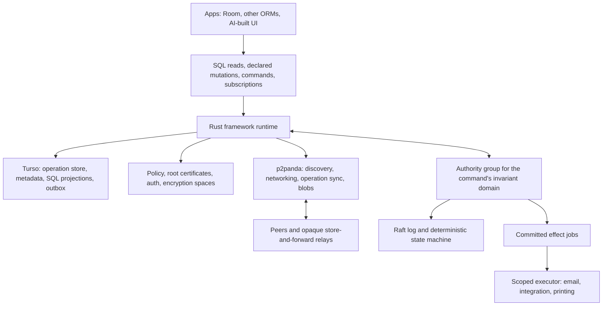

# Rocky DB: P2P ERP framework architecture proposal

> Historical proposal. [V4](architecture-proposal-v4.md) supersedes this document
> for future architecture and implementation order. Existing evidence and
> implemented contracts are described in runtime guides and decision records.

Status: design proposal, not an implemented or benchmarked guarantee. Research checked on 2026-10-03. The recommendations below are architectural deductions; linked upstream documentation establishes available building blocks, not the correctness of their proposed composition.

Note 2026-10-04: historical. The runtime uses SQLite, not Turso; see [design rationale](../runtime/write-concurrency.md#engine).

## 1. Recommended direction

Build a Rust framework runtime around Turso Database and the p2panda modules. Turso supplies embedded SQL execution and local durable storage; p2panda supplies authenticated operations, networking, synchronization, group management, and encryption building blocks. Rocky DB must supply the application data model, merge semantics, authoritative transactions, policy enforcement, shard placement, migration protocol, SDK contracts, and external-effect execution.

The framework's canonical replicated state should be **versioned, authenticated logical operations and authoritative committed results**. Each node materializes its authorized subset into local SQL tables. Local database files and WAL pages are implementation details, not the P2P replication protocol.

Use two consistency paths:

- **Mergeable path:** authorized operations synchronize between peers and merge deterministically. Suitable for drafts, notes, tags, and other data with deliberately chosen merge semantics. Offline changes can still be provisional with respect to concurrent permission revocation.
- **Authoritative path:** scoped authority groups serialize commands and enforce invariants. Suitable for posting invoices, allocating unique business numbers, enforcing inventory limits, granting privileged permissions, and creating external-effect jobs. An offline device can prepare a command; it cannot promise a final commit without the relevant quorum.

One mesh has a root signing identity, but many independent authority groups can own different invariant domains. An authoritative node participates in the groups assigned to it and can otherwise be a partial replica or an opaque relay.



This is a P2P data and transport architecture with privileged coordination groups. It can run entirely on user-controlled hardware. It is not a system in which every peer has equal authority or every operation is available during every partition.

## 2. What the upstream stack actually provides

### Turso Database

The requested engine is the Rust Turso Database project, distinct from libSQL and Turso Cloud. Its README describes embedded SQLite compatibility, CDC, and MVCC. It is pre-1.0; encryption at rest and incremental query subscriptions are experimental. Pin a tested release/commit and qualify the exact SQL subset used by the framework. [Turso project](https://github.com/tursodatabase/turso)

CDC is documented as early preview, enabled per connection. It includes transaction IDs and commit markers. Do not publish an uncommitted CDC group. Full capture increases write amplification. A CDC consumer needs durable cursors, deduplication, provenance distinguishing local writes from remote materialization, and crash/rollback tests. CDC captures changes; it does not define safe distributed merge semantics. [Turso CDC manual](https://github.com/tursodatabase/turso/blob/main/docs/manual.md#cdc-early-preview)

The compatibility table lists several SQLite commit/update/preupdate/WAL hooks and `sqlite3_set_authorizer` as unsupported. It also says mixed SQLite/Turso multiprocess access is unsupported. Turso-native extensions are not generally interchangeable with SQLite loadable extensions. Some overview text in the manual is stale relative to the compatibility table, so use a pinned build and executable compatibility tests to resolve disagreements. [Turso compatibility](https://github.com/tursodatabase/turso/blob/main/COMPAT.md)

Consequently, an extension may help expose virtual tables or narrowly scoped SQL facilities, but **the extension is not the architectural core**. The runtime must own networking, cryptographic state, consensus, transactions, and platform lifecycle. Begin with a wrapper; add a small upstream engine API or patch only when a measured integration gap requires it.

### p2panda

The documented high-level API currently provides topic-based partial replication, authenticated append-only operations, causal processing, replay, and transactional persistence. Its description still places some integrated auth/encryption processing in future work. Do not infer that every individual module is already wired into the high-level API. [p2panda API](https://docs.rs/p2panda/0.7.1/p2panda/)

Use the modules throughout the design:

| Module | Framework role |
| --- | --- |
| `p2panda-core` | Signed operation envelopes, hashes, author logs, causal references |
| `p2panda-net`, `p2panda-discovery` | Peer connectivity, gossip, private topic discovery |
| `p2panda-sync` | Catch-up and anti-entropy; custom sync interfaces where needed |
| `p2panda-store` | Storage traits; implement a Turso adapter |
| `p2panda-stream` / processing APIs | Dependency ordering and durable processing pipelines |
| `p2panda-auth` | Group membership, permission levels and application conditions |
| `p2panda-spaces`, `p2panda-encryption` | Authenticated encrypted group contexts and key changes |
| `p2panda-blobs` | Content-addressed transfer of already-encrypted attachments and snapshots |

These are the purposes described by the project's [library catalog](https://p2panda.org/#libraries). The storage traits and transaction provider make a Turso implementation plausible; they do not establish that the current SQLite reference store can be swapped for Turso unchanged. [Store API](https://docs.rs/p2panda-store/0.7.1/p2panda_store/)

Security maturity is a material dependency: the current encryption README says the crate has not received a security audit and warns that APIs are unstable. It also documents observable group-control metadata. The framework needs an audit of the chosen upstream version and its integration before handling sensitive ERP data in production. [Encryption README](https://github.com/p2panda/p2panda/blob/main/p2panda-encryption/README.md)

For reproducibility, upstream main commits observed during research were Turso `fc98dacd13a047feb7389f3abd67c4a4f0d0edc4` and p2panda `e11d590d3de2aa04ececfb0c43c26ed309e0e7cc`. Published API documentation consulted was p2panda 0.7.1. These are research snapshots, not recommended production pins; main and released APIs may differ.

## 3. Data model and write contracts

A language-independent manifest must define tables/entities, stable field IDs, types, logical IDs, ownership/shard rules, read scopes, mutation permissions, merge strategies, command handlers, invariants, and compatibility requirements. SQL names can change without changing logical identity.

Example:

| Data | Write contract | Reason |
| --- | --- | --- |
| Invoice draft description | Multi-value register or explicitly chosen text CRDT | Concurrent changes can be reconciled |
| Tags | Observed-remove set | Preserve independent additions and removals |
| Posted invoice | Authoritative immutable result | Amounts and issued identity must not change through later draft merges |
| Available stock | Authoritative allocation, or a separately proven escrow model | A plain counter cannot prevent concurrent overselling |
| Sequential invoice number | Authoritative allocator per declared scope | Local uniqueness does not provide distributed business uniqueness |
| Payroll fields | Separate read/encryption scope | A SQL filter cannot protect data already decrypted by the peer |

**I-confluence is a property of operations, invariants, and a merge procedure together.** A table or SQL statement cannot generally be marked safe just because it uses a CRDT. Use a conservative default: commands require authority unless their semantics have been explicitly qualified for coordination avoidance. AI may propose a manifest, but it cannot certify arbitrary invariants. [Coordination Avoidance in Database Systems](https://www.vldb.org/pvldb/vol8/p185-bailis.pdf)

Capture logical intent when it matters. A row changing from 10 to 9 does not tell a sync engine whether the user meant “set to 9,” “decrement by 1,” or “reserve one item.” Generic CDC cannot recover that distinction. Likewise, replaying arbitrary SQL can produce different results because reads, time, randomness, and triggers differ.

Support SQL DML only for a documented subset of replicated tables with declared semantics. Strong operations use named commands such as `post_invoice` or `reserve_stock`; unsupported writes fail with a meaningful error. Direct editing of posted records, permissions, protocol metadata, or schema is not part of ordinary ORM CRUD.

At each endpoint, verify provenance, canonical encoding, capabilities, schema, dependency closure, allowed field transitions, and merge-operation validity before accepting application state. Untrusted clients may forge payloads, equivocate, choose extreme timestamps, clone keys, and flood dependencies. Signatures identify authors; they do not prove truthful data. Prefer conflict-preserving registers initially over wall-clock last-write-wins, and never trust a client clock to establish rights or finality.

For large multi-row operations, declare an atomic logical batch within one shard and encryption scope. Cross-scope or cross-shard transactions require a separate contract. A local SQL transaction is not automatically a distributed atomic transaction.

## 4. Authority groups and consensus

### Raft recommendation

Raft is a good default **if authority processes are trusted to follow the protocol** and may crash, restart, or become partitioned. Three voters tolerate one unavailable voter; five tolerate two. A majority must communicate to commit. Use a maintained Rust implementation, with OpenRaft a candidate, and implement/test its transport, durable log, state machine, and snapshot interfaces. [Raft paper](https://raft.github.io/raft.pdf), [OpenRaft documentation](https://docs.rs/openraft/latest/openraft/docs/)

Adding voters to one group increases replication work and fault tolerance. It does not inherently increase that group's write throughput. Scale writes by adding **independent groups/shards with different leaders**, batching commands, and distributing groups across machines. Replicas can scale suitable reads, subject to the declared freshness guarantee.

An authority node can be partial across the mesh, but a normal voter must hold the log and invariant-relevant state for every group in which it participates. Three validators cannot independently enforce a stock constraint if each has an unrelated third of that constraint's state. Witnesses and opaque ordering replicas are potential later optimizations with different guarantees.

Keep Raft request/response traffic on an authenticated online protocol through the p2panda/iroh networking substrate. Use p2panda operation dissemination for **committed results** and client proposals, not speculative Raft entries. A proposal propagated by gossip is not a commit.

### Strong command lifecycle

1. Client persists a signed command with a request ID, arguments, input hashes/versions, and authorization references. It may show a pending local preview.
2. The relevant group routes the command to its consensus log. Admission prevalidation may reject obviously malformed requests, but it is not a final authorization or invariant decision. All invariant-affecting commands, policy changes, and schema transitions in that domain must respect the same serialization.
3. After ordering, a deterministic state-machine transition checks current authorization and preconditions against the committed state at that log position, then applies or rejects the command. IDs, timestamps, and external observations are explicit inputs; validators execute no network side effects. This avoids a precheck/commit race with another command or revocation.
4. The group durably records its result, deduplication entry, state change, and any effect job. Only committed results are published as authoritative operations.
5. Peers verify the result's authority scope, configuration epoch, and evidence, then materialize it. Request status transitions from pending to committed or rejected.

A command that consumes CRDT drafts must identify an exact accepted version or hash and seal it into the committed record. Reading whatever draft happens to have arrived at the leader does not create a globally consistent invoice. Later draft changes cannot mutate the sealed result.

Remote consumers need an explicitly specified trust contract for receipts. A signed result from the leader is simple under the CFT assumption. If isolated consumers must reject results fabricated using one stolen authority credential, require attestations from multiple current members that they have durably applied the committed result. Bind the evidence to the mesh, domain, command/result hash, log position, and membership configuration. This receipt protocol needs design and testing; collecting signatures is not a replacement for consensus.

Persist each consumer's known configuration/checkpoint high-water marks and reject rollback below them. An offline consumer can verify historical authority evidence, but cannot prove that no newer membership or revocation epoch exists. Freshness-sensitive acceptance requires contact with the current trusted group or the configured freshness mechanism; onboarding through an arbitrary relay must not silently establish the latest trust state.

### Authority compromise is a different model

The demand that an authority key can be stolen and cause malicious activity means Byzantine behavior is in scope if safety must survive that event. Raft does not guarantee safety under Byzantine authorities. Authentication, epochs, and rotation reduce exposure but do not change its fault model.

Choose explicitly:

| Choice | Benefit | Cost / limitation |
| --- | --- | --- |
| CFT Raft; compromise is a security incident | Simpler, fewer replicas, generally lower overhead | A malicious authority is outside the safety guarantee; rotation cannot undo leaked data or all committed damage |
| Permissioned BFT consensus | Can preserve safety despite a bounded number of malicious authorities | Typical designs require at least `3f + 1` replicas for `f` Byzantine faults; more implementation and operational cost |
| Opaque ordering authorities | Can order encrypted proposals without seeing payloads | Cannot directly evaluate arbitrary plaintext ERP invariants; trusted validators or specialized proof systems are still required |

The classic BFT model and tradeoffs are established by [Practical Byzantine Fault Tolerance](https://www.usenix.org/legacy/events/osdi99/full_papers/castro/castro_html/castro.html). Recommendation: keep a consensus interface, start with Raft if its compromise limitation is accepted, and decide the fault model before publishing guarantees. BFT consensus does not prevent an authorized malicious reader from leaking plaintext.

## 5. Keys, trust, and recovery

Treat the three requested levels as **signing authority levels**, not a shared symmetric encryption hierarchy.

| Level | Proposed purpose | Handling |
| --- | --- | --- |
| Mesh root | Sign genesis, permitted authority membership/delegation policy, and exceptional recovery transitions | Offline signing key; distribute only its public key |
| Authority identity | Authenticate one node, with certificates scoped to roles/domains and an authority epoch | Separate node keys; narrow rights; controlled rotation |
| Client/device identity | Sign operations and requests as a revocable principal | Per-device keys; user enrollment/recovery; least privilege |

Separate signing, transport identity, and encryption key material. Root signatures grant authority; they must not automatically derive every shard's data keys. Use random per-encryption-domain secrets managed by p2panda spaces/encryption. A relay receives replication rights without secrets. An authority receives decryption rights only for the state it must validate.

Add app/service identities below the client/user enrollment model. An app receives an attenuated capability: resource scope, allowed actions/fields, schema/policy epoch, delegation limit, and issuer chain. Each delegation can only narrow the parent's rights. A node being an authorized voter does not automatically make it a payroll reader, mesh administrator, or permission manager.

`p2panda-auth` provides group ACLs with conditions and nested groups; it is not automatically the entire certificate hierarchy. Implement the root/authority certificate protocol and map its decisions into group membership and the framework policy engine. Its levels are cumulative (`Pull < Read < Write < Manage`), so blind submission and “manage membership without reading all data” require a separate action/capability model and careful key-distribution integration. [Auth API](https://docs.rs/p2panda-auth/0.7.1/p2panda_auth/)

Prefer one **logical** root identity with protected backups or threshold signing over one irreplaceable physical secret. If the product intentionally forbids recovery without the root, document the result precisely: losing the private root prevents root-authorized administration/recovery; existing peers may continue functioning under existing credentials. It does not instantly erase data or stop all synchronization.

Threshold backup/signing can preserve one public trust anchor while tolerating loss of some shares. It introduces ceremony and policy complexity, and is a product choice rather than a prerequisite for the first prototype.

Root recovery is not a normal Raft membership change. A forced reconfiguration after quorum loss can create competing histories. Require an explicit exceptional recovery epoch, checkpoint selection, quarantine/fencing of the old configuration, and redistribution of the new trust state. Uninformed offline peers cannot immediately know the old epoch has been superseded. Preserve this limitation in the API rather than claiming automatic partition-safe recovery. If the root itself is compromised, recovery requires an independently trusted recovery policy/anchor or out-of-band establishment of a new mesh.

Client keys are lower *authority* value, but may be high *data* value. A payroll reader's device key and stored plaintext can expose payroll after revocation. “Untrusted client” means its behavior is never trusted to enforce permissions; it may still legitimately receive sensitive data within a granted read scope.

## 6. Encryption and permission enforcement

**An invariant validator is an authorized endpoint.** E2EE can protect payloads from intermediate peers while allowing a scoped authority to decrypt and validate. If “no peer in the middle” includes every validator, arbitrary plaintext validation is incompatible with that demand without additional cryptographic computation such as narrowly tailored zero-knowledge proofs, MPC, or another changed trust model. Do not make those technologies a v1 prerequisite.

Permission enforcement has three separate responsibilities:

1. Replication authorization decides who should receive ciphertext; this controls honest-peer distribution and resource use, not confidentiality against copied ciphertext.
2. Key distribution controls who can decrypt which domain.
3. Write/command authorization controls which signed operations can affect accepted state.

SQL filters are useful UX and query controls, but they cannot protect secrets on a hostile device holding the database and a shared decryption key. For row/field-level confidentiality, use separate cryptographic compartments: for example payroll private fields separate from ordinary employee directory fields. Per-record data keys wrapped to authorized groups offer flexibility at the cost of key-envelope and rekeying overhead. Start with explicit stable compartments and expand only as needed.

Read predicates depending on mutable relationships must cause key access and replication subscriptions to change. Moving a record between scopes requires a defined transition and may require re-encryption/re-wrapping. No scheme can claw back plaintext already copied from an earlier scope.

For ERP history and replay, p2panda's persistent-data encryption model is a better initial fit than a message ratchet designed to discard historical message keys. Retaining historical data access necessarily limits forward secrecy of that retained data. Key-agreement forward secrecy and data-history forward secrecy are different guarantees. [Group encryption design](https://p2panda.org/2025/02/24/group-encryption.html)

Encrypt attachments before placing them into the blob layer. Use ciphertext hashes as transport identifiers, protect filenames and manifests, and encrypt snapshots for their intended read scope. Transport encryption alone is insufficient for persisted store-and-forward data.

Track metadata leakage explicitly: traffic timing, sizes, routing scopes, operation headers, and group-control information may remain visible. Topics and discovery confidentiality help, but do not imply metadata anonymity.

### Revocation and finality

Choose an explicit cut point for every revocation:

- **Strict authoritative cut:** write rights and their revocation are ordered in the same domain as strong commands. After the revocation commits in that domain, later commands are refused. Old offline commands are revalidated when submitted; a client-supplied timestamp is not evidence of pre-revocation authorization.
- **Offline mergeable cut:** concurrent data and permission changes follow a deterministic rule. Remove-wins may invalidate tentative edits and require replay/re-materialization. Clients must be informed of rollback/conflict states.
- **Read exclusion:** updated group keys protect ciphertext created in the new key epoch. Offline writers that have not learned the update may still encrypt with an old secret known to the removed user; instant exclusion for all future offline publications cannot be promised.

p2panda documents application-level replay to remove concurrently invalidated edits and the risk of key disclosure through concurrent offline member additions. For high-value grants, order admission and key release through authority rather than giving every offline manager unrestricted key-distribution power. [Convergent access-control integration](https://p2panda.org/2025/08/27/notes-convergent-access-control-crdt.html)

A global client revocation spanning independent groups is complete only after all relevant write-serving groups are fenced or acknowledge the cut. Otherwise an isolated group may still serve under old policy. Expose per-domain progress, or require a central freshness check/limited lease and accept the availability cost. Never infer the absence of a newer revocation merely from an operation's dependency references.

Once an ERP result is declared authoritative and final, do not retroactively treat it as never committed because a later auth CRDT branch appeared. Resolve permissions before finalization; later incidents produce explicit corrective/audit records. Irreversible effects cannot follow tentative permission state.

## 7. Sharding and partial replication

Keep three concepts distinct:

- **Invariant domain:** state that must be coordinated together.
- **Encryption/read domain:** data sharing one confidentiality boundary.
- **Physical shard/replication topic:** unit of storage, transfer, and placement.

They may align for simple apps, but they are not interchangeable. Start with coarse domains such as tenant/project/warehouse; avoid one consensus group per row. A small control group stores authoritative placement and governance metadata, not every application's data.

An authority node can own warehouse A and serve as an encrypted relay for warehouse B. Nobody must replicate the entire mesh. Each active group still needs enough durable replicas of its relevant state; losing the last copies cannot be repaired by cryptography or the mesh root.

Use separate author logs per replication scope where possible, with topic mappings, rather than filtering arbitrary holes out of one mesh-wide author log. Selective replication must preserve the dependencies needed for log verification, authorization, key agreement, and materialization. Do not make unrelated secret domains depend on each other's plaintext operations. Use verifiable control records or committed references where appropriate. Validate sparse-log behavior against the chosen p2panda sync implementation. [Sync interfaces](https://docs.rs/p2panda-sync/0.7.1/p2panda_sync/)

Replication subscriptions describe intentional subsets, not just SQL predicates evaluated over whatever is already present. For dynamic subsets, define membership entry/exit, missed-history retrieval, deletion notices, authorization changes, and resumption cursors.

Every query result must carry or be associated with coverage and freshness: subscribed scopes, snapshot/checkpoint position, pending local changes, and whether coverage is complete for the declared query scope. On a partial replica, absence is not proof of nonexistence. A local join or `COUNT(*)` cannot silently stand in for a complete ERP report. Remote/federated queries are online and must preserve authorization and state provenance.

Keep invariant-heavy transactions within one domain initially. Global uniqueness needs a global scoped allocator or a changed ID contract. Cross-shard atomic transactions need a protocol such as replicated-coordinator two-phase commit and introduce blocking and recovery complexity; independent Raft groups alone do not provide them. Sagas suit workflows whose intermediate states and compensations are acceptable. They do not satisfy an invariant that must never be violated.

Shard movement/splitting is also a generation transition: transfer a committed checkpoint, catch up the destination, fence the source, then switch routing. Never independently bootstrap two writable owners for the same domain.

## 8. Migrations and generations

Do not use one mesh-wide generation number for every kind of change:

| Version / epoch | Purpose |
| --- | --- |
| Wire protocol version | Envelope encoding and interoperability |
| Application schema generation | Logical types, fields, merge semantics, validation |
| Local projection version | SQL tables/indexes/ORM schema on this device |
| Policy/auth revision | Rights and admission rules in a scope |
| Authority membership epoch | Permitted voters/validators and receipt verification |
| Encryption epoch | Key state for one confidentiality domain |

A signed, content-addressed application manifest describes migration parents, stable IDs, transformation/validation code hashes, supported source generations, minimum runtime features, and scope impact. Governance authorizes the manifest; the relevant authority group commits activation for its invariant domain. Global migrations must explicitly coordinate all affected domains or run as staged per-domain changes.

Recommended migration protocol:

1. Publish and verify the manifest before activation; stage the required schema/reducer code on validators.
2. Prefer additive expand/contract evolution: add a field, retain old input decoding, backfill a new projection, update clients, then retire the old representation.
3. Pin every operation to its source schema generation and every command execution to an accepted handler generation. Decode old records in their original schema and transform them deterministically; never reinterpret old column positions as the new schema.
4. Activate an incompatible invariant transition at a committed domain checkpoint. Gate old command submissions and route compatible old operations through explicit upcasters.
5. Migrate/rebuild local SQL projections transactionally where supported; use shadow tables and an atomic switch for large rebuilds. Preserve a readable prior state and operation cursor for recovery.
6. Keep old-generation adapters for a declared offline-support window. An older device can relay opaque new operations, but must not materialize or mutate semantics it does not understand. It can retain compatible old reads and pending drafts.
7. On reconnect, accept a compatible old edit, transform it, or return a structured rejection/rebase requirement. Preserve the user's pending work; do not silently discard it.

Not all migrations are losslessly reversible. Splitting a field, tightening a constraint, changing currency rounding, changing a merge strategy, or moving a record across encryption scopes requires explicit data semantics. Use forward corrective generations for committed history; a local software rollback must not rewrite finalized financial records.

Avoid application-controlled raw DDL on managed tables. Room migration code must be generated/aligned with the same framework manifest and local projection version. Room and the framework cannot independently own incompatible schema versions for one managed database. AI-generated migrations are proposals requiring the configured governance approval before activation.

Indefinite offline support, irreversible migration, and bounded compatibility/storage cannot all be guaranteed. Publish a maximum supported offline generation/window and a bootstrap/rebase procedure for devices that exceed it.

## 9. Persistence, restart safety, and history

Use one transactional Turso storage boundary for related protocol and application state where feasible. Separate internal tables from app projections; implement the p2panda store traits rather than allowing a separate SQLite driver to open the same file.

For an accepted incoming operation, atomically persist validation disposition, updated auth/encryption state, logical/materialized changes, processing cursor, and change notification record. It is also reasonable to durably store an unprocessed ciphertext inbox first, then atomically process it later. A stored operation is not automatically an applied operation.

For an outgoing mutation, atomically persist the operation, encryption-state transition, local projection update or tentative overlay, and durable outbox. Send only after commit. Retrying sends the same stored encrypted operation; it must not invent a new logical request or reuse unsafe encryption state. Restored/cloned databases require a defined device-incarnation/key procedure to prevent log forks and cryptographic state reuse.

If the chosen high-level p2panda API cannot share this transaction with Turso, use lower-level APIs or a durable inbox/outbox with idempotent materialization and acknowledgment-after-commit. Do not claim cross-database atomicity. p2panda's own transaction discussion emphasizes this system/application integration boundary. [Transactions and crash resilience](https://p2panda.org/2025/07/09/streams-transactions-crash-resilience.html)

CDC is an optional capture bridge for SQL writes, not the sole outbox protocol. If transforming a committed CDC batch happens later, it must remain durable until a unique logical batch and its checkpoint are persisted together. Enforce restrictions before successful local acceptance where possible; security of the mesh still depends on remote validation because hostile clients can modify their local file.

Maintain per-scope authenticated checkpoints/snapshots with schema, authority, policy, and key references. Snapshot acceptance needs trust evidence, not just a hash supplied by an arbitrary relay. Verify payload hash, scope authorization, checkpoint evidence, and compatibility before replacing a projection.

Tombstones, revocation provenance, log-fork evidence, and offline dependencies constrain garbage collection. Quorum acknowledgment is not acknowledgment by every offline writer. Either retain the necessary history, or declare a compaction cut after which stale devices must bootstrap and rebase. Compaction is not guaranteed secure deletion: old encrypted copies and old keys may still exist on other peers. Retain finalized ledger/audit records according to application policy, even if derived projections are rebuilt.

## 10. Room, Kotlin/KMP, and language-neutral consumption

Define an ordinary Rust public API with owned handles and plain types. Expose engine lifecycle, prepared SQL reads, parameters/results, declared mutations, commands, request status, replication subscriptions, change streams, migrations, and key/enrollment operations. Keep protocol correctness independent of generated bindings.

An official Rocky DB KMP library should provide coroutine-friendly APIs and Room integration, but UniFFI alone is not a promise of all targets. Mozilla lists Gobley as third-party KMP support for JVM and Native. Use the native UniFFI paths or Gobley as qualified integrations; keep a C ABI option for native adapters and a separate JS/Wasm binding strategy where required. [UniFFI binding support](https://github.com/mozilla/uniffi-rs#third-party-foreign-language-bindings), [Gobley](https://github.com/gobley/gobley)

| Target family | Proposed route | Qualification needed |
| --- | --- | --- |
| Android and JVM desktop | UniFFI Kotlin or Gobley JVM backend; packaged Rust libraries | ABI targets, lifecycle, cancellation, thread usage, binary distribution |
| iOS/macOS Kotlin Native | Gobley KMP/native integration or explicit native bridge | Build/link toolchain, symbols, concurrent handles, mobile background lifecycle |
| Other Kotlin Native desktop targets | Same native bridge concept | Each target's Turso, crypto, networking, and packaging support |
| JS / WasmJs browser | Separate Rust/Wasm/JS adapter with KMP wrapper | Whole-stack networking, storage, threading and Room support; not just engine compilation |

Browser support is a distinct portability milestone. A native Turso Wasm build does not establish that p2panda/iroh networking or the entire framework is browser-ready. Consider an E2EE browser transport gateway or alternative browser transport, with an explicit availability dependency. Do not advertise every KMP target until the actual target matrix passes.

Room's KMP API allows a custom `SQLiteDriver`. Implement `RockySQLiteDriver` over the runtime's owned Turso connections and statements. Room can generate familiar SQL read DAOs; eligible mergeable writes pass through the framework's restricted write bridge. Authoritative writes use command APIs, even when a DAO exposes the result as an ordinary entity. [Room KMP setup](https://developer.android.com/kotlin/multiplatform/room)

A custom driver is not an off-the-shelf Turso Room adapter. Validate Room-generated schema, queries, transactions/savepoints, migration metadata, trigger behavior, error codes, and connection pooling on a pinned build. Keep framework metadata inaccessible to ordinary app handles; the current engine's missing authorizer hook means a thin unrestricted SQL connection is not an adequate app permission boundary.

For hostile app isolation, choose an actual SQL enforcement mechanism: approved query templates or a validated SQL subset through a broker, or separately materialized per-app projections containing only authorized data. Block unapproved DDL, `ATTACH`, key/engine pragmas, and direct internal-table access. Views alone do not stop an app issuing a query against the underlying tables. Separate projection databases require idempotent replay and revision cursors rather than pretending their commits are atomic with the canonical store. Room's own setup and metadata statements need a narrowly scoped driver control path distinct from ordinary app queries.

Room invalidation is a separate integration problem. Remote writes through an unrelated connection do not automatically produce correct DAO Flow notifications. Route remote projection writes through a compatible tracked write path or implement explicit changed-table tracking and a tested invalidation bridge. Calling refresh alone is insufficient if Room's tracking mechanism never observed the mutation. [Room InvalidationTracker](https://developer.android.com/reference/androidx/room/InvalidationTracker)

Offer an ORM-independent subscription API first:

```text
subscribeQuery(sql, parameters, declaredScopes, freshnessMode)
  -> initial snapshot plus durable local revision
  -> committed revision/table invalidations or result batches

submitCommand(name, payload, requestId)
  -> local pending receipt

observeRequest(requestId)
  -> pending | committed | rejected | needs_rebase
```

Register subscriptions and obtain their initial snapshot under one revision protocol to avoid a read/subscribe race. Send notifications after materialization commits. Include revision cursors, coverage, authority positions where relevant, and pending/conflict status. Bound callback queues, batch FFI results, support cancellation, and send a reset/resnapshot indication when a consumer falls behind.

Initially invalidate affected tables and re-run indexed local queries. Add result diffs/incremental maintenance when measurements justify it. A real-time local update means “this node applied a change”; it does not mean every peer has seen it or that a pending command is final. Strong online reads require the group's appropriate consensus read barrier; offline reads return a clearly identified last-known state.

Other language libraries can use the same protocol and engine contracts through Rust, generated bindings, a C adapter, or optional local IPC. ORM neutrality means no ORM owns replication semantics. It does not imply that every language binding or every ORM's arbitrary SQL behavior is automatically supported.

## 11. Authenticated RPC and external effects

Provide a scoped service registry whose advertisements are signed and authorized. Authenticate the peer connection and separately authorize every method. A request binds mesh, service, method, target identity, capability chain, arguments/hash, request ID, and policy/schema context. Encrypt request/response payloads to the authorized endpoints, including queued store-and-forward requests. Persist replay protection and per-principal quotas.

Use direct RPC for online queries or interactive calls. Use durable commands/jobs for offline-capable work. The p2panda sync traits provide transport composition; the framework still has to define RPC authorization, timeouts, retries, result provenance, and errors. A generic sync protocol is not automatically an ERP RPC protocol.

For invoice email:

1. `post_invoice` commits an immutable invoice and an authorized email job in the same authoritative transition.
2. The job contains a stable effect ID, exact invoice version, recipient, and allowed executor scope. The email node gets access only to the necessary payload and holds its own SMTP credentials.
3. An executor claims the job with a fencing token, rechecks its current execution capability, sends, and records the result.
4. Retrying the job uses the same effect ID and provider idempotency key when the provider offers one.

Never send from a Raft state machine or upon observing a tentative draft. Multiple peers observing a job must not each execute it independently.

There is a crash window after SMTP accepts an email and before local completion is durable. Without provider-side deduplication or an atomic external transaction, exactly-once delivery cannot be guaranteed. Record ambiguous outcomes for reconciliation; choose at-least-once retry or at-most-once attempts according to the application. A stable email `Message-ID` alone is not a universal SMTP deduplication guarantee. Fencing is only effective at preventing stale external execution when the external service or a controlled gateway enforces it.

## 12. AI-built apps and the application security boundary

Make app generation manifest-driven: schemas, scoped query definitions, named commands, screen definitions, merge/conflict UX, service access, and migrations. The framework can generate SDK types and Room entities/DAOs for a pinned manifest. Truly dynamic apps may need dynamic SQL/query types instead of assuming new Room entities can appear without recompilation.

Treat generated code and model output as untrusted. Enforce capabilities inside the runtime and validators, never only in UI code. Privileged manifests and migrations enter the configured governance workflow. A model must not widen its own rights.

If independently installed apps must be isolated on one device, put them in sandboxed processes or an appropriately constrained runtime, with per-app handles/capabilities and no direct access to database files, native secrets, or unrestricted network credentials. Native code sharing a process with the engine and access to its memory/files is not a hostile-app security boundary.

Offer permission-scoped AI tools and schema/command introspection. If the no-cloud requirement includes AI inference, use local models or explicitly approved user-controlled inference nodes. The data framework does not require a hosted model; sending data to a hosted model is a separate disclosure decision.

## 13. Performance, availability, and operations

This design has credible scaling paths, not an established performance result:

- Local indexed SQL reads avoid network latency.
- Logical operation batching, selective replication, and encrypted blob transfer control bandwidth.
- Independent authority groups distribute command throughput.
- Persistent checkpoints speed bootstrapping and reduce replay work.
- Group sizes, cryptographic compartment count, indexes, CDC modes, and FFI batching determine overhead.

Hot invariants remain coordination bottlenecks. Global ordering, cross-shard transactions, frequent key changes, and many tiny security compartments reduce scalability. Do not assume enabling MVCC makes globally invariant-sensitive commands serializable; their state transitions must respect the authoritative order and correct isolation.

Escrow can improve bounded offline availability for suitable resources: reserve a quota centrally, then spend it within a correctly enforced allocation. However, classic bounded-counter/escrow models assume correct participants. A hostile client can fork its key/state and submit conflicting spends; signatures alone cannot prevent offline double-spending. Final spending by untrusted clients needs authoritative redemption/conflict handling, trusted hardware, or another explicitly justified model. Treat escrow as a separate security proof, not a shortcut around the client trust requirement. [Bounded counters and escrow](https://arxiv.org/abs/1503.09052)

No mandatory cloud is feasible. Configure LAN discovery, explicit peer addresses, user-operated bootstrap nodes, and self-hosted relays; audit defaults for public discovery/relay services. Internet P2P behind restrictive NATs may require reachable relay infrastructure. It can be user-owned. [Iroh deployment options](https://www.iroh.computer/)

For sustained authoritative availability, use machines expected to remain online. Sleeping phones should normally be clients rather than required quorum voters. Mobile OS background restrictions mean real-time sync is best-effort when suspended. Provide background scheduling and catch-up on foreground/reconnect.

Ship operational tooling for encrypted backup/restore, root custody, key rotations, placement, pending/rejected operations, replication lag, audit trails, and recovery rehearsals. Replication is not backup: valid destructive operations can replicate everywhere, and no root key can reconstruct lost data or missing data-encryption keys.

## 14. Contradictions and the decisions they require

| Demand combination | Constraint | Practical resolution |
| --- | --- | --- |
| Arbitrary offline writes + strict global ERP invariants | Partitioned peers cannot independently promise conflicting allocations | Pending commands, explicit mergeable operations, or separately justified reservations |
| CFT consensus + safety despite a malicious authority | Raft excludes Byzantine behavior | Accept compromise as outside the safety model, or choose BFT |
| No authority may decrypt + arbitrary authority-side validation | Validators lack the inputs needed to enforce rules | Scope authorities as authorized endpoints, or restrict validation/use specialized proofs |
| Instant revocation + disconnected readers/writers | Peers cannot learn an unseen revoke; old plaintext/keys remain | Domain commit cuts, key epochs, provisional offline data, clear propagation status |
| Fine-grained secrecy + broad shared group key | Any key holder can decrypt all ciphertext covered by that key | Separate encryption compartments and key distribution |
| Every authority partial within one invariant + independent local validation | A validator cannot check absent state | Full relevant state per group, or a different validated proof/ordering model |
| Add authorities + automatic write scale-out | One group still serializes its workload | Split independent invariant domains across groups |
| Transparent arbitrary ORM writes + semantic/invariant-safe replication | Row changes omit intent and global preconditions | Restricted SQL DML plus named commands |
| Unlimited offline support + destructive migrations + bounded history | Missing transformations/dependencies cannot always be reconstructed | Published compatibility horizon, snapshots, and rebase |
| Fully equal peers + privileged mesh root and authorities | Governance creates asymmetric trust | Describe the system as permissioned P2P with scoped authorities |
| No cloud + zero infrastructure requirements + internet-wide reachability | Restrictive networks may need a reachable relay; quorum needs live hosts | User-operated infrastructure, local-only mode, explicit service dependencies |
| Exactly-once external effects + ordinary SMTP | No atomic transaction links consensus commit and SMTP acceptance | Idempotent services where available; explicit ambiguous-outcome handling |

The root-key hierarchy and partial mesh replication are compatible. The contradictions are about the guarantees promised across those boundaries.

## 15. Implementation sequence and evidence gates

### Phase A: feasibility and contracts

Build small spikes before expanding the framework:

1. **Turso transactional store:** persist p2panda operation, auth/encryption state, SQL projection, and cursor with one controlled transaction. Kill the process at every boundary; prove recoverability and no published uncommitted operation.
2. **Room adapter:** custom driver on Android/JVM and one iOS path. Exercise generated schema, transaction rollback, migration, remote invalidation, cancellation, and connection lifecycle.
3. **Encrypted partial sync:** three endpoints and an opaque relay; two read scopes and an attachment. Inspect network/persisted bytes, revoke a member, reconnect an old writer, and verify/document old-key exposure and dependency closure.
4. **Authoritative stock demo:** three trusted voters, two disconnected clients, one remaining item. Both clients queue a reservation; only one becomes committed. Repeat with partitions and leader crashes.
5. **Generation demo:** old client offline during an additive migration and then an incompatible one; demonstrate preservation, transformation, or explicit rejection of its pending work.

These spikes decide whether narrow Turso patches, p2panda adapters, or binding alternatives are necessary. They are proposed work, not completed prototypes.

### Phase B: one usable vertical slice

Deliver one mesh, a protected root identity, one three-node authority group, a small number of encrypted domains, partial clients, draft/posted invoice separation, live query invalidation, and an email-job executor with documented retry semantics. Use manifest migrations and a Kotlin SDK. Begin Room with read/query integration if full transparent writes would delay a sound core.

### Phase C: framework semantics and adversarial testing

Stabilize command and mutation contracts, app capabilities, schema/code versioning, enrollment/recovery, snapshots, compaction horizons, multi-device identities, malicious-client validation, and audit records. Test malformed operations, log forks, missing dependencies, stale epochs, revoked apps, quotas, and restore/cloned-device behavior. Obtain an independent security review of crypto composition and the app boundary.

### Phase D: horizontal scale and target expansion

Add independent authority groups, placement/movement, reporting across scoped replicas, additional bindings/targets, and optimized queries. Add cross-shard atomicity or BFT only with explicit requirements and qualification evidence. Browser support gets its own transport/storage validation milestone.

Benchmark on declared hardware/network/topologies: local read latency; pending and authoritative commit latency; throughput per hot group and across independent groups; reconnect catch-up; snapshot size; write amplification; key-update cost; memory/FFI overhead; and mobile battery/background behavior. No high-performance or highly-scalable claim should precede these measurements.

## 16. Recommended initial decisions

1. Rust runtime is the core; Turso is storage/query execution, with an adapter and optional narrow extensions.
2. Logical operations and committed results are the replication format; SQL is the local consumption interface.
3. Authorities may decrypt only assigned invariant scopes; intermediate relays remain opaque.
4. Start with Raft only after explicitly accepting its authority-compromise limitation; keep consensus behind an interface.
5. Use one logical root signing anchor, separate node/device keys, and independent encryption domains. Prefer root backup/threshold custody to avoid one physical loss ending recovery.
6. Mergeable drafts remain separate from authoritative ERP results and external effects.
7. Scoped encryption and runtime/validator checks enforce permissions; UI/SQL filters alone do not.
8. Version schema, projections, policy, membership, protocol, and encryption independently.
9. Make coverage, freshness, pending state, rejection, and rebase ordinary SDK concepts.
10. Target Android/JVM and one iOS integration first, then qualify the remaining KMP/native/browser matrix.

The earliest architectural decisions to settle are the authority compromise model, which validators may read which data, and how much offline work may remain provisional. Those determine the framework's security and correctness guarantees; library selection cannot remove those choices.
